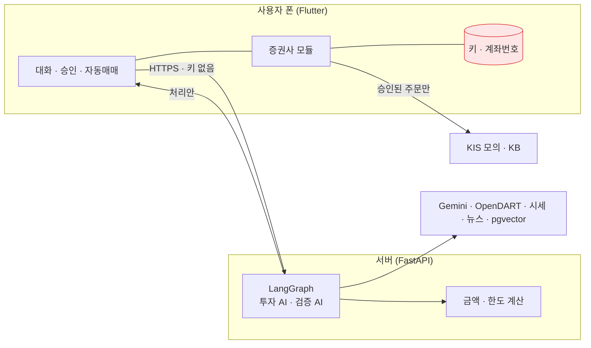

# 자연어 투자 에이전트

> "SK하이닉스 4주 사줘", "삼성전자 사도 돼?"처럼 말로 하면 **투자 AI가 제안하고 → 검증 AI가 원문을 다시 확인하고 → 사용자가 승인한 주문만 사용자 폰에서** 증권사로 나가는 앱.

LLM이 돈을 다룰 때 생기는 문제(지어낸 숫자, 근거 없는 확신, 키 유출, 사용자가 모르는 주문)를 **구조로 막는 것**이 중심이다.

| 지표 | 결과 |
|---|---|
| 모의 자동매매 하루 (10/8, 사람 개입 없음) | 매수 4,727,750원 → **−1.52%**, 같은 날 코스피 **−2.62%** |
| 모의 자동매매 2일차 (10/12, AI가 사고팔기 판단) | 투자 AI 제안 **35건**(매도 판단 23) → 매수 2·매도 0, 틀린 근거 제안 **3건 반려**. 2일 누적 계좌 **−3.50%** vs 코스피 **−6.17%** |
| 모의 자동매매 3일차 (10/13, 코스피 −5.46% 날) | AI가 매도 8건(절반씩 나눠 팔기), 매수 0건. 하루 **−1.78%**, 3일 누적 계좌 **−5.22%** vs 코스피 **−11.30%** |
| 1·2일차 제안·검증 46건 재점검 | 승인됐지만 빠진 것이 있던 제안 발견 → 코드 검사 보강 후 10/12 승인 33건 중 **23건을 다시 잡음** |
| 1·2일차 원인 분석 → AI 보완 | 공통 원인 "시장을 못 봄" → **코스피·코스닥 지수·며칠 흐름을 AI 근거로**, 시장 급락 시 즉시 재판단, 매도 수량도 AI가 |
| 고친 시스템으로 그날 재현 (개선 확인) | 장중 하락 중 매수를 **12번 모두 거름** (그날 자료만 사용, 수익 검증은 아님) |
| 검증 AI 오류 주입 (틀린 제안 20개, 3회) | 평균 **19.3/20** 차단, 멀쩡한 제안 30개 중 오탐 **0** |
| 요청 이해 골든 세트 | **77/77** 문장, 248항목 정답 (중앙값 1.6초) |
| 성향 신호 파인튜닝 (Qwen2.5-1.5B LoRA) | 정확도 34% → **83%**, 위험 놓침 **0.4%** (Gemini와 같음), 4배 빠름 |
| 백테스트 (1년, 생존 편향 제거) | 앱 규칙 **+36.7%** vs 동일 비중 +29.8% |

**날짜별 성과 모음 (1·2·3일차 요약·리포트·원자료)**: [docs/reports/README.md](docs/reports/README.md) · AI 수정 기록: [docs/AI_CHANGELOG.md](docs/AI_CHANGELOG.md)

`Python · FastAPI · LangGraph · Gemini · PostgreSQL/pgvector · Flutter · KIS 모의투자 API · KB증권 Open API` · 테스트 서버 295 / 앱 37

---

## 1. 실제로 돌려 본 결과: 10/8 모의 자동매매

KIS 모의계좌(1,000만 원)로 장 시작부터 마감까지 앱이 **사람 손 없이** 종목 선정 → 투자 AI 제안 → 검증 AI 확인 → 한도 검사 → 주문까지 했다.

### 성과

| 종목 | 수량 | 평균 매입가 | 종가 | 평가손익 | 종목 등락 | 동종 업종 평균 |
|---|---|---|---|---|---|---|
| 현대건설 | 22 | 106,700 | 106,800 | **+2,200 (+0.09%)** | −3.70% | 건설 −4.10% |
| NH투자증권 | 93 | 25,595 | 24,800 | **−73,950 (−3.11%)** | −6.59% | 증권 −3.19% |
| **합계** | | | | **−71,750 (−1.52%)** | | 코스피 −2.62% |

- 계좌 전체 기준 −0.72%. 종가 기준 **미실현** 손익이다 (10/9 휴장, 매도는 10/12)
- 우리는 매수 시점(09:26~09:31)부터 종가까지, 코스피는 전일 종가 대비라 기간이 다르다. 참고용 비교다
- 출처: KIS 모의투자 일별 시세·잔고, 서버 DB의 제안서·검증·주문 기록

### 원인 분석 (손실 −71,750원)

| 원인 | 숫자 | 시스템이 봤나 |
|---|---|---|
| 시장 전체 급락 | 코스피 −2.62%, 3거래일 −5.4%, 외국인 −2.4조·기관 −1.9조 순매도 | ❌ 지수·수급 데이터 없음 |
| NH투자증권 업종 악재 | 증권 평균보다 −3.4%p 더 빠짐. 당일 아침 실적 우려·목표주가 4만→3.4만 원 | ❌ 뉴스 없음 |
| 장중 하락을 보고도 매수 | 09:27에 이미 −3.39%. 투자 AI가 반대 근거로 적고도 매수 | ✅ 봤지만 "사용자 지시"로 처리 |
| 선정 기준에 수익 신호 없음 | "최근 공시 순"으로 고름. 현대건설은 한 달 −18% 하락 추세 | ❌ 추세 안 씀 |
| 하루 늦은 가격 | 아침 분석이 10/6 종가(112,900원) 사용 | ❌ |
| (운) 늦게 사서 덜 잃음 | 버그로 20분 늦게 매수. 시가였다면 약 −11만 원 더 (추정) | — |

**결론**: 주문 과정(근거 확인·한도·중복 방지)은 설계대로 작동했고, 틀린 숫자로 나간 주문은 0건이다. 하지만 **무엇을 언제 살지 정하는 전략에 수익 근거가 없었다**. 손실은 거의 시장 분위기와 한 종목의 업종 악재로 설명된다.

### 그날 사고 5건과 조치

| 시각 | 사고 | 조치 |
|---|---|---|
| 09:05 | 매수 2건 서버 거부 (새 입력 칸이 검사 모델에 빠짐) | 15분 만에 수정, 테스트 추가 |
| 09:20 | 실패 종목을 "오늘 끝"으로 기록 | 하루 3번 재시도, 산 수량은 빼고 계산 |
| 09:27 | KIS 초당 호출 제한으로 주문 실패 | 2초 뒤 최대 3번 재전송 → 09:30 체결 |
| 15:00 | 잔고 조회 12.5초 > 제한 10초, 자동 매도 시작 못 함 | 제한 30초, 조회 성공 뒤에만 "매도함" 기록 |
| 15:21 | 위험을 줄이는 매도까지 한도에 막힘 | 매도는 한도에서 빼고 1회 한도 안으로 나눠 팔기 |

### 분석으로 바꾼 것 → 그날을 다시 돌려 보니

| 원인 | 바꾼 것 |
|---|---|
| 장중 하락을 보고도 매수 | 자동 주문을 사용자 지시와 구분, 투자 AI가 "관찰"로 거절 가능 |
| 뉴스 없음 | Google 뉴스 RSS(무료)를 출처로, 악재는 반대 근거로 |
| 보유 중 급락 | 장중 −3% 하락 시 AI가 매도 판단 (종목당 하루 3번) |
| 매도가 막힘 | 매도도 매일 아침 사용자 승인, 나눠 팔기 |
| 선정 기준 근거 없음 | 백테스트로 규칙 검증 (3장) |

**재현**: 10/8 첫 자동 매수 때 AI가 본 자료를 그대로 넣었다. 자료는 공시·재무·종가와 폰이 보낸 현재가·1분봉이다. 여기에 지금 로직을 적용해 종목마다 3번씩 다시 돌렸다. 뉴스는 매수 시각 전에 나온 기사만 넣었다 (미래 정보 없음).

| 종목 (그때 상황) | 그때 자료만 | + 매수 전 뉴스 | 그날 실제 | 그날 종가 손익 |
|---|---|---|---|---|
| 현대건설 (09:26, 장중 −3.70%) | 관찰 3/3 | 관찰 3/3 | 매수 | +2,200 |
| NH투자증권 (09:27, 장중 −3.39%) | 관찰 3/3 | 관찰 3/3 | 매수 | −73,950 |

- **12번 모두 "지금은 사지 않고 관찰"**. 뉴스가 없어도 로직 변경만으로 하락 중인 매수를 거른다
- 뉴스를 넣으면 근거에 "거래대금 감소로 3분기 실적 눈높이 하향" 보도가 들어간다 (그날 NH 추가 하락의 원인)
- **이것은 수익이 아니다**: 사지 않았으니 손실도 수익도 없다. 확인한 것은 "10/8 손실의 원인이 된 판단(하락 중 매수)을 이제 거른다"는 것뿐이다
- 오르는 날에도 사는지, 즉 너무 조심해서 기회를 놓치지 않는지는 미확인이다. 수익은 여러 날의 실제 모의 자동매매로 검증한다 (10/12부터)

전체 리포트: [docs/reports/2026-10-08-mock-auto-trading.html](docs/reports/2026-10-08-mock-auto-trading.html)

### 2일차 (10/12): 사고파는 판단을 AI에게

10/8 분석대로 바꾼 뒤 처음 돌린 날. 사람은 아침에 "살 총액 500만 원, AI 매도 허용"만 승인했다.

| 판단 | 횟수 | 결과 |
|---|---|---|
| 아침 후보 매수 (셀트리온) | 2 | 체결. 3번째 추가 주문은 투자 AI가 "관찰"로 막음 |
| 12:00·13:30 후보 다시 찾기 | 6 | 모두 "관찰" → 하락장에서 오후 매수 0 |
| 보유 종목 매도 판단 (30분마다, 급락 시 바로) | 23 | 보유 22 · 관찰 1 → 매도 0, 손절선(−7%) 도달 0 |
| 검증 AI | 38 | 승인 25 · 조건부 10 · **반려 3** (없는 출처 ID 등, 코드 검사가 잡음) |

| 종목 | 평균 매입가 | 10/12 종가 | 평가손익 |
|---|---|---|---|
| 셀트리온 20주 (오늘 매수) | 184,100 | 180,400 | −74,000 (−2.01%) |
| 현대건설 22주 (10/8) | 106,700 | 100,200 | −143,000 (−6.09%) |
| NH투자증권 93주 (10/8) | 25,595 | 24,250 | −125,085 (−5.25%) |
| **합계 (기아 2주 포함)** | 8,632,135 | 8,283,850 | **−348,285 (−4.03%)** |

- **보유 판단은 오늘 종가로는 틀렸다**: 13:53에 팔았다면 약 4.4만 원 덜 잃었다 (추정). 막은 추가 매수는 약 2.7만 원 손실을 피했다 (추정)
- **장중에 찾은 오류**: 서버 하루 분석 한도(20번)가 10:44에 차서 매도 판단이 약 3시간 멈췄는데, 앱이 실패를 "AI가 보유 판단"으로 기록해 바로 알아채지 못했다 → 한도 100번, 실패는 따로 기록. **실패를 판단으로 기록하면 안 된다**
- 같은 날 코스피 −3.65%, 코스닥 −4.83%. 보유 주식의 하루 등락은 −3.13%. 10/7 종가부터 2일 누적은 계좌 −3.50%, 코스피 −6.17%다. 다만 현금이 절반 가까이 있어서 덜 빠진 것이다. 종목을 잘 골랐다는 뜻은 아니다
- 이틀로는 전략을 평가할 수 없다

2일차 리포트: [docs/reports/live-20261012.md](docs/reports/live-20261012.md)

### 1·2일차에서 배운 것 → AI를 이렇게 고쳤다

두 날의 공통 원인은 **AI가 시장 전체를 못 본 것**이었다. 10/8은 코스피 −2.62% 날 하락 중에 샀고, 10/12는 코스피 −3.65%(4거래일 연속 하락) 날 보유 종목을 계속 들고 있었다.

| 드러난 문제 | 고친 방법 | 확인 |
|---|---|---|
| 시장 지수를 안 봄 | 폰이 KIS 지수 API(현재지수·일자별지수)로 코스피·코스닥 지수, 등락률, 오른/내린 종목 수, 최근 25거래일 종가를 받아 분석 때 보낸다. 서버는 키 없이 받기만 한다 | 모의투자에서 두 API 응답 확인 |
| 며칠 흐름을 모름 | 서버 코드가 1·5·20거래일 등락률과 연속 하락일을 계산해 출처 `market:KOSPI`로 준다. 숫자는 AI가 아니라 코드가 계산 | 10/12 실제 지수로 테스트: "5거래일 −8.42%, 4거래일 연속 하락" |
| 시장 급락을 근거에서 빠뜨림 | 투자 AI 지시: 시장이 크게 빠지면 매수는 관찰, 보유는 줄일지 판단. 검증 AI 지시: 시장 급락을 위험에서 빠뜨리면 지적 | 장 마감 후 실제 앱 분석: 투자 AI가 `market:KOSPI` 출처로 "코스피 −3.65%, 4거래일 연속 하락, 내린 종목 720개"를 근거·위험에 쓰고 **관찰** |
| 시장 급락에도 30분을 기다림 | 코스피 −1.5% 아래(지난 알림보다 1%p 더 빠질 때마다)면 보유 종목 전부를 바로 AI에게 다시 묻는다 | 앱 테스트 |
| 매도는 전부 아니면 0 | 투자 AI가 매도 수량을 전부/절반 중 고르고, 앱은 그만큼만 판다 (1주면 전부) | 앱 테스트 |
| 한도 실패를 "보유 판단"으로 기록 | 실패는 따로 기록하고 질문 횟수에서 뺌, 서버 분석 한도 20 → 100 | 장중 수정 후 14:04부터 정상 판단 |
| 급락 종목을 11분마다 다시 물음 | 지난번보다 1%p 더 빠졌을 때만 다시, 아니면 30분 주기 | 앱 테스트 |

- 매수·매도 기준을 숫자 규칙으로 정하지 않고, **AI가 볼 자료를 늘리고 검증 AI가 확인하게** 했다
- 효과는 아직 모른다. 내일부터 같은 방식으로 모의 자동매매를 이어서 확인한다

### 검증을 믿을 수 있었나: 1·2일차 제안·검증 46건 다시 보기

장중에는 "검증 AI 승인"을 믿고 사고팔았다. 끝나고 기록을 하나씩 다시 보니 **승인됐지만 빠진 것이 있는 제안**이 많았다.

| 이렇게 제안·검증했는데 | 나중에 보니 빠진 것 | 신뢰도 문제 | 고친 것 |
|---|---|---|---|
| 셀트리온 매수 3건 "조건부 승인" (10/12) | 조건이 "영업이익 숫자를 원문에 맞게 고쳐라", "뉴스 말고 공시를 인용하라". 틀린 제안이었다 | 고쳐야 할 제안이 통과했고, 자동매매는 **조건을 확인하지 않고** 20주를 샀다 | 자동 매수는 "승인"만. 숫자·출처를 고쳐야 하면 조건부가 아니라 반려 |
| 제안 36건 중 21건이 사실 근거에 뉴스만 인용 (10/12) | 뉴스는 제목뿐인 미확인 보도. 검증 AI가 매번 지적만 하고 승인 | 같은 실수가 하루 종일 반복됐다 | 뉴스만 출처인 사실 근거는 **코드가 반려**, 투자 AI가 고쳐 다시 낸다 |
| 아침 분석이 10/7 종가로 PER 계산 (10/12) | 3거래일 묵은 가격. 신선도 검사 결과 0건 | 지금 가격과 다른 숫자로 판단했다 | 오늘 시세 없이 2거래일 넘게 묵은 종가면 코드가 경고, 검증 AI가 원문과 다시 대조 |
| NH투자증권 매수 3건 승인 (10/8) | 반대 근거에 "장중 하락"을 적고도 매수 | 반대 근거를 적기만 하고 결론에 반영하지 않았다 | 검증 항목 "결론 일관성" 추가: 가장 큰 반대 근거를 이유 없이 무시하면 반려 |
| 셀트리온 보유 승인 (10/12 14:04) | 오늘 현재가·장중 흐름·시장 지수를 받고도 근거에 안 씀 | 손실이 커지는 날 재무 근거만으로 보유했다 | 보유 종목 판단에 오늘 자료를 하나도 안 쓰면 코드가 반려 |
| 현대건설 "관찰" (10/12 14:26) | 보유 종목에 관찰은 팔라는지 들고 있으라는지 모호 | 자동매매가 행동으로 옮길 수 없다 | 보유 종목은 보유 또는 매도 중에서만 |

**다시 검사한 결과** (저장된 10/12 제안에 새 코드 검사를 적용, Gemini 재호출 없이)

| | 승인·조건부였던 제안 | 새 검사에 걸림 | 내용 |
|---|---|---|---|
| 10/12 | 33 | **23** | 뉴스를 사실로 21, 묵은 종가 7, 보유 판단에 오늘 자료 없음 1 (겹침 있음) |
| 10/12 자동 매수 | 3 | **3** | 조건부 승인이라 이제 자동으로 사지 않는다 |

- 걸린 제안은 버려지는 것이 아니라 투자 AI가 지적을 받아 고쳐 다시 낸다 (최대 2번, 그래도 안 되면 사용자 판단)
- **매도도 반드시 AI 판단 + 검증**을 거친다. 전에는 −7% 손절만 AI 없이 팔았는데, 이제 손절선(−7%)·급락·**급등(+3%)**·시장 급락이 오면 바로 AI에게 묻고, AI가 팔자고 하고 검증 AI가 승인할 때만 판다 (전부 또는 절반)
- 남은 한계: 새 검사로 반려와 수정이 늘어 분석 한 번에 Gemini 호출이 늘 수 있다. 장중 효과는 다음 모의 자동매매에서 확인한다

### 3일차 (10/13): 보완한 AI로 다시, 그리고 장중에 또 고친 것

코스피 −5.46%(SK하이닉스 −9.4%) 급락일. 사람은 아침 계획만 승인했다.

| | 결과 |
|---|---|
| 하루 | 계좌 **−1.78%** vs 코스피 −5.46% (현금 비중이 커서 덜 빠졌다) |
| 매도 | 8건. 현대건설 전부, NH·셀트리온은 **절반씩 세 번** (새로 넣은 "AI가 매도 수량 결정" 동작) |
| 매수 | 0건. 후보 4종목 모두 실시간 재검증에서 "관찰" |
| 새 검증 | 08:20 자동 브리핑에서 "뉴스를 사실로 쓴" 제안을 2번 반려, 투자 AI가 고쳐 세 번째에 승인 |
| **잘못한 판단** | 시초가 급락 때 판 세 종목 모두 종가가 더 높았다. 들고 있었으면 약 7.9만 원(0.9%p) 덜 잃었다 → 장 초반 급락 직후 매도 판단에 반등 근거를 함께 보게 하는 것이 다음 과제 |

장중에 드러나 바로 고친 것 (모두 커밋·푸시, 다음 날부터 적용):

| 문제 | 고친 것 |
|---|---|
| 아침 브리핑·공시 수집을 사람이 손으로 돌림 | 서버가 매일 07:00 수집, 08:20 브리핑 |
| 모의에도 1일 한도 500만 원 → 판 돈으로 갈아탈 수 없음 | 모의는 금액 한도 없음, 살 총액 "주문 가능 금액 전부(판 돈 포함)" |
| "관찰"이 한 번 나오면 그 종목은 그날 끝 | **사는 판단도 30분마다**, 후보 다시 찾기 10~14시 매시 |
| AI 사용량 제한(429) 오류가 재시도 횟수를 다 씀 | 오류도 30분 뒤 다시 |
| 후보가 공시 종목 몇 개뿐 | 폰이 KIS **거래대금·상승률 상위**를 받아 후보로 |
| 하루 새 종목 3개 제한, 매수는 15:00에 멈춤 | 개수 제한 없이 AI가 판단 (종목당 35%까지), 매수 15:20·매도 판단 15:28까지 |

3일차 리포트: [docs/reports/live-20261013.md](docs/reports/live-20261013.md)

AI 판단·검증을 고친 내역 전체 (문제 → 고친 것 → 파일·함수 → 조절 값 → 테스트): [docs/AI_CHANGELOG.md](docs/AI_CHANGELOG.md)


## 2. 검증 AI가 틀린 제안을 거르나

투자 AI가 실제로 쓴 제안서 10개에 일부러 오류 20종을 넣었다. 숫자 ×3, 없는 출처, 증가↔감소 뒤집기, 출처에 없는 계약 주장, "무조건 오른다", 고령·안정형에게 몰빵 매수 등이다.

| 단계 | 차단 | 바꾼 것 |
|---|---|---|
| 처음 | 15/20 | — |
| 코드 검사 보강 | 19/20 | 출처 종목 대조, 금액 단위·크기 대조, "위험·비용 없다" 문구 검사 |
| 검증 AI 지시 수정 | **18 · 20 · 20 (평균 19.3)** | 코드 경고를 원문과 다시 대조, 설명 못 하면 승인 안 함 |

- 오류를 넣지 않은 원래 제안서 30개는 **모두 승인** (오탐 0)
- 평가 중 **투자 AI의 실제 실수**도 찾았다: "78조 9,548조 원" 단위 오류는 첫 평가 때 검증 AI가 승인했지만 지금은 코드가 막는다
- 아직 가끔 놓침: 말이 안 되는 수치("상위 240%"), 출처에 없는 계약 주장 (각 3회 중 1회)

전체 (재현 포함): [docs/reports/evaluation-20261010.md](docs/reports/evaluation-20261010.md) (정답·오류 사례는 Claude가 만들었다)

## 3. 백테스트 (2025-10 ~ 2026-10, 235거래일)

매일 그날 기준 시가총액 상위 150종목을 다시 골라 **생존 편향**을 뺐다. 미래 정보를 쓰지 않는지 테스트로 확인했고, 왕복 비용 0.23%를 반영했다.

| 전략 | 그날 기준 대상 | 오늘 살아남은 종목만 (편향) |
|---|---|---|
| 동일 비중 (기준) | +29.8% | +76.4% |
| **앱 브리핑 규칙** | **+36.7%** | +57.4% |
| 모멘텀 (5일 상승 상위 3) | −64.6% | +134.0% |
| 역추세 (5일 하락 상위 3) | −47.7% | +67.9% |

같은 모멘텀 전략이 편향 때문에 −64.6%에서 +134.0%로 부풀려진다. 과거 결과는 미래를 보장하지 않는다.

## 4. 성향 신호 파인튜닝

퀴즈 규칙은 "다음 달 방 빼야 하는데 그 돈 굴려볼까" 같은 말을 못 본다. 그래서 문장에서 위험 신호 6종(생활비·빌린 돈·급등 추격·공포 매도·몰빵·없음)을 고르는 모델을 학습했다.

| 방법 | test (293) | hard (57) | 위험 놓침 | 문장당 |
|---|---|---|---|---|
| 키워드 규칙 | 49.5% | 24.6% | 40.3% | 0ms |
| Gemini 프롬프트 | 92.2% | 100% | 0.4% | 1,335ms |
| **Qwen2.5-1.5B LoRA** | 33.8% → **83.3%** | 36.8% → **96.5%** | **0.4%** | **303ms** |

- 가상 문장 1,500개로 학습했고, 학습과 시험은 말투로 분리했다. RTX 5060 Ti에서 몇 분 걸렸고 GPU 메모리를 16GB에서 3.7GB로 줄였다
- 신호는 투자 AI 참고와 처리안 경고에만 쓴다. 검증 AI에는 주지 않는다. **실제 사용자 정확도는 미확인**이다

## 5. LangGraph: 대화가 주문이 되기까지

```
사용자 말 → rewrite("그거" 풀기) → classify ─┬ 조회    → fetch 멈춤 → 폰이 증권사에서 잔고·시세를 읽어 답함
                                              ├ 분석    → gather → 투자 AI → 검증 AI ─(반려)→ 투자 AI (최대 2번) → 기록
                                              ├ 주문    → 종목 → 정정·취소 대상 | 예약·분할 → 계좌(fetch) → 가격
                                              │           → gather → 투자 AI → 검증 AI → 정책 검사(코드) → approval 멈춤 → execute 멈춤 → 체결 기록
                                              └ 결과·기록·용어 → DB 기록으로 답 (LLM은 분류만)
```

- **멈춤(interrupt) 4종류로 "서버는 키가 없다"를 구현**했다. 증권사 일이 필요하면 서버 그래프가 멈추고, 폰이 답해야 다음으로 간다
  - `fetch`: 잔고·시세 조회 (2곳)
  - `approval`: 사용자 승인 (1곳)
  - `execute`: 폰이 주문 (1곳)
  - `question`: 되묻기 (6곳)
- **Postgres 체크포인트**: 멈춘 그래프 상태를 DB에 저장해서 앱을 껐다 켜도 승인 대기 대화가 이어진다
  - 10/8 재현 때도 체크포인트에서 그날의 현재가·1분봉을 그대로 꺼내 썼다
- **분석 노드 재사용**: 주문 그래프는 분석과 같은 노드(gather → 투자 AI → 검증 AI)를 그대로 쓴다. 분석 직후 주문이면 그 검증 결과를 이어 쓴다. 그래서 직접 지시한 주문도 자동매매 주문도 검증 없이 처리안이 될 수 없다
- **LLM 호출은 한 파일(`llm.py`)에만**: 요청 이해("그거" 풀기·분류·값 뽑기)를 3번에서 1번 호출로 합쳐 6~10초 → 약 1.4초로 줄였다. 테스트는 이 파일만 가짜로 바꿔 비용 0으로 돈다

## 6. RAG: 공시 원문을 근거로

| 항목 | 값 |
|---|---|
| 대상 | 코스피 100 + 코스닥 50 (151종목), 공시 11,967건 |
| 본문 | 정기보고서 최신 2건 + 주요사항보고서 3건 → **29,352조각** (표 보존 조각 14,251) |
| 임베딩·검색 | Gemini embedding 768차원, PostgreSQL pgvector (코사인 거리) |
| 한 번의 분석에 넣는 자료 | 종가, 재무제표, 최근 공시 5건, **본문 조각 최대 6개**, 뉴스 5건, 현재가·1분봉, 계좌 |

- **검색**: 요청 문장과 고정 관점 3개(실적과 수익성, 위험 요인, 사업 전망)로 4번 찾는다. 질문이 좁아도 위험 요인이 빠지지 않게 하려는 것이다
  - 절대 기준(거리 0.6 이하)과 상대 기준(그 검색의 1등 + 0.05 이내)으로 관련 없는 문단을 버린다. 기준값은 실측으로 정했다 (관련 문단 0.33~0.56)
- **겪은 문제**: 벡터 색인(HNSW)이 전체에서 가까운 것을 먼저 고른 뒤 종목으로 걸러서 150종목 중 115종목은 결과가 비었다
  - 그 종목 조각만 먼저 고르고 거리를 정확히 재는 방식으로 바꿔 해결했다 (종목당 수백 조각이라 빠름)
- **출처 ID로 인용하고 검증 AI가 다시 읽는다**: 조각마다 `dart:{접수번호}#{순번}` ID를 붙인다
  - 투자 AI는 근거마다 이 ID를 달고, 검증 AI는 투자 AI가 본 글이 아니라 **ID로 원문을 다시 불러와** 대조한다
  - 없는 ID는 코드가 막는다. 평가에서 투자 AI가 지어낸 출처 ID를 실제로 잡았다
- 표가 문장으로 깨지지 않게 "[표] 항목 | 값" 형태로 보존하는 청킹을 만들었다. 10/12 재임베딩으로 조각이 12,974 → 29,352개가 됐다 (재무 표가 숫자 그대로 검색됨)

## 7. 설계

| 원칙 | 구현 |
|---|---|
| 서버는 증권사 키를 모른다 | 키는 폰 보안 저장소에만. 서버는 처리안까지, 주문은 폰이 직접 |
| 모든 주문은 3단계 | 투자 AI → 검증 AI → 사용자 승인. 자동매매·정정·취소도 같은 길 |
| 검증 AI는 독립적 | 결론 없이 제안·출처 ID만 받아 원문을 다시 읽고 판정 |
| 숫자는 코드가 | LLM은 분류·문장만. 금액·한도·수수료는 코드가 계산 |
| 기본은 모의투자 | 실전 모드는 직접 켜야 하고(모의 체결 10건·5일 이상), 실전 자동매매는 1회 30만 원 |



## 8. 실행

`apps/api/.env.example`을 `.env`로 복사해 키를 채우고, PostgreSQL(pgvector)을 띄운다.

```bash
uv --directory apps/api run python -m app.migrate
```

```bash
uv --directory apps/api run uvicorn app.main:app --port 8000
```

```bash
cd apps/client && flutter run --dart-define-from-file=dev_keys.env
```

```bash
uv --directory apps/api run pytest
```

## 9. 한계

- 모의 자동매매는 3일·네 종목이라 전략 판단에는 수십 거래일이 필요하다
- 시장 지수는 10/12 밤부터 본다. 수급(외국인·기관 순매수)과 업종 지수는 아직 안 본다. 지수를 넣은 뒤의 장중 성과는 아직 없다
- KB증권 실전 연결은 실제 키로 확인 전이다. 실계좌 주문은 사람이 직접 한다

모의투자 결과이며 투자 권유가 아니다.
