# 자연어 투자 에이전트

> "SK하이닉스 4주 사줘", "삼성전자 사도 돼?"처럼 말로 하면 **투자 AI가 제안 → 검증 AI가 원문으로 다시 확인 → 사용자가 승인한 주문만 사용자 폰에서** 증권사로 나가는 앱.
> 모의투자에서는 같은 흐름으로 **AI가 사람 손 없이 사고파는 자동매매**를 매일 돌리며 판단 로직을 고치고 있다.

LLM이 돈을 다룰 때 생기는 문제(지어낸 숫자, 근거 없는 확신, 키 유출, 사용자가 모르는 주문)를 **구조로 막는 것**이 중심이다.

`Python · FastAPI · LangGraph · Gemini · PostgreSQL/pgvector · Flutter · KIS 모의투자 API · KB증권 Open API · Qwen2.5 LoRA` · 테스트 서버 356 / 앱 45

## 지금 상태 (2026-10-29, 모의 자동매매 15일차)

- **10/29 (15일차)**: 코스피 **−1.24%**(장중 −3.2%까지), 계좌 **−0.17%**로 1.07%p 덜 빠졌다. 09:38 하이브 5주를 손절선(−7.7%)에서 팔았고 종가가 −6.07%라 팔기를 잘했다. 매수 검토 5건은 모두 검증을 통과했지만 주문은 0건이었다. 코드상 10/27에 정한 "코스피 20일 평균 아래면 새로 안 삼" 규칙으로 보이나 앱 안내 기록은 **미확인**. 영업적자 종목(하이브·LG에너지솔루션·SKC)은 후보에서 빠졌다 → [리포트](docs/reports/live-20261029.md)
- **10/28 (14일차)**: 코스피 **+6.63%** 급등일에 계좌 **−0.28%**로 6.91%p 뒤졌다. 현금이 약 38~47%였고 유한양행 10주를 14:37에 팔았다(종가가 더 낮아 잘 팖). 새로 산 것은 없다 → [리포트](docs/reports/live-20261028.md)
- **15일 누적: 계좌 −13.53%, 코스피 −12.73%.** 10/27까지는 코스피보다 덜 빠졌지만 10/28 급등을 따라가지 못해 **이제 코스피보다 0.8%p 뒤진다**. 아직 수익은 나지 않았다
- **마감 총자산 어긋남 (10/29)**: 앱이 15:32에 저장한 값이 KIS 일봉 종가로 계산한 값보다 13,650원 낮았다 (10/28은 정확히 같았다). 시각을 늦춰도 안 고쳐지고 원인은 **미확인**이다. 그래서 일일 마감 값은 KIS 일봉 종가 × 수량 + 현금으로 쓴다
- **10/29 마감 뒤 (사용자 결정)**: 과거 1년 규칙 시험에서 **변동성 상한(상위 20% 제외)이 수익을 +61.0% → +6.9%로 깎고 낙폭은 같다**는 것을 확인해, **모의투자에서만 상한을 풀었다**(실전은 그대로). 모의에서 1~2주 지켜보고 시험과 다르면 되돌린다. 영업적자 종목을 후보에서 빼는 규칙(10/28)은 그대로. 표는 [과거 구간 가상 투자](#과거-구간-가상-투자-ai-판단이-규칙보다-나은가-1028)

- **전략 검증 시작 (10/27)**: 과거 1년을 규칙으로 돌려 보니(`docs/reports/sim-20261027.md`) 하락장(코스피 20일 평균 아래)에 계속 사는 것이 약점이었다 (지금 규칙 1년 −2.2% → 하락장엔 안 사면 +39.4%, 무작위로 흔들어도 겹치지 않음). 10/27 마감 뒤 앱에 반영 (AI가 우선순위를 정함, 사용자 위임). 같은 전략도 1년 수익이 ~40%p 흔들려 나머지 비교(아침·종가 매수, 손절선 유무)는 믿기 어렵다. 다음은 AI 판단이 규칙보다 나은지 60일 샘플로 보는 2단계(약 37달러, 시작 전 허락)
- 10/27 기준: 13일 누적 계좌 **−13.14%**, 같은 기간 코스피 **−17.13%**. 덜 빠진 것은 대부분 현금 비중 덕이었다
- 10/27은 코스피 **+3.09%** 반등일인데 계좌는 **−0.53%**로 3.62%p 뒤졌다 (반등일 다섯 번째, 가장 큰 차이). 들고 있는 8종목 중 6종목이 내렸고 현금이 38%였다. 매수 후보는 오르는 종목은 "고점 근처", 덜 오른 종목은 "평균선 아래"로 모두 관찰했다. 11:46 사용자 결정으로 **지수가 +2% 넘게 오른 날은 고점 근처라는 것만으로 관찰하지 않게** 바꾸자 매수 판단이 늘었지만, 급등 경고(LG씨엔에스)와 비중 상한(삼성바이오로직스, 종가 −5.37%)에 막혀 주문은 0건
- 10/27 마감 뒤 (사용자 결정): 마감 계좌 값 자동 저장을 15:32로 늦춤(15:30:08 값이 동시호가 반영 전이라 9,350원 낮았다), 1주도 못 살 때 앱 기록 남기기, 검증 AI가 "시장보다 뚜렷하게 약함·평균선 아래·실적 악화"를 단기 신호로 보지 않게 함 (하이브 매도를 4번 반려)
- 10/26은 코스피 **−1.46%**, 코스닥 −3.26%. 계좌도 **−1.46%**로 코스피와 같았다. 가장 큰 손실은 코스닥 −1.76%이던 09:06에 산 유한양행(종가 −3.20%). 셀트리온은 +2.82%에 팔아 "이익이 나면 단기 신호로도 판다"가 처음 동작했고, 판 뒤 더 비싸게 다시 사려 하자 AI가 관찰했다 ("오늘 판 기록" 첫 동작). 15:30 마감 계좌 값 자동 저장도 처음 동작해 종가 계산과 1원까지 같았다
- 10/26에 고친 것: 장 전에 위험 1등급도 1등급만으로 관찰하지 않기(사용자 결정, 모의투자만)와 서버가 늦게 켜지면 놓친 수집 바로 하기, 장중에 출처 검사 오반려 2건, 마감 뒤 **지수가 −1% 넘게 빠진 아침엔 10시 전 매수 쉬기**와 **시장 탓 매도 미룸을 지수보다 1.5%p 넘게 더 빠진 종목엔 안 하기**(사용자 결정)
- 10/23은 코스피가 갭 −2.36%로 시작해 저가 −4.11%까지 빠졌다가 **+0.30%(고가 = 종가)**로 끝난 날. 계좌는 **−0.09%**로 0.39%p 뒤졌다 (반등일 4번 모두 시장보다 뒤짐). 매수 1건(코웨이), 매도 0건. 09:35 "시장 탓" 매도 미룸 3건 중 2건이 틀려(약 −1.9만 원) 10/20·10/22에 이어 세 번째 손해. 이익 +1% 즉시 질문(셀트리온 +5.5%, HLB +1.1%)과 사람이 산 종목(기아) 자동 점검은 동작했다. 마감 뒤: 마감 계좌 값이 빠지던 원인(자동매매는 15:28에 멈추고 마감 값은 사람이 화면을 열 때만 저장)을 찾아 자동매매가 15:30~15:35에 저장하게 했고, 위험 문장의 `(출처: 사용자)`는 표시만 떼게 했다
- 10/22는 코스피 **−3.52%** 폭락일(갭 −1.14%로 시작해 저가 −4.35%). 계좌는 **−2.55%**로 0.97%p 덜 빠졌다. 아침엔 한 건도 팔지 않았고, 10:41 "시장 탓" 매도 미룸 6건은 모두 틀렸다(약 −8.9만 원). 첫 매도는 13:37(고영 손절선), 마감 전 점검에서 삼성SDI·SK이노베이션을 팔았다
- **손해의 원인(주문 기록으로 계산)**: 매도 24건 중 21건이 손실, 확정 손실 약 −114만 원. 65%는 10/13·10/19 아침 급락에 판 것, 22%는 오늘 손절. 하락일(10/8·10/12)에 산 물량이 그 뒤 −8~−13% 더 빠진 것이 큰 구조적 원인이다
- 어제 고친 것 중 HLB 되돌리기(09:07), 한 호가 낮은 지정가(5건 모두 체결), 단기 신호만으로 판 매도 금지(0건)는 동작했다. 판 종목을 다시 사는 일이 없어 "오늘 판 기록"은 아직 못 봤다. 장 마감 뒤 "사람이 직접 산 종목(기아 등)도 자동 점검", 손절선일 때만 점검 이유 전달, 출처 ID 풀어 쓰기를 고쳤다
- 10/23 장 전: 자산 탭 장중 그래프에 **코스피 비교선**을 겹쳐 그렸다 (같은 출발점에서 코스피처럼 움직였다면). 또 산 직후에도 바로 팔 수 있게 산 뒤 30분 대기를 없애고, 지금 팔아 이익(+0.5% 이상)이 나는 매도는 단기 신호만으로도 팔 수 있게 했다. 이익이 +1%를 넘으면 30분을 기다리지 않고 바로 묻고, 점검이 늘어 하루 분석 한도를 200 → 250(보유 몫 70)으로 올렸다(사용자 결정). 강제 손절 주문이 검증에 막히지 않게 이유를 전달하고 막히면 다시 시도, 오늘 판 종목은 다시 맡지 않게 했다
- 매일 장이 끝나면 판단 기록을 다시 보고 원인을 찾아 고친다. 지금은 **AI를 조정하는 단계**다 → [날마다 고친 것](#3-날마다-고친-것)

---

## 1. 핵심 수치

| 영역 | 결과 |
|---|---|
| 모의 자동매매 (10/8~10/29, 15거래일, 1,000만 원) | 누적 **−13.53%** vs 코스피 −12.73% (10/27엔 코스피보다 덜 빠졌으나 10/28 급등 +6.63%를 못 따라감). 체결 매수 25·매도 27 |
| 매일 고친 AI 판단·검증 로직 | 10일 동안 **50개 이상** ([수정 기록](docs/AI_CHANGELOG.md)에 문제 → 위치 → 테스트) |
| 검증 AI 오류 주입 (틀린 제안 20개 × 3회) | 평균 **19.3/20** 차단, 멀쩡한 제안 30개 오탐 **0** |
| 1·2일차 제안 재점검 | 코드 검사 보강 뒤 10/12 승인 33건 중 **23건을 다시 잡음** |
| 10/8 손실 원인 재현 | 고친 로직에 그날 자료를 넣자 하락 중 매수를 **12번 모두 거름** (수익 검증은 아님) |
| 요청 이해 골든 세트 | **77/77** 문장, 248항목 정답, 중앙값 1.6초 |
| 성향 신호 파인튜닝 (Qwen2.5-1.5B LoRA) | 정확도 34% → **83%**, 위험 놓침 0.4% (Gemini와 같음), 4배 빠름 |
| 백테스트 (1년, 생존 편향 제거) | 앱 규칙 **+36.7%** vs 동일 비중 +29.8% |
| 공시 RAG | 151종목 공시 11,967건, 본문 **29,352조각** 임베딩 |

## 2. 어떻게 동작하나

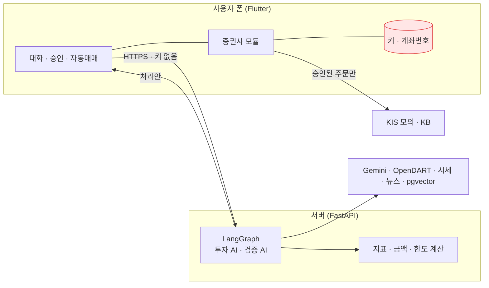

### 판단 한 번의 흐름

```
폰: 잔고 · 현재가 · 1분봉 · VWAP · 시장 지수를 증권사에서 읽음 (키는 폰에만)
 → 서버: 공시 원문(RAG) · 재무 · 종가 · 뉴스를 모으고, 지표는 코드가 계산
 → 투자 AI: 허용된 행동(매수·관찰·보유·매도) 하나 + 근거마다 출처 ID
 → 코드 검사: 없는 출처, 금액 단위, 뉴스를 사실로, 묵은 자료, 하락 중 매수 → 걸리면 반려
 → 검증 AI: 결론은 안 보고 출처 ID로 원문을 다시 읽어 대조 → 반려면 투자 AI가 고쳐 다시 (최대 2번)
 → 정책 검사(금액·비중·장 시간) → 폰이 증권사에 주문 → 체결 기록
```

### 자동매매 하루 (사람은 아침에 계획만 승인)

| 시각 | 하는 일 |
|---|---|
| 07:00 · 14:00 | 서버가 공시·재무·종가 수집. 장중에는 분석할 때 그 종목 오늘 공시를 30분마다 다시 받음 |
| 08:20 | 서버가 상승 추세 종목 중 후보 3개를 골라 투자 AI → 검증 AI로 미리 판단 |
| 아침 | 사람이 "오늘 계획" 승인 (살 총액, AI 매도 허용). 안 하면 그날은 아무것도 안 함 |
| 09:05~15:20 **매수** | 후보를 실시간 시세로 다시 판단해 매수. "관찰"이면 30분 뒤 다시. 10~14시 매시 거래대금·상승률 상위로 후보 보충. 코스피·코스닥이 −1% 넘게 빠진 아침엔 10시 전에 사지 않음 (10/26) |
| 09:30~15:28 **매도** | 보유 종목(사람이 직접 산 종목도 모의투자에서는 함께, 10/22~)을 30분마다 AI에게 "팔까?" 질문. 팔지는 AI가 "판다·든다"를 같은 무게로 비교해 정함. 장중 단기 신호(VWAP 아래·5분 저가 하락)만으로는 팔지 않음. 매도 지정가는 현재가보다 한 호가 낮게 |
| 바로 묻는 경우 | 매입가 ±3%, 이익 +1% 넘음(10/23, 지난번 질문보다 +0.5%p 더 오를 때마다), 손절선 −7% (물은 뒤 1.5%p 더 빠지면 다시), 코스피 −1.5%, 오늘 최고 +2% 넘은 뒤 1.5%p 돌려줌, 14:30 마감 전 점검 |
| 시장 탓 하락 | 지수가 −1.5%~−3%이고 종목이 지수보다 1.5%p(10/26, 전 3%p) 넘게 나쁘지 않으면 내리는 쪽 매도 판단을 30분 미룸 (미룬 뒤 지수가 1%p 더 빠지면 바로 물음). 미룬 때 가격은 서버에 남겨 종가와 비교. 투자·검증 AI는 "시장 하락만으로는 팔지 않는다" (종목만의 근거가 있어야) |
| 얼마나 사나 (코드) | **변동이 큰 종목은 적게**: 평소 하루 변동의 2배만큼 빠지면 총자산의 2%만 잃을 만큼(종목당 최대 35%). **주식 비중은 총자산의 70%까지** |
| 안전장치 (코드) | −10%면 절반·−15%면 전부 강제 손절, **하락장(코스피가 20일 평균 아래)엔 새로 안 삼 (10/27~, 전엔 절반 매수)**, 급락 종목은 절반만 매수, 장 시작 30분은 매도 판단 안 함 (강제 손절만, 산 뒤 대기는 10/23에 없앰). 체결 안 된 매도는 다음 날 보유로 되돌림 |
| 사람 확인이 필요한 매수 | 5일 **+10% 넘게** 오른 급등주(분석 대상 상위 10%), 성향보다 위험한 주문. 자동으로 승인하지 않고, 그날은 다시 묻지 않는다 |
| 위험 1등급 (악재 공시) | 관리종목·상장폐지 사유·횡령·배임·불성실공시. **모의투자에서는 AI가 매수 여부를 판단**한다. 10/26부터는 "1등급이라는 것만으로 관찰하지 않고" 공시가 실적·주가에 주는 영향을 따져 정함 (전에는 "감수할 근거가 없으면 관찰"이라 매일 관찰로 끝났다). 실전은 막음 |

### AI에게 주는 자료 (숫자는 전부 코드가 계산, AI는 인용만)

| 자료 | 내용 |
|---|---|
| 공시·재무 | 정기보고서·주요사항보고서 본문 조각 최대 6개, 주요 계정 (금액 옆에 조·억 단위를 같이) |
| 장중 흐름 | 1분봉 최근 30개, VWAP(거래량 가중 평균가), 하락 중·반등 중, 오늘 시가·고가, 고가 때와 지금 수익, 하루 흐름 |
| 시장 | 코스피·코스닥 등락, 1·5·20거래일 흐름, 20일 평균 대비 |
| 추세 | 20·60일 평균 대비, 20일 평균 방향, 시장 대비 강도 |
| 계좌 | 보유 수량·평균가, 세금·수수료 뺀 "지금 팔면 손익" |
| 뉴스 | 제목·언론사·링크만. 공시로 확인 안 되면 "보도에 따르면" 추론으로만 |
| 오늘 반려 | 보유 종목이면 오늘 그 종목 매도가 검증에서 반려된 이유 (최근 3개). 같은 근거로 다시 내지 않게 |
| 오늘 판 기록 | 오늘 이 종목을 판 시각·가격·판 근거. 다시 사려면 판 이유가 사라졌다는 새 근거를 쓰게 |

## 3. 날마다 고친 것

장이 끝나면 그날 기록(주문, AI 판단, 검증 반려, 앱 화면)을 다시 보고 **무엇이 있었나 → 어떻게 바꿨나**를 남긴다.
참고는 그날 리포트(근거·숫자)와 외부 기준이다. 바꾼 파일·함수·테스트는 [수정 기록](docs/AI_CHANGELOG.md)에 있다.
날짜별 내용은 제목을 누르면 펼쳐진다 (가장 최근 날만 펼쳐 둔다).

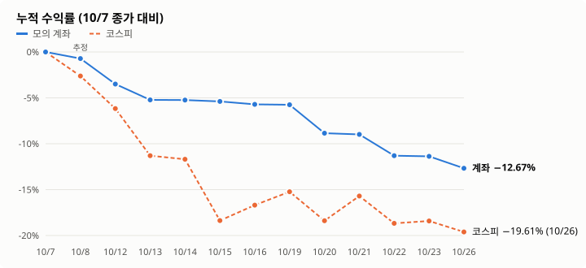

| 날 | 코스피 | 계좌 (그날) | 체결 | 리포트 |
|---|---|---|---|---|
| 10/29 (15일차) | **−1.24%** (코스닥 −2.34%, 장중 저가 −3.2%) | **−0.17%** (장중 −0.07%~−0.70%) | 매도 1 (하이브 손절) | [리포트](docs/reports/live-20261029.md) |
| 10/28 (14일차) | **+6.63%** (코스닥 +3.69%) | **−0.28%** (장중 +0.94%~−0.30%) | 매도 1 (유한양행) | [리포트](docs/reports/live-20261028.md) |
| 10/27 (13일차) | **+3.09%** (코스닥 +2.29%) | **−0.53%** (장중 +0.37%~−0.70%) | 매수 1 | [리포트](docs/reports/live-20261027.md) |
| 10/26 (12일차) | **−1.46%** (코스닥 −3.26%) | **−1.46%** (장중 −0.35%~−1.48%) | 매수 2, 매도 1 (전부 체결) | [리포트](docs/reports/live-20261026.md) |
| 10/23 (11일차) | **+0.30%** (갭 −2.36%, 저가 −4.11%) | **−0.09%** (장중 −0.04%~−0.40%) | 매수 1 | [리포트](docs/reports/live-20261023.md) |
| 10/22 (10일차) | **−3.52%** (갭 −1.14%, 저가 −4.35%) | **−2.55%** (장중 −0.90%~−2.57%) | 매도 5, 매수 1 (전부 체결) | [리포트](docs/reports/live-20261022.md) |
| 10/21 (9일차) | **+3.29%** | **−0.15%** (장중 +1.03%~−0.34%) | 매도 5, 매수 4 (매도 1건 체결 0주) | [리포트](docs/reports/live-20261021.md) |
| 10/20 (8일차) | **−3.73%** | **−3.28%** (장중 −3.52%) | 매도 2, 매수 1 | [리포트](docs/reports/live-20261020.md) |
| 10/19 (7일차) | **+1.76%** (아침 약 −2%) | **−0.04%** (장중 −2.05%) | 매도 4, 매수 3 | [리포트](docs/reports/live-20261019.md) |
| 10/16 (6일차) | **+2.05%** | **−0.34%** (장중 +1.64%) | 매수 6 | [리포트](docs/reports/live-20261016.md) |
| 10/15 (5일차) | **−7.57%** | −0.16% | 0 | [리포트](docs/reports/live-20261015.md) |
| 10/14 (4일차) | −0.44% | −0.03% | 0 | [리포트](docs/reports/live-20261014.md) |
| 10/13 (3일차) | −5.46% | −1.78% | 매도 8 | [리포트](docs/reports/live-20261013.md) |
| 10/12 (2일차) | −3.65% | 보유 −4.03% | 매수 2 | [리포트](docs/reports/live-20261012.md) |
| 10/8 (1일차) | −2.62% | 산 종목 −1.52% | 매수 4 | [원인 분석](docs/reports/2026-10-08-mock-auto-trading.html) |

<details open>
<summary><b>10/29 (15일차) 코스피 −1.24%에 −0.17%, 하이브 손절은 맞았고 매수 5건은 주문 없이 끝남</b></summary>

| 무엇이 있었나 | 어떻게 바꿨나 | 참고 |
|---|---|---|
| **잘된 점**: 09:38 하이브 5주를 평균가 대비 −7.7%에서 손절. 종가 −6.07%라 안 팔았으면 약 2.6만 원을 더 잃었다. 영업적자 종목(하이브·LG에너지솔루션·SKC)이 후보에서 빠졌고 오류는 0건 | | [리포트](docs/reports/live-20261029.md) |
| **확인 못 한 점**: 매수 검토 5건이 모두 검증을 통과했는데 주문은 0건. 서버가 아니라 폰 자동매매가 사지 않았고 코드상 하락장 규칙(코스피 20일 평균 아래)으로 보이나 앱 안내 기록은 **미확인** | | 리포트 2장 |
| 앱이 15:32에 저장한 마감 총자산이 KIS 일봉 종가 계산보다 13,650원 낮음 (10/28은 정확히 같았음) | 시각을 늦춰도 안 고쳐져 코드는 안 바꿈. 원인 미확인. 일일 마감 값은 KIS 일봉 종가 × 수량 + 현금으로 씀 | 리포트 머리말 |
| 과거 1년 규칙 시험: 변동성 상한(상위 20% 제외)이 수익을 +61.0% → +6.9%로 깎고 낙폭은 같음 | 마감 뒤(사용자 결정) 모의투자에서만 상한을 풂. 실전은 그대로. 1~2주 지켜본 뒤 되돌릴지 정함 | [과거 구간 가상 투자](#과거-구간-가상-투자-ai-판단이-규칙보다-나은가-1028) |

| 09:24 | 10:24 | 13:24 | 마감 (16:11) |
|---|---|---|---|
|  | 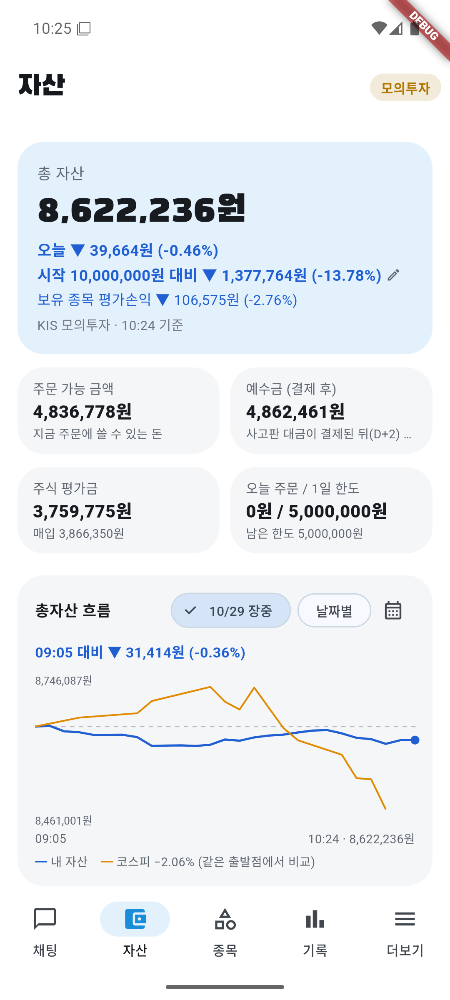 |  | 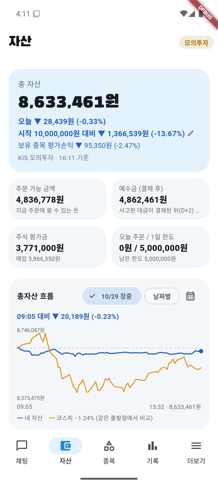 |

</details>

<details>
<summary><b>10/28 (14일차) 코스피 +6.63% 급등일에 −0.28%, 유한양행을 종가보다 높게 팔고 새로 산 것은 없음</b></summary>

| 무엇이 있었나 | 어떻게 바꿨나 | 참고 |
|---|---|---|
| 코스피가 하루에 +6.63% 올랐는데 계좌는 −0.28% (6.91%p 뒤짐). 현금이 약 38~47%였고 보유 종목은 크게 오르지 않았다. 14:37 유한양행 10주를 78,000원에 팔았고 종가 77,300원 | 시장 대응은 안 고침. 마감 뒤 과거 1년 시험으로 영업적자 종목을 후보에서 빼는 규칙을 만들어 저녁에 서버에 반영 | [리포트](docs/reports/live-20261028.md) |
| 매수 검토 8건이 모두 검증을 통과했지만 주문은 0건 (원인 미확인) | | 리포트 2장 |

</details>

<details>
<summary><b>10/27 (13일차) 코스피 +3.09% 반등일에 −0.53%, 사려던 것은 급등 경고와 비중 상한에 막힘</b></summary>

| 무엇이 있었나 | 어떻게 바꿨나 | 참고 |
|---|---|---|
| **잘된 점**: 서버가 08:38에 켜지자 놓친 07시 수집을 바로 함 (150종목). 강한 상승장 지시 뒤 "고점 근처만으로 관찰"이 없어지고 매수 판단이 늘었다. 비중 상한으로 못 산 삼성바이오로직스는 종가 −5.37% | | 리포트 1·3장 |
| **잘못된 점**: 코스피 +3.09%에 계좌 −0.53% (반등일 다섯 번째, 3.62%p 뒤짐). 8종목 중 6종목이 내렸다. 오전 매수 후보는 오르는 종목은 "20일 최고가 근처라 되돌림 위험", 덜 오른 종목은 "평균선 아래"로 모두 관찰 | 11:46(사용자 결정): 지수가 +2% 넘게 오른 날은 고점 근처라는 것만으로 관찰하지 않게 투자·검증 AI 지시 | 리포트 3·4장 |
| 하이브 매도(시장보다 6.7%p 약함·60일 평균 아래·영업이익 −129%)를 검증 AI가 "단기 신호뿐"으로 4번 반려 | 마감 뒤(사용자 결정): 이 셋은 단기 신호가 아니라 더 긴 근거라고 검증 지시문에 넣음 | 리포트 1·4장 |
| 15:30:08 자동 저장 마감 값이 종가 계산보다 9,350원 낮음 | 마감 저장을 15:32~15:35로 늦춤 | 리포트 4장 |
| 삼성바이오로직스 매수 판단이 비중 상한(남은 몫 약 66만 원 < 1주 146만 원)으로 0주가 됐는데 기록 없음 | 1주도 못 살 때 앱 기록에 남김 | 리포트 4장 |

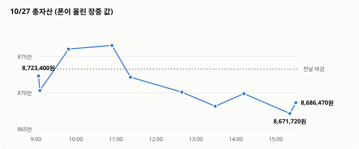

| 09:06 셀트리온 매수 | 10:29 | 13:29 | 마감 |
|---|---|---|---|
|  | 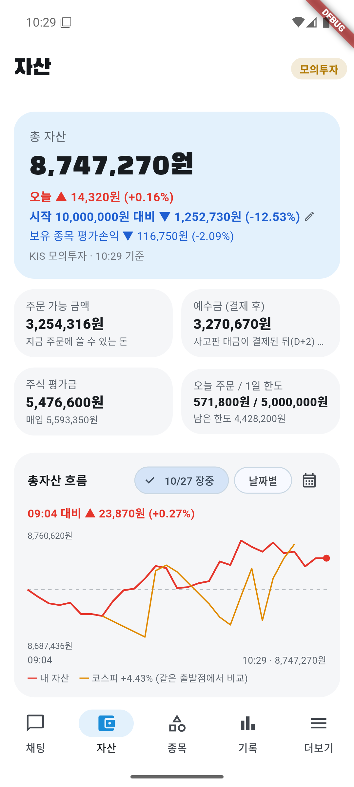 | 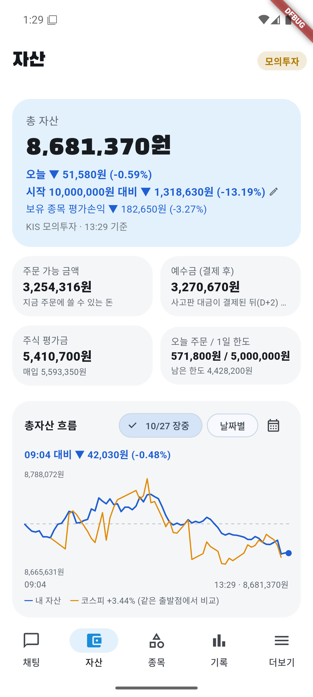 | 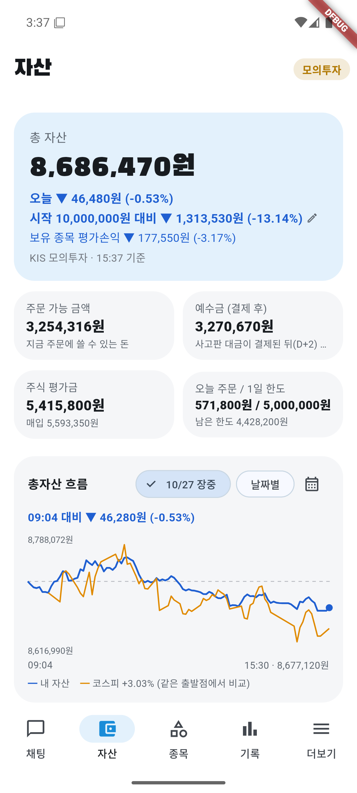 |

</details>

<details>
<summary><b>10/26 (12일차) 시장과 같이 −1.46%, 하락하는 아침에 산 것이 가장 큰 손실</b></summary>


| 무엇이 있었나 | 어떻게 바꿨나 | 참고 |
|---|---|---|
| **잘된 점**: 셀트리온을 +2.82%에 이익 매도 (종가는 +0.37% 더 높았을 뿐). 판 뒤 더 비싸게 다시 사려 하자 관찰. 급등 경고로 안 산 LG씨엔에스 −1.61%. 15:30 마감 계좌 값 자동 저장이 종가 계산과 같음 | | 리포트 1·3장 |
| **잘못된 점**: 코스닥 −1.76%이던 09:06에 산 유한양행이 종가 −3.20%(−27,000원). 10/8·10/12와 같은 하락하는 날 아침 매수 | 마감 뒤(사용자 결정): **10시 전에 코스피나 코스닥이 −1%보다 더 빠져 있으면 새로 사지 않음** | 리포트 3·4장 |
| 11:36 시장 탓 미룸 6건 중 3건 맞음(합 −1.5만 원, 손해 본 날 네 번째). 지수보다 1.7%p 더 빠진 HLB까지 미룬 게 손해의 대부분 | 마감 뒤(사용자 결정): 종목이 지수보다 **1.5%p**(전 3%p) 넘게 더 빠지면 미루지 않음 | 리포트 1·4장 |
| 아침 후보 3개 중 2개가 위험 1등급이라 "감수할 근거가 없으면 관찰"로 매일 관찰 | 장 전(사용자 결정): 1등급이라는 것만으로 관찰하지 않고 공시 영향을 따져 판단 (모의투자만) | 리포트 4장 |
| 서버가 주말 내내 꺼져 07시 수집을 건너뜀, 출처 `intraday`(코드 없음)·판 가격 금액 검사로 오반려 2건 | 켜질 때 놓친 수집 바로 하기, 코드 없는 출처 인정, 판 기록을 계좌 출처에 넣기 | 리포트 4장 |

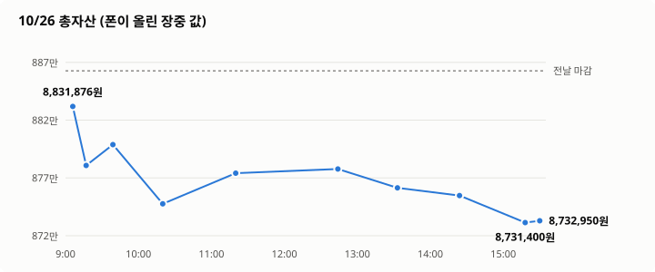

| 09:06 유한양행 매수 | 10:19 셀트리온 매도 | 13:02 하이브 매수 | 마감 |
|---|---|---|---|
| 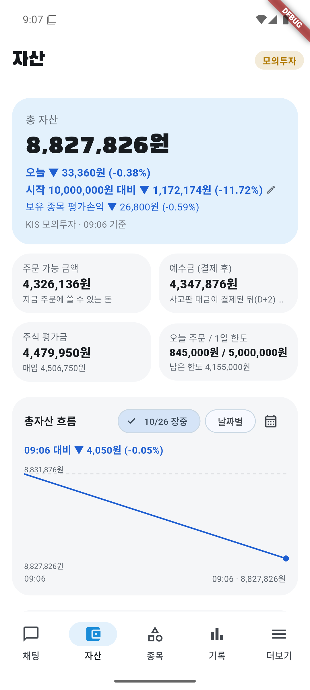 |  | 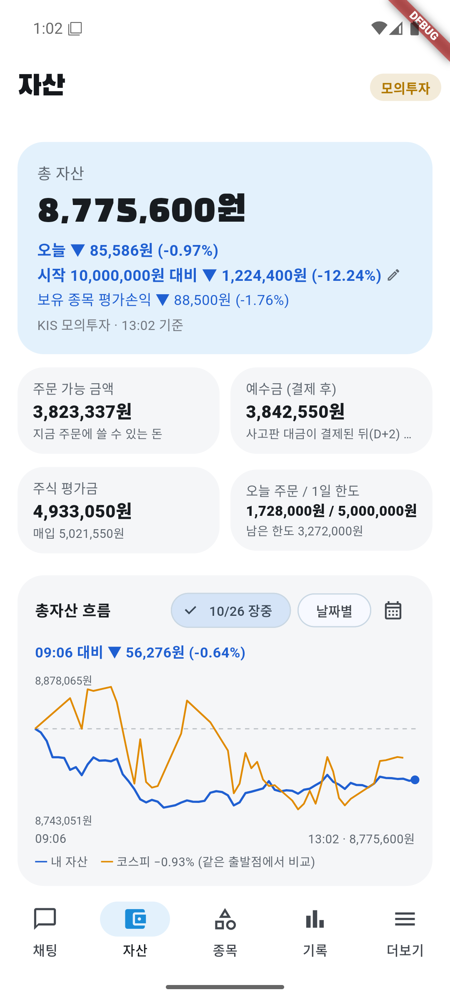 | 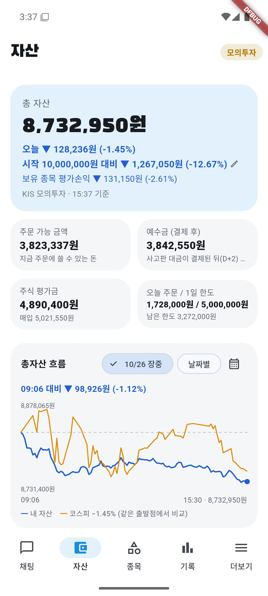 |

</details>

<details>
<summary><b>10/23 (11일차) 코스피가 −4.11%에서 고가로 끝난 날, 계좌는 거의 그대로</b></summary>


| 무엇이 있었나 | 어떻게 바꿨나 | 참고 |
|---|---|---|
| **잘된 점**: 장 전에 고친 것 중 이익 +1% 즉시 질문(셀트리온 +5.5% 10:41, HLB +1.1% 13:59 → 둘 다 보유), 사람이 산 종목(기아) 자동 점검이 동작. 급등 경고로 안 산 유한양행 +0.83%·하이브 −0.40% (큰 차이 없음). 10/22에 판 5건은 오늘 종가로 보면 모두 더 내림 (판 게 약 11.7만 원 나음) | | 리포트 1·3장 |
| **잘못된 점**: 코스피 +0.30%에 계좌 −0.09% (반등일 4번 모두 시장보다 뒤짐). 09:35 시장 탓 미룸 3건 중 2건 틀림(KT&G −2.37%, HMM −1.09%, 약 −1.9만 원). 지수는 올랐는데 종목은 안 올라 "시장 탓" 판단 자체가 틀린 날 | 미룸을 끌지, 하락장 신규 매수를 쉴지는 사용자와 정한다 (이번엔 제외) | 리포트 3·5장 |
| 기아 출처 ID `지표 ID: op_income_yoy`가 어제 고친 뒤에도 반려 | 앞에 지표·metric이 붙어도 `ID:`를 뗌 (13:21) | 리포트 4장 |
| 계획 화면에 계좌에 없는 옛 보유 기록(피에스케이홀딩스 7주)이 보임. 전량 매도 체결 전에 그 종목을 다시 "직접 산 종목"으로 맡을 수 있음 | 계좌에 없는 종목은 보유 기록에서 빼고, 오늘 자동으로 판 종목은 그날 다시 맡지 않음 (13:21) | 리포트 4장 |
| 마감 뒤 앱이 계좌 값을 올리지 않음 (마지막 15:25). 자동매매는 15:28에 멈추고 종가 값은 사람이 자산 화면을 열 때만 저장됐다 | 마감 뒤: 자동매매가 15:30~15:35에 한 번 저장 (오늘 마감 값은 종가 × 수량 + 현금으로 계산) | 리포트 4·5장 |
| 위험 문장 `(출처: 사용자)`가 "없는 출처"로 반려 (HMM, 하루 한 번쯤) | 마감 뒤: 출처 표시에서 `사용자`만 떼고 문장은 남김 | 리포트 4장 |

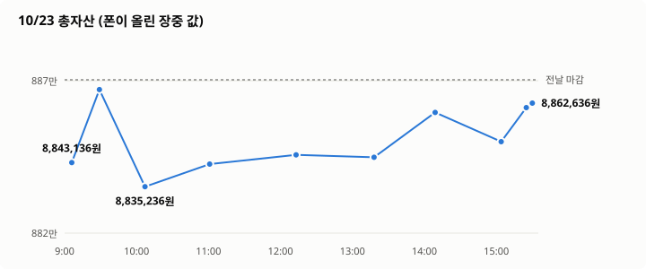

| 09:29 | 12:29 | 14:35 코웨이 매수 | 마감 |
|---|---|---|---|
|  | 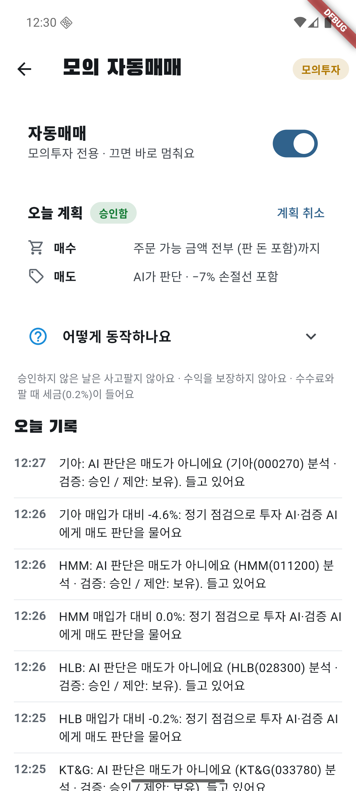 | 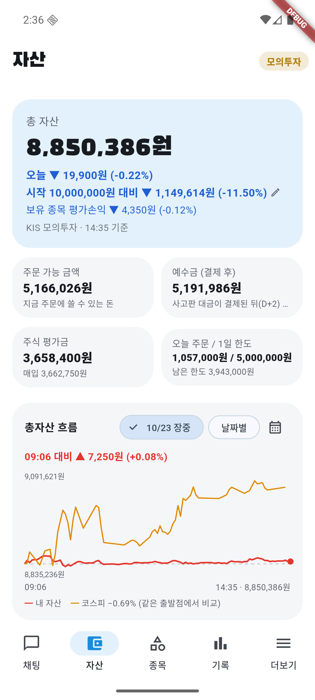 | 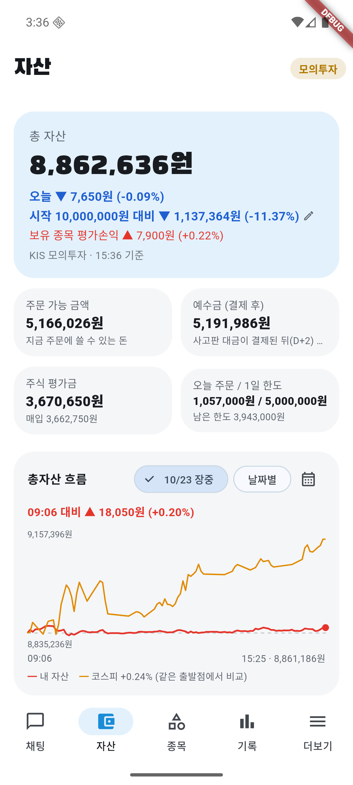 |

</details>

<details>
<summary><b>10/22 (10일차) 폭락일에 시장보다 0.97%p 덜 빠졌지만, 아침 미룸이 손해</b></summary>


| 무엇이 있었나 | 어떻게 바꿨나 | 참고 |
|---|---|---|
| **잘된 점**: 코스피 −3.52%에 계좌 −2.55%. 어제 고친 것이 모두 동작 (HLB 보유 복구 09:07, 한 호가 낮은 지정가 매도 5건 모두 체결, 단기 신호만으로 판 매도 0건). 손절선 매도 근거가 20일 평균 이탈 같은 더 긴 근거. 팔아서 종가 기준 +12,196원 | | 리포트 1·3장 |
| **잘못된 점**: 10:41 시장 탓 매도 미룸 6건이 모두 틀림 (코스피 −1.76% → 마감 −3.52%, 그때 팔았으면 약 +8.9만 원). 10/20(−5.95만 원)에 이어 이틀 연속. 고영은 −7.3%에서 보유 판단 → 두 시간 반 뒤 −8.8%에 팔아 확정 손실 −14.4만 원 | 하락이 이어질 때 미룸을 끌지, 하락장에서 신규 매수를 쉴지는 사용자와 정한다 (이번엔 제외) | 리포트 3·5장 |
| 손절선 −7.3%의 SK이노베이션 매도가 점검에서 승인됐는데 주문 단계에서 이유를 몰라 반려 → 주문 0건 | 손절선일 때만 앱이 이유를 주문 단계에 보내 투자·검증 AI가 보게 함 (13:37 고영에서 동작) | 리포트 4장 |
| 점검 이유(마감 전·정기, 매입가 대비 %)를 보냈더니 AI가 "마감 전 점검 기준에 도달해서 매도"처럼 없는 기준을 근거로 씀 | 손절선 외에는 이유를 안 보내고 문구에서 %·"이미 승인"을 뺌. 투자 AI에게 "행동은 sell, [자료]에서 확인한 사실만" | 리포트 4장 |
| 출처 ID가 매일 새 모양으로 반려 (`ID: op_income_yoy`, `per/pbr/revenue_yoy 지표`) | 앞머리·꼬리를 떼고 슬래시로 이은 것은 쪼갬. 모르는 ID는 그대로 반려 | 리포트 4장 |
| 기아처럼 사람이 직접 산 종목은 자동 점검 밖이라 계속 들고 있음 (사용자 결정) | 5분 점검 때 계좌 보유 중 맡지 않은 종목도 같은 점검. 모의투자만, 분석 대상 종목만 | 리포트 4장 |
| "아침 하락 뒤 반등하나"를 계좌와 나란히 볼 기록이 없음 | 계좌 기록 때 그때 코스피·코스닥 %를 같이 저장 (마이그레이션 022). 지수 일봉 300일 분석: 하락 출발 99일 중 49%만 시초가보다 오른 채 마감 | 리포트 2장 |

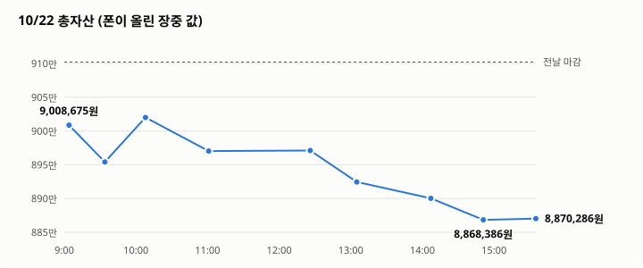

| 12:34 HMM 매수 | 13:37 고영 매도 | 14:37 SK이노베이션 매도 | 마감 |
|---|---|---|---|
|  | 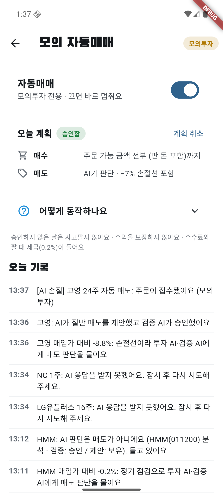 | 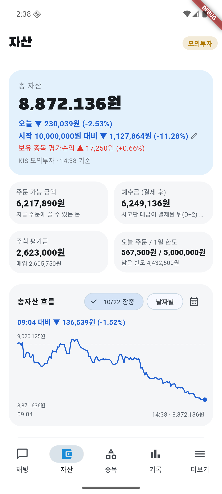 | 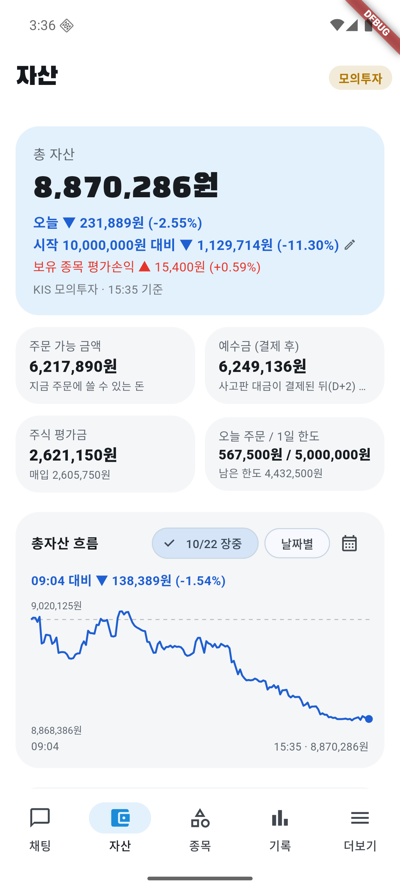 |

</details>

<details>
<summary><b>10/21 (9일차) 반등일에 몇 분짜리 신호로 팔아 시장보다 3.4%p 뒤짐</b></summary>


| 무엇이 있었나 | 어떻게 바꿨나 | 참고 |
|---|---|---|
| **잘된 점**: 급등 경고로 안 산 엘앤씨바이오 −4.17% (안 산 게 맞음). 장중 공시(불성실공시 지정예고)로 판 LG에너지솔루션은 종가와 같은 가격. 재무 금액 단위 반려 0건 (어제 6건) | — | 리포트 1·3장 |
| **잘못된 점**: 코스피 +3.29%에 계좌 −0.15%. 판 5건 중 3건이 판 뒤 더 오름. 근거 대부분이 "VWAP 아래·5분 저가 하락" 같은 몇 분짜리 신호. 한화시스템은 산 지 18분 만에 −3.1%에 팔았는데 종가는 +4.94% | 장중(11:07): 산 뒤 30분은 매도 판단 안 함. 장 마감 뒤: 투자·검증 지시문에 "장중 단기 신호만으로는 팔지 않는다, 추세 꺾임·손절선·공식 악재 같은 더 긴 근거가 있어야" (검증 AI가 반려) | 리포트 3장 |
| 한화시스템을 70,800원에 팔고 3시간 뒤 73,000원에 다시 삼 | 막지 않고 오늘 판 기록을 투자·검증 AI에게 보여 다시 사는 근거를 쓰게 (일괄 금지는 사용자와 상의해 하지 않음) | 리포트 3장 |
| HLB 지정가 매도(현재가 42,450원)가 체결 0주로 끝났는데 앱은 판 것으로 기록, 그 뒤 점검 안 함 | 장 마감 뒤: 체결 안 된 자동 매도는 다음 날 보유로 되돌림, 자동 매도 지정가는 한 호가 낮게 | 리포트 3장 |
| 급등 경고 매수가 사람 확인 대기로 10분 만료를 되풀이 (엘앤씨바이오 3번) | 장중(11:07): 사람 확인으로 멈춘 매수는 그날 다시 묻지 않음 | 리포트 4장 |
| 자동 매도 근거에 "사용자의 지시에 따라" (사실과 다름), 출처 ID 형식(`per:계산 불가`, `fin:…#91`, `metric:`)으로 반려 4건 | 지시문 고침, 출처 ID 바로잡기 | 리포트 4장 |
| 지난 날 장중 흐름·날짜별 손익·시작 대비가 안 보이고, 종목을 이름으로만 찾음 (사용자) | 총자산 그래프에 달력·누른 점의 시각·금액, 날짜별 표(접기), 자산 카드에 "오늘"·"시작 대비", 하단 **종목** 탭(150종목 16개 주제, 검색) | 리포트 4장 |

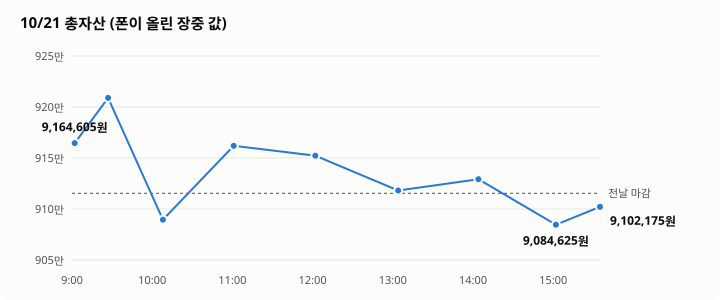

| 09:57 한화시스템 매도 | 12:34 다시 매수 | 마감 |
|---|---|---|
|  | 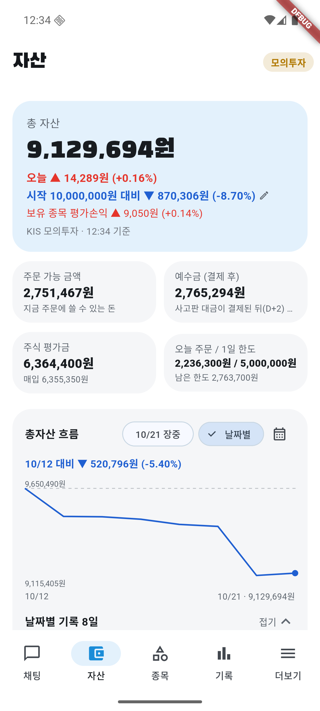 | 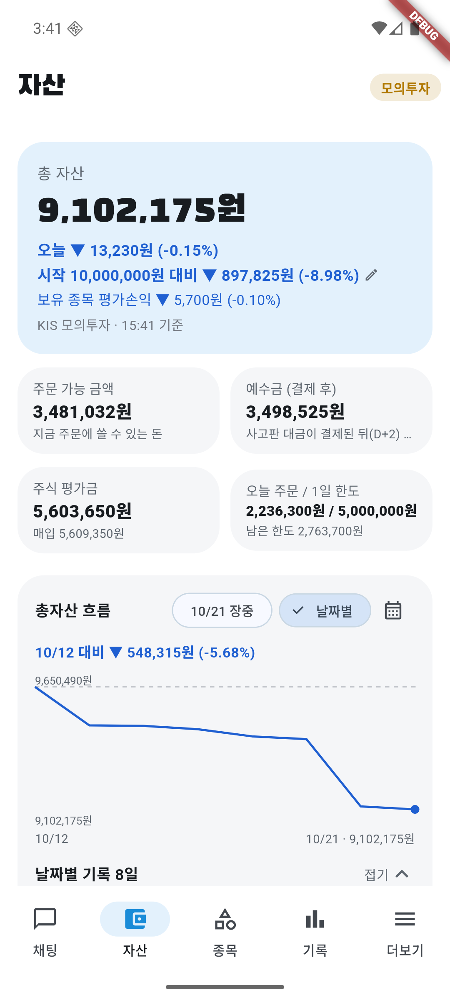 |

</details>

<details>
<summary><b>10/20 (8일차) 급락장에서 시장보다 덜 빠졌지만, 미룬 매도는 손해</b></summary>


| 무엇이 있었나 | 어떻게 바꿨나 | 참고 |
|---|---|---|
| **잘된 점**: 코스피 −3.73%에 계좌 −3.28%. 판 2종목 모두 종가보다 높게 (S-Oil 146,300 → 종가 144,000, SK이노베이션 148,400 → 종가 148,100 = 그날 저가). 산 KT&G는 +0.47%로 버팀 | — | 리포트 1장 |
| 장 전에 넣은 "시장 탓 하락이면 매도 30분 미루기"가 09:33 5종목에 동작. 검증 AI는 시장 하락만으로 낸 매도를 7번 반려 | — (규칙 첫날) | 리포트 3장 |
| **잘못된 점**: 시장이 −2.3%에서 −3.7%로 계속 빠져 미룬 5종목 중 4종목이 더 내려감 (약 −59,500원). 고영 −8.04% | 미루는 기준값(30분·3%p·−3%)은 그대로 (반등일 10/13·10/19와 반대 결과라 표본을 더 쌓음). 장 마감 뒤 고침: 미룬 뒤 지수가 1%p 더 빠지면 바로 묻고, 미룬 때 가격을 서버에 남겨 점수표·장 마감 요약이 종가와 비교 | 리포트 3·5장 |
| 고영이 손절선 질문 한 번 뒤 −8.04%까지 30분 점검만 받음 | 장 마감 뒤 고침: 지난 손절선 질문보다 1.5%p 더 빠지면 다시 질문 | 리포트 5장 |
| 검증 반려 20건 중 6건이 재무 금액 10배 오기 | 장 마감 뒤 고침: 재무 금액 옆에 조·억 단위를 같이 (`3,991억 4,400만 원`) | 리포트 4장 |
| 삼성SDI가 시장 하락만으로 매도를 4번 내고 4번 반려 | 장 마감 뒤 고침: 오늘 그 종목 매도 반려 이유를 투자 AI에게 보여 줌 | 리포트 4장 |
| 자동매매 매수 처리안 21건이 "만료"로 쌓임 (AI가 주문 직전 "관찰"이라 한 것) | 장중에 서버만 고침: 관찰이면 처리안 없이 기록만 | 리포트 4장 |
| 공시를 07·14시에만 받아 장중 악재를 모름 | 장중에 서버만 고침: 분석할 때 오늘 공시를 30분마다 받음 | 리포트 4장 |
| "지표 volatility_60d", "pbr:0.77배", "market:KOSDAI" 같은 출처 ID로 반려 5건 | 출처 ID 바로잡기 | 리포트 4장 |
| 매수 후보 분석 한도(120)에 6번 막힘 | 하루 한도 200, 보유 몫 50 (사용자 결정, 기본값) | 리포트 4장 |
| 앱 화면이 줄글이라 보기 어려움 (사용자) | 더보기 아이콘 칸, 자동매매 설명 접기, 채팅 읽음 배지·종목 검색, 기록 날짜 접기·달력, 자산 보유 두 줄, 공시 원문 열기. 서버가 꺼져도 로그아웃 안 됨 | 리포트 4장 |


| 09:41 S-Oil 매도 | 15:18 SK이노베이션 매도 | 마감 |
|---|---|---|
| 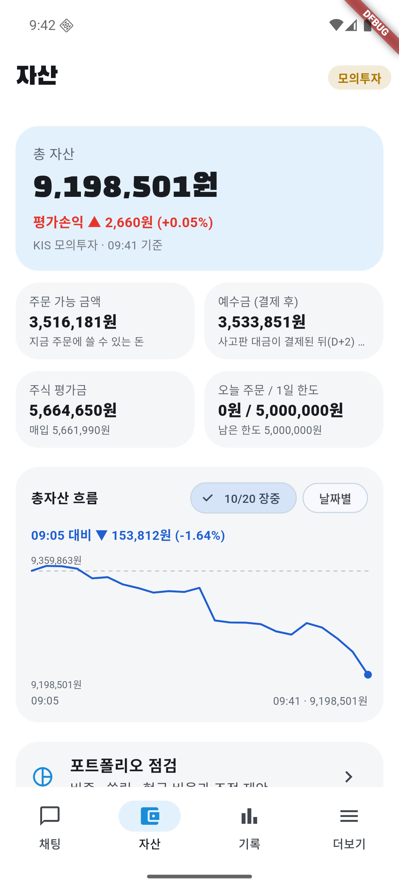 | 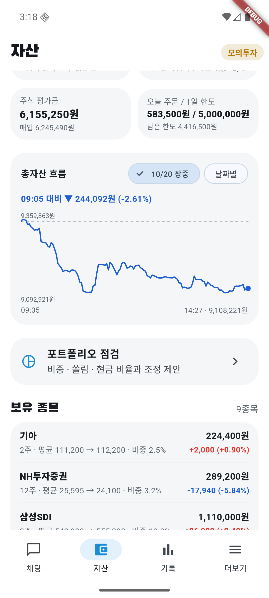 |  |

</details>

<details>
<summary><b>10/19 (7일차) 아침 급락에 4종목을 팔았는데, 모두 다시 오름</b></summary>


| 무엇이 있었나 | 어떻게 바꿨나 | 참고 |
|---|---|---|
| **잘된 점**: 바닥(10:57, −2.05%)에서 종가까지 +2.05% 회복. 들고 간 종목 평가손익 −81,690원 → +171,860원 (+253,550원) | — | 리포트 1장 |
| **잘못된 점**: 코스피 −2%인 아침에 손절선·급락·이익 돌려줌으로 판 4종목이 **모두 판 가격보다 높게 마감** (+3.97%~+10.14%, 들고 있었으면 +284,800원). 10/13 시초가 매도에 이어 두 번째. 하루 −0.04%로 코스피(+1.76%)보다 1.8%p 뒤짐 | 아직 안 바꿈: 시장 전체가 빠질 때의 매도 판단은 사용자와 정할 것 | 리포트 3·5장 |
| "오늘 최고에서 돌려준 이익" 매도가 처음 동작 (피에스케이홀딩스 +4.76% → −3.74%, HLB 절반). KIS 모의가 오늘 시가·고가를 보내 줌. 두 번 다 판 뒤 다시 오름 | 그대로 (표본 2건) | 리포트 3장 |
| AI가 사자고 한 매수 11건이 승인 대기로 만료. 하락장이라 5일 +0.2%도 "가장 많이 오른 편"으로 잡힘 (순위만 봄) | 급등은 상위 10%이면서 **실제로 5일 +10% 넘게**. 자동매매 주문은 "내 투자 습관"에서 뺌 | 리포트 3·4장 |
| 횡령·배임·불성실공시 예고가 있는 LG에너지솔루션을 AI가 1주 삼 | 이 공시들을 위험 1등급으로. 대신 **모의투자에서는 1등급도 AI가 판단** (사용자: 막으면 AI 판단을 확인할 수 없음). 1등급 근거와 "감수할 근거가 없으면 관찰"을 AI에게 | 리포트 4장 |
| 09:05 시장 급락 알림이 장 시작 30분 규칙에 걸려 실제론 안 묻고 소진 | 장 시작 30분엔 알림을 남기지 않음 | 리포트 4장 |
| 기록에서 매수·매도 구분이 안 되고, 서버가 최근 100건만 보내 아침 매도가 잘림. 하루 총자산 흐름을 앱에서 못 봄 | 매수(빨강)·매도(파랑) 필터, 자산 탭에 총자산 그래프 (오늘 장중 / 날짜별) | 리포트 4장 |

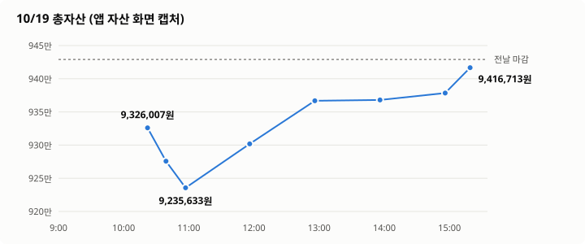

| 10:39 HLB 절반 매도 | 마감 | 자산 그래프 (날짜별) | 기록 매도 필터 |
|---|---|---|---|
| 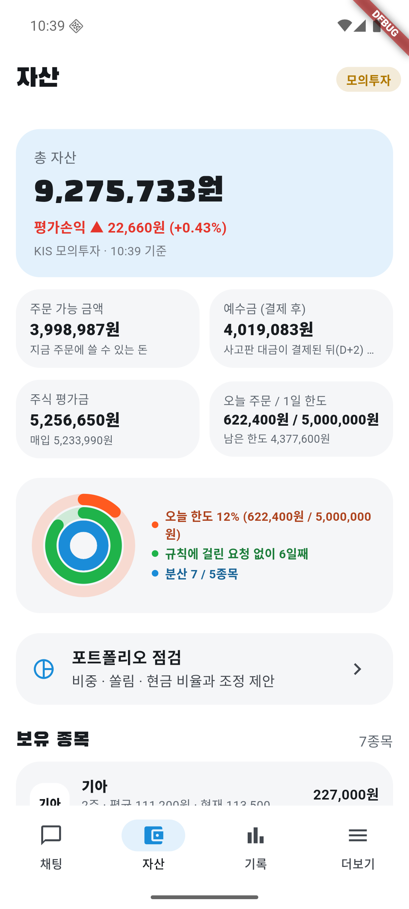 | 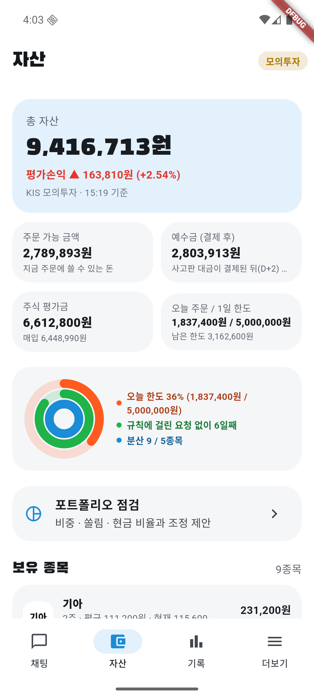 |  |  |

</details>

<details>
<summary><b>10/18 (주말) 수량 규칙을 1년 백테스트로 정함</b></summary>


| 무엇이 있었나 | 어떻게 바꿨나 | 참고 |
|---|---|---|
| 모든 종목을 똑같이 "종목당 35%"로 사고, 첫 반등날 현금 92%를 씀 | 변동성 기준 수량(평소 변동 2배에 총자산 2%) + 전체 주식 비중 70% 상한 | 1년 백테스트 (아래 표), 변동성 목표 연구 (Barroso·Santa-Clara) |
| "하루 매수 한도"를 검토 | 넣지 않음: 며칠에 걸쳐 결국 비중이 100%까지 차서 효과 없음 | 같은 백테스트 |
| "14:30 이후 매수 금지"를 검토 | 보류: 6일 동안 14:30 이후 매수가 0건 (10시 뒤 매수 4건은 평균 −2.09%, 표본이 하루뿐) | KAIST 장 마지막 1시간 반전 연구 |

1년 백테스트 (2025-11~2026-10, 지금 후보 규칙을 일봉으로 흉내, 후보 3·6개 × 3·5·10일 보유 6개 조건의 중앙값, AI 판단은 되돌리지 못해 후보는 다 산다고 가정):

| 규칙 | 수익률 | 최대 낙폭 | 6개 중 손실 |
|---|---|---|---|
| 사서 들고 있기 (대상 동일 비중) | +21.3% | −35% | — |
| 이전 (종목당 35%) | +23% | −51% | 1 (−4% ~ +134%로 들쭉날쭉) |
| 하루 한도 50% | +6% | −49% | 2 |
| **변동성 수량 + 비중 70% (적용)** | **+37%** | **−33%** | **0** |

</details>

<details>
<summary><b>10/16 (6일차) 첫 반등장, 오른 만큼 돌려줌</b></summary>


| 무엇이 있었나 | 어떻게 바꿨나 | 참고 |
|---|---|---|
| 14:32 분석 한도(100)가 차서 오후 보유 종목 매도 판단 17번 거절. 그 사이 계좌 +0.76% → −0.93% | 한도 150, 그중 30번은 보유 종목 매도 점검 전용 | 리포트 5장 (서버 기록) |
| +2~3%까지 갔다가 내려온 4종목에 질문이 없었다 (매입가 ±3%만 봄) | 오늘 최고 +2% 넘은 뒤 1.5%p 내려오면 바로 질문, 14:30 마감 전 점검 | 리포트 3장 |
| AI가 최근 30분만 봐서 하루 모양을 모름. 이익 중 종목은 모두 "보유" | AI 자료에 오늘 시가·고가·돌려준 폭·하루 흐름. 지시를 "판다·든다를 같은 무게로"로 (숫자 규칙 대신 AI 판단, 사용자 결정) | 리포트 6장 |
| 가격이 바뀐 처리안을 체결로 오인, 흑자 전환 지표 ID로 반려 6번 | 다시 온 처리안도 같은 기준으로 승인, 계산 못 하는 지표 ID는 코드가 뗌 | 리포트 4장 |

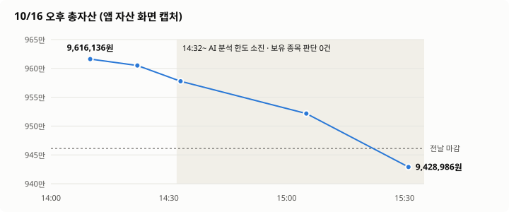

| 14:10 장중 최고 부근 | 15:31 마감 |
|---|---|
|  |  |

</details>

<details>
<summary><b>10/15 (5일차) 폭락장, 사지 않고 버팀</b></summary>


| 무엇이 있었나 | 어떻게 바꿨나 | 참고 |
|---|---|---|
| 후보를 "최근 공시 종목"으로 골라 같은 하락 종목을 5번 보고 5번 관찰 | 후보를 상승 추세·20거래일 등락률 강한 순으로, 2시간 안에 본 종목은 뺌 | 리포트 3장 |
| 급락일엔 상승 추세 종목도 반등과 상관없이 관찰 | 반등 확인(저가를 더 안 낮추고 VWAP 위) 뒤 절반 매수 | 리포트 3장 |
| 손절선(−7%) 아래(NH투자증권 −9.16%)에서도 AI가 계속 보유 | 강제 손절 −10% 절반·−15% 전부, 하락장엔 종목당 몫 절반 | 리포트 5장, Faber 추세 필터 |
| 흑자 전환을 "+105.79% 증가"로 계산해 반려 4번 | 전년 적자면 "흑자 전환"·"적자 지속"으로 | 리포트 5장 |

</details>

<details>
<summary><b>10/14 (4일차) 공개 매매 기준과 비교한 점검</b></summary>


| 무엇이 있었나 | 어떻게 바꿨나 | 참고 |
|---|---|---|
| AI가 PER·실적·변동성만 받아 언제 살지 볼 근거가 없음 | 추세·시장 국면·VWAP·5분 저가 하락을 코드가 계산해 자료로. 하락 중이면 자동 매수를 코드가 막음 | [점검 보고서](docs/reports/ai-audit-20261014.md) |
| 상승 추세 삼성SDI(+5.00%)를 위험만 보고 관찰 | 절반 매수, 지시 균형 ("관찰도 비용이 있다") | 리포트 2장 |
| 검사 코드 버그로 셀트리온 판단 9번 반려 | 공시 표 숫자를 원문 값으로 읽게 수정 | 리포트 3장 |
| AI가 너무 조심스러운지 볼 숫자가 없음 | 관찰 판단 점수 (아래) | 리포트 4장 |

</details>

<details>
<summary><b>10/8 ~ 10/13 (1~3일차)</b></summary>

#### 10/13 (3일차) 시초가에 판 종목이 모두 다시 오름

| 무엇이 있었나 | 어떻게 바꿨나 | 참고 |
|---|---|---|
| 시초가 급락 때 판 3종목 모두 종가가 더 높음 (약 7.9만 원) | 장 시작 30분은 손절선만 질문 | 리포트 2장, KAIST 장 초반 연구 |
| 검증 반려 48건 중 35건이 "뉴스를 사실로" | 뉴스만 출처인 사실은 코드가 "보도에 따르면" 추론으로 | [수정 기록](docs/AI_CHANGELOG.md) 10/14 장 전 |
| "숫자를 고쳐라" 조건부 승인인데 자동매매가 매수 (10/12) | 자동 매수는 "승인"만 | [2일차 리포트](docs/reports/live-20261012.md) 7장 |

#### 10/12 (2일차) 시장 급락을 못 봄

| 무엇이 있었나 | 어떻게 바꿨나 | 참고 |
|---|---|---|
| 시장 전체 하락을 AI가 모름 | 시장 지수를 자료로, 코스피 −1.5%면 보유 종목 즉시 재판단 | 리포트 6장 |
| 분석 한도 20이 10:44에 차서 3시간 판단 정지, 실패를 "보유"로 기록 | 한도 100, 실패는 따로 기록 | 리포트 4장 |
| 매도는 사람이 정해진 시각에만 | 30분마다 AI 매도 판단, 전부·절반 선택 | 리포트 4장 |

#### 10/8 (1일차) 하락 중에 삼

| 무엇이 있었나 | 어떻게 바꿨나 | 참고 |
|---|---|---|
| 반대 근거에 "하락 중"을 적고도 매수, 시장 지수·뉴스를 안 봄 | 자동 주문은 AI가 "관찰"로 거절할 수 있게, 뉴스 출처 추가 | [원인 분석](docs/reports/2026-10-08-mock-auto-trading.html) |

</details>

### 결과로 확인된 것

- 하락 중 매수: 10/8 판단을 고친 로직으로 재현하면 12번 모두 거름 (10/14부터는 코드가 직접 막음)
- 공포성 매도: 장 시작 30분 규칙 뒤 시초가 매도 0건
- 실시간 재확인: 10/15 폭락일에 매수 시도 3번을 멈춤. 그때 샀으면 종가 기준 −9.81%(삼성SDI), −12.44%(피에스케이홀딩스)
- 뉴스를 사실로 쓴 반려: 10/13 35건 → 10/14 13건
- 오후 판단 정지: 10/16은 14:32에 분석 한도가 차서 멈춤 → 10/19는 127/150으로 마감까지 보유 종목 판단이 계속됨
- 이익 돌려줌 매도: 10/19 2번 동작. 두 번 다 판 뒤 종가가 더 높았다 (+4.68%, +3.97%)
- 시장 급락 아침의 매도: 10/13·10/19 모두 판 종목이 종가에 다시 올랐다 (10/19 4건 모두, +284,800원 놓침)
- 시장 탓 하락에 매도 미루기 (10/20 첫날): 시장이 계속 빠져 미룬 5종목 중 4종목이 더 내려감 (약 −59,500원). 대신 판 2건은 종가보다 높게 팔았다
- 오후 판단 정지: 10/20 매수 후보 몫(120)에 6번 막힘 → 하루 한도 200·보유 몫 50으로 (10/21은 150/200으로 막힘 없음)
- 재무 금액 조·억 병기 (10/21 첫날): 금액 단위 반려 6건 → 0건
- 반등일의 매도: 10/21 판 5건 중 3건이 판 뒤 더 오름 (+30,000원 놓침). 근거 대부분이 몇 분짜리 장중 신호
- 시장 탓 미룸: 10/20 −5.95만, 10/22 −8.9만(6건 모두 틀림), 10/23 −1.9만 원(3건 중 2건 틀림), 10/26 −1.5만 원(6건 중 3건 맞음). 하락이 이어진 날도 반등일도 손해 → 10/26 마감 뒤 조건을 1.5%p로 좁힘

### 관찰 판단 점수 (AI가 너무 조심스러운가)

| 날 | "관찰"한 후보의 그날 평균 | 놓친 기회 (+2% 넘게) | 피한 손실 (−2% 넘게) |
|---|---|---|---|
| 10/13 | −2.91% | 1 | 2 (에이피알 −19.60%) |
| 10/14 | +2.00% | 3 (삼성SDI +5.54%) | 0 |
| 10/15 | −8.87% | 0 | 11 (고영 −14.80%) |
| 10/19 | +1.57% | 4 (현대오토에버 +9.92%) | 2 (엘앤씨바이오 −4.71%) |
| 10/20 | −5.73% | 0 | 8 (한화시스템 −13.90%) |
| 10/21 | −0.28% (매수 검토 +2.99%) | 2 (대한광통신 +12.24%) | 2 (서진시스템 −10.88%) |
| 10/22 | −3.53% (매수 검토 −3.21%) | 0 | 9 (SK이노베이션 −8.17%) |
| 10/23 | −0.51% (매수 검토 −0.04%) | 1 (삼성E&A +7.94%) | 4 (삼성SDI −4.20%) |
| 10/26 | −1.24% (매수 검토 −1.05%) | 1 (로보티즈 +9.56%) | 6 (HLB −5.65%) |

빠지는 날은 관찰이 손실을 피했고, 오르는 날은 기회를 놓쳤다 (10/19 놓친 기회 4). 10/21은 반등일인데도 관찰이 −0.28%로 매수 검토(+2.99%)보다 낮았다. 10/22는 판 5건 모두 판 게 나았고(들고 있었으면 −12,196원), 10:41에 미룬 6건은 하나도 맞지 않았다. 10/23은 관찰이 평균 −0.51%로 대체로 맞았지만 삼성E&A(+7.94%)를 놓쳤고, 09:35 미룸 3건 중 1건만 맞았다. 10/26은 하락일이라 관찰(−1.24%)이 대체로 맞았고, 실제로 산 유한양행(−3.54%)이 매수 검토 중 가장 나빴다. 10/27 점수는 다음 거래일 14시 종가 수집 뒤.

**아침 하락 뒤 반등하나** (10/22 지수 일봉 300거래일, 일봉이라 최저 시각은 모름): 코스피가 하락 출발(시초가 −0.3% 이하)한 99일 중 시초가보다 오른 채 마감한 날은 49%, 장중 −2% 넘게 빠진 84일 중에는 30%였다. 최저점에서 마감까지는 평균 1.6~2%p 올랐다. "아침에 팔면 늘 틀린다"는 며칠 표본의 인상이었고, 규칙은 그대로 둔다. 10/22부터 계좌 기록에 그때 코스피·코스닥 %를 같이 쌓아 몇 주 뒤 분봉 수준으로 다시 본다.

### 과거 구간 가상 투자: AI 판단이 규칙보다 나은가 (10/28)

실시간 장으로 매일 시험하면 결과를 보는 데 너무 오래 걸리고 아직 성과도 안 나와서, 과거 데이터로 먼저 시험해 보고 나은 방식만 실제 앱에 적용할 예정이다.

과거 한 달씩을 골라 "그날 아침까지의 정보만 보고" 사고팔게 했다 (날짜로 자른 DB, 뉴스는 제목만, 구간은 지수만 보고 미리 고름). 규칙만(`sim.py`) 결과와 비교. AI 호출은 하루 한 번(10:05)이고 판단 건당 약 0.03달러.

| 구간 | 지수 | AI 판단 | 규칙만 | AI 주식 비중 |
|---|---|---|---|---|
| 상승 (5/4~6/2) | +41.7% | +9.1% | **+30.6%** | 24% (규칙 65%) |
| 폭락 (7/1~7/29) | −35.3% | −1.5% | −2.0% | 1% |
| 횡보 (2025-11-27~12-24) | +4.5% | −2.8% | −4.0% | 33% (규칙 46%) |
| 보통 오름 (1/19~2/19) * | +19.4% | +1.5% | **+7.8%** | 58% (규칙 69%) |
| 보통 내림 (9/14~10/16) * | −18.9% | +0.1% | **+5.1%** | 33% (규칙 60%) |

\* 매수 프롬프트를 "규칙이 고른 종목이니 기본은 매수"로 바꿔 돌린 것. 효과가 거의 없어 반영하지 않았다.

- **미리 정한 기준**(3구간 중 2곳 이상에서 규칙만보다 낫고, 폭락에서 뒤지지 않고, 개선 +1%p 이상)은 못 채웠다. 새 두 구간에서도 졌다. 한 구간 오차는 ±20%p 정도라 작은 차이는 의미가 없다.
- **AI가 덜 번 이유는 매수 쪽**: 매수 후보를 관찰로 돌린 건의 대부분(오름 32/34, 내림 18/21)이 "60일 변동성 상위 80% 초과"라는 앱 코드 규칙 때문이었다. 규칙만 쪽에는 이 필터가 없어서 같은 조건의 비교가 아니다.
- **AI가 나았던 쪽은 매도와 방어**: 폭락·횡보·내림 구간에서 손실이 작거나 낙폭이 작았고, 내림 구간 매도 승률은 62% 대 22%(표본 13건)였다.
- **"매수는 규칙대로, AI는 추가 매도만"도 시험했다** (같은 5구간, 규칙만과 같은 조건: −7% 손절·20일 평균 이탈·10:30 매수 그대로, AI가 안 팔면 규칙만과 소수점까지 같은 결과): 상승 +16.2% 대 +30.6%, 폭락 −2.0% 대 −2.0%, 횡보 −3.7% 대 −4.0%, 보통 오름 +12.7% 대 +7.8%, 보통 내림 +3.2% 대 +5.1%. 이긴 곳 2, 비긴 곳 1, 진 곳 2(상승 −14.4%p)로 평균 −2.2%p다. 일부 구간에서 매도 승률은 높았지만(보통 내림 62% 대 22%) 수익으로 이어지지 않았다. (앞서 −7% 손절·20일 이탈 없이 돌린 시험은 조건이 달라 비교할 수 없어 뺐다.) **지금은 규칙 위주로 가고 AI는 검증·설명에 쓴다.** 손절선은 1년 시뮬레이션에서 −7%가 −10%·−12%·없음보다 낫거나 비슷해 그대로 둔다. 총 비용은 약 21.6달러.
- **AI 판단에 정보가 있었나** (기록된 판단 약 800건의 며칠 뒤 지수 대비 수익률, AI 호출 없음): 가격 흐름을 보고 한 "매수 대 관찰", "팔라 대 들고 가라"는 오차보다 큰 차이가 없었다. 반면 **실적 악화·악재 공시를 이유로 든 관찰 25건은 5일 뒤 지수보다 −9.6%p, 10일 뒤 −14.7%p** 못 올랐다. "변동성 제한만" 이유로 든 관찰 75건은 5일 뒤 +2.3%p로 오히려 더 올라, 이 제한은 상승장 수익을 막는 쪽이었다. 25건은 11종목(특히 4종목 반복)이라 표본이 작다. AI가 글을 읽고 짚은 신호만 쓸모가 있었다.
- **그 신호를 규칙으로 만들어 1년에 시험** (`sim.py`의 `fin_filter`, 비용 0): 직전 정기보고서에서 영업적자인 종목은 매수 후보에서 뺐다. 접수일 당일 아침에는 아직 모르는 것으로 본다. 재무가 없으면 거르지 않는다.

| | 1년 | 상승 | 폭락 | 횡보 | 보통 오름 | 보통 내림 |
|---|---|---|---|---|---|---|
| 지금 규칙 | +56.2% | +30.6% | −2.0% | −4.0% | +7.8% | +5.1% |
| + 영업적자 거름 | **+61.0%** | **+45.7%** | −2.0% | −2.6% | +11.5% | +5.1% |
| + 적자·이익 반토막 거름 | +66.1% | +42.8% | −2.0% | −2.9% | +11.5% | +5.1% |

  분기별로는 4분기 중 3분기에서 나아졌고(4.6→5.8, 2.0→10.1, −4.9→−0.6), 한 분기는 조금 나빠졌다(37.6→35.8). 주의: 이 아이디어를 낸 AI 기록이 같은 구간에서 나왔으니 이 숫자를 그대로 믿으면 안 된다(규칙 두 가지는 보기 전에 정했다). 후보 5개 안에서만 걸러 더 아래 후보로 채우지는 않았다(받아 둔 1분봉이 그 범위뿐). **10/28 앱에 적용했다**(`briefing.pick_candidates`, 영업적자만 뺌, 반토막까지는 안 뺌). 지금 분석 대상 100종목 중 하이브·LG에너지솔루션·SKC 3개가 후보에서 빠진다. 10/29부터 모의투자로 실제 후보가 달라지는지 확인한다.

**변동성 상한 시험 (10/29, 규칙만, AI 호출 0원)**: 앱은 60일 변동성이 같은 시장 안에서 높은 쪽 20%인 종목을 매수 후보에서 뺀다(적극투자형, `suitability.MAX_VOLATILITY_RANK_FOR_BUY`). 이 제한이 수익을 막는지 보려고 시뮬에 같은 식(`sim.Strategy.vol_cap`, `sim.vol_ranks`)을 넣고, 뺀 자리는 다음 순위로 채웠다. 10:30 매수·하락장 새로 안 삼·영업적자 거르기는 모두 같게 두었다.

| 변동성 상한 | 1년 | 최대 낙폭 | 분기별 (1→4) | 5개 구간 (상승·폭락·횡보·보통 오름·보통 내림) |
|---|---|---|---|---|
| 없음 | +61.0% | −28.3% | +12.5 · +26.4 · +14.6 · −1.2 | +45.7 · −2.0 · −2.6 · +11.5 · +5.1 |
| 90% (완화) | +45.5% | −28.7% | +7.4 · +22.5 · +9.1 · +1.4 | +46.2 · −2.0 · −8.2 · +10.1 · +6.1 |
| 80% (지금 앱) | +6.9% | −28.7% | −1.9 · +9.5 · +0.9 · −1.4 | +2.5 · −2.9 · −7.5 · +11.3 · −1.3 |

같은 기간 지수(KODEX 200)는 +54.5%. 영업적자 거르기를 빼고 봐도 순서는 같다(+56.2 / +45.1 / +7.0%). 출렁임이 큰 종목이 곧 최근 강한 종목이라, 상한이 수익을 크게 깎았고 낙폭은 줄이지 못했다(−28~−29%로 같음). 폭락 구간은 하락장 매수 금지가 이미 막아서 차이가 없다. 4분기 중 3분기에서 상한 없음이 가장 낫고, 마지막 분기만 90%가 조금 낫다. **주의**: 같은 1년 자료로 본 결과이고, 시뮬의 순위 대상(그날 시총 상위 코스피 100·코스닥 50, 시장별)이 앱의 분석 대상 100종목과 달라 숫자가 그대로 같지는 않다. 상한은 투자 성향 안전 규칙이라 바꾸는 것은 사용자 결정이었다. **10/29 사용자가 모의투자에서만 상한을 푸는 것으로 정했다**(`suitability.buy_block_reason`, `mock`일 때 상한 무시, 실전은 그대로 80%). 모의투자에서 1~2주 지켜보고, 결과가 시험과 크게 다르면 되돌린다. 실전에 쓸지는 그때 따로 정한다.
- **버그 한 번**: 처음 돌린 상승 구간 71건은 미래 자료가 섞여(10월 가격·8월 재무) 버렸다. 원인(앱 `connect`가 날짜 설정을 덮어씀)을 고치고 테스트를 남긴 뒤 다시 돌렸다.

**하락장 매수 시험 (10/30, 규칙만, AI 호출 0원)**: 코스피가 20일 평균 아래일 때 새 매수를 어떻게 할지 1년으로 비교했다. 다른 규칙(10:30 매수, 영업적자 거르기, 변동성 상한 없음)은 같다.

| 하락장 매수 | 1년 | 최대 낙폭 | 분기별 (1→4) | 폭락 구간 | 최근 하락 구간(9/14~10/16) |
|---|---|---|---|---|---|
| 안 삼 (지금) | +61.0% | −28.3% | +12.5 · +26.4 · +14.6 · −1.2 | −2.0% | +5.1% |
| 절반만 | +21.4% | −34.9% | +17.8 · +15.9 · −5.1 · −6.3 | −13.3% | +4.0% |
| 평소대로 | +14.8% | −49.6% | +15.7 · +27.9 · −14.0 · −9.8 | −23.5% | +2.0% |
| 오르는 종목만(지수보다 20일 수익률 +30%p 넘게) | +33.8% | −45.9% | +18.5 · +31.2 · +0.3 · −14.2 | −12.2% | +2.0% |

- 하락장에 안 사는 쪽이 수익과 낙폭 모두 가장 낫다. 하락장에서 오르는 종목만 골라 사는 방법은 기준을 +5·15·30%p로 올려 봐도 안 사는 쪽을 넘지 못했다(+14.8 · +11.8 · +33.8%). +5%p는 후보가 이미 오름 추세라 거르는 효과가 없었다.
- 한계: 같은 1년으로 고르고 같은 1년으로 확인한 것이라 앞으로도 같다는 보장은 없다. 모의 9거래일은 너무 짧아 실제 효과는 아직 모른다. 선별 매수 코드는 효과가 없어 저장소에 넣지 않았다.

<details>
<summary>참고한 공개 매매 기준 (10/14 점검)</summary>

| 기준 | 근거 | 적용 |
|---|---|---|
| 20·60일 평균 위, 평균이 오를 때 매수 | 실무 관례 | 추세 자료 (코드 계산) |
| 지수가 평균 아래면 매수를 줄임 | Faber (낙폭 감소 효과) | 하락장엔 종목당 몫 절반 → 10/27부터 새로 안 삼 (1년 시뮬레이션) |
| 떨어지는 칼날을 잡지 않음 | 실무 관례 | 5분 저가 3번 연속 하락 + VWAP 아래면 자동 매수 차단 |
| 장 초반 30분 움직임은 이어지지 않음 | KAIST, KOSPI 809종목 | 9:00~9:30은 손절선만 질문 |
| 한국 개별 종목은 급등 뒤 되돌림 우세 | 1983~2023 한국 연구 | +10% 넘게 오른 종목은 후보에서 뺌 |
| LLM은 계산·정보 중요도 판단이 약함 | StockBench, FinMem | 숫자는 코드가 계산, AI는 인용만 |
| 분할 진입 | 실무 관례 | 절반 매수 |
| 손실 제한 | O'Neil 등 | −10% 절반·−15% 전부 강제 손절 |
| 이익 실현 | O'Neil, Van Tharp | 숫자 규칙 대신 AI 판단 (10/16 사용자 결정). ATR 손절은 보류 |

</details>

## 4. 검증: 틀린 제안을 거르나

확실한 것은 **코드가** 막고(출처 ID, 금액 단위, 다른 종목 자료, "위험 없다" 문구, 뉴스만 출처인 사실, 묵은 자료), 판단이 필요한 것은 **검증 AI가** 원문과 대조한다.

| 오류 주입 평가 | 차단 | 바꾼 것 |
|---|---|---|
| 처음 | 15/20 | — |
| 코드 검사 보강 | 19/20 | 출처 종목 대조, 금액 단위·크기 대조, "위험·비용 없다" 문구 |
| 검증 AI 지시 수정 | **18 · 20 · 20 (평균 19.3)** | 코드 경고를 원문과 다시 대조 |

- 원래 제안서 30개는 모두 승인 (오탐 0). 평가 중 투자 AI의 실제 실수("78조 9,548조 원")도 잡았다
- 검사 코드도 틀린다: 10/14에 맞게 쓴 공시 금액을 검사가 못 읽어 9번 반려했다. 검사가 판단을 막으면 그것도 버그로 다룬다

평가 전체: [evaluation-20261010.md](docs/reports/evaluation-20261010.md)

## 5. 적용한 기술

### LangGraph: 대화가 주문이 되기까지

```
사용자 말 → rewrite("그거" 풀기) → classify ─┬ 조회    → fetch 멈춤 → 폰이 증권사에서 잔고·시세를 읽어 답함
                                              ├ 분석    → gather → 투자 AI → 검증 AI ─(반려)→ 투자 AI (최대 2번)
                                              ├ 주문    → 계좌(fetch) → gather → 투자 AI → 검증 AI → 정책 검사
                                              │           → approval 멈춤 → execute 멈춤 → 체결 기록
                                              └ 결과·기록·용어 → DB 기록으로 답 (LLM은 분류만)
```

- **멈춤(interrupt)으로 "서버는 키가 없다"를 구현**: 증권사 일이 필요하면 그래프가 멈추고 폰이 답해야 넘어간다
- **Postgres 체크포인트**: 앱을 껐다 켜도 승인 대기 대화가 이어진다. 지난 판단을 그날 자료로 다시 돌려 볼 때도 쓴다
- **분석 노드 재사용**: 직접 지시한 주문도 자동매매 주문도 검증 없이 처리안이 될 수 없다
- **LLM 호출은 `llm.py` 한 곳**: 요청 이해 3번 호출을 1번으로 합쳐 6~10초 → 약 1.4초. 테스트는 이 파일만 가짜로 바꿔 비용 0

### RAG: 공시 원문을 근거로

- 코스피 100 + 코스닥 50, 공시 11,967건 → 본문 **29,352조각** (표 보존 14,251), Gemini embedding 768차원 + pgvector
- 요청 문장 + 고정 관점 3개(실적, 위험 요인, 사업 전망)로 검색해 위험 요인이 빠지지 않게 했다
- HNSW 색인이 종목 필터 전에 후보를 골라 150종목 중 115종목 결과가 빈 문제 → 종목 조각만 먼저 고르고 정확히 재는 방식으로 해결
- 조각마다 `dart:{접수번호}#{순번}` ID. 검증 AI는 **ID로 원문을 다시 불러와** 대조한다

<details>
<summary>성향 신호 파인튜닝 (Qwen2.5-1.5B LoRA)</summary>

"다음 달 방 빼야 하는데 그 돈 굴려볼까" 같은 말 속 위험 신호 6종을 고르는 모델.

| 방법 | test (293) | hard (57) | 위험 놓침 | 문장당 |
|---|---|---|---|---|
| 키워드 규칙 | 49.5% | 24.6% | 40.3% | 0ms |
| Gemini 프롬프트 | 92.2% | 100% | 0.4% | 1,335ms |
| **Qwen2.5-1.5B LoRA** | 33.8% → **83.3%** | 36.8% → **96.5%** | **0.4%** | **303ms** |

가상 문장 1,500개, 말투로 학습·시험 분리, RTX 5060 Ti에서 GPU 메모리 16GB → 3.7GB. 실제 사용자 정확도는 미확인.

</details>

<details>
<summary>백테스트 (2025-10 ~ 2026-10, 235거래일)</summary>

매일 그날 기준 시가총액 상위 150종목을 다시 골라 생존 편향을 뺐고, 왕복 비용 0.23%를 넣었다.

| 전략 | 그날 기준 대상 | 살아남은 종목만 (편향) |
|---|---|---|
| 동일 비중 | +29.8% | +76.4% |
| **앱 브리핑 규칙** | **+36.7%** | +57.4% |
| 모멘텀 (5일 상승 상위 3) | −64.6% | +134.0% |

같은 모멘텀 전략이 편향 때문에 −64.6%에서 +134.0%로 부풀려진다. 과거 결과는 미래를 보장하지 않는다.

</details>

## 6. 설계 원칙

| 원칙 | 구현 |
|---|---|
| 서버는 증권사 키를 모른다 | 키는 폰 보안 저장소에만. 서버는 처리안까지, 주문은 폰이 직접 |
| 모든 주문은 3단계 | 투자 AI → 검증 AI → 사용자 승인 (자동매매는 아침 계획 승인). 정정·취소도 같은 길 |
| 검증 AI는 독립적 | 결론 없이 제안·출처 ID만 받아 원문을 다시 읽고 판정 |
| 숫자는 코드가 | LLM은 판단·문장만. 지표·금액·한도·세금·수수료는 코드가 계산 |
| 실패를 판단으로 기록하지 않는다 | 한도·오류 실패는 따로 기록 (10/12 교훈) |
| 기본은 모의투자 | 실전 모드는 직접 켜야 하고, 실계좌 주문은 사람이 직접 |

## 7. 실행

`apps/api/.env.example`을 `.env`로 복사해 키를 채우고, PostgreSQL(pgvector)을 띄운다.

```bash
uv --directory apps/api run python -m app.migrate
```

```bash
uv --directory apps/api run uvicorn app.main:app --port 8000
```

```bash
cd apps/client && flutter run -d emulator-5554 --no-enable-impeller --dart-define-from-file=dev_keys.env
```

```bash
uv --directory apps/api run pytest
```

관찰 판단 점수 (그날 종가가 수집된 다음 날):

```bash
uv --directory apps/api run python -m app.scorecard 2026-10-14
```

## 8. 한계와 다음 과제

- **수익 미검증**: 9거래일(하락장 6일, 반등장 3일), 누적 −8.98% (코스피 −15.70%). 전략을 판단하려면 수십 거래일이 필요하다
- 반등일 3번 모두 코스피보다 크게 뒤졌다. 10/21 장 마감 뒤 넣은 "단기 신호만으로 팔지 않기"가 매도 쪽을 줄이는지, 매수 쪽(현금 비중·관찰 판단)은 점수표로 보고 정한다
- 코스피보다 덜 빠진 것은 현금 비중 덕이다. 종목 선택 실력으로 보지 않는다
- 시장 탓 하락과 종목 하락을 나누는 규칙을 10/20에 넣었다. 반등일(10/13·10/19)엔 팔지 않는 게 맞았고, 계속 빠진 날(10/20)엔 미룬 게 손해였다. 10/21부터 미룬 매도도 점수표에 저절로 쌓인다 (10/21은 상승일이라 0건). 하락일 결과를 더 보고 기준값을 정한다
- 정할 것: 하루 매수 한도(10/16에 현금 92%를 하루에 씀), 늦은 시각 매수 제한
- 앱 매수 기록을 실제 잔고와 맞추는 코드가 필요하다 (10/16 피에스케이홀딩스 7주로 잘못 기록)
- 다음 과제: 관찰 판단 점수 쌓기, 봉별 거래량, 수급(외국인·기관)·업종 지수
- KB증권 실전 연결은 실제 키로 확인 전이다. 실계좌 주문은 사람이 직접 한다

## 문서

| 문서 | 내용 |
|---|---|
| [docs/reports/README.md](docs/reports/README.md) | 날짜별 성과 모음 (요약·리포트·원자료 JSON) |
| [docs/AI_CHANGELOG.md](docs/AI_CHANGELOG.md) | AI 판단·검증 수정 기록 (파일·함수·조절 값·테스트) |
| [docs/reports/ai-audit-20261014.md](docs/reports/ai-audit-20261014.md) | 공개 매매 기준과 비교한 점검 |
| [docs/reports/2026-10-08-mock-auto-trading.html](docs/reports/2026-10-08-mock-auto-trading.html) | 1일차 원인 분석·재현 |
| [docs/plan/PROGRESS.md](docs/plan/PROGRESS.md) | 개발 진행 상황 |

모의투자 결과이며 투자 권유가 아니다.
