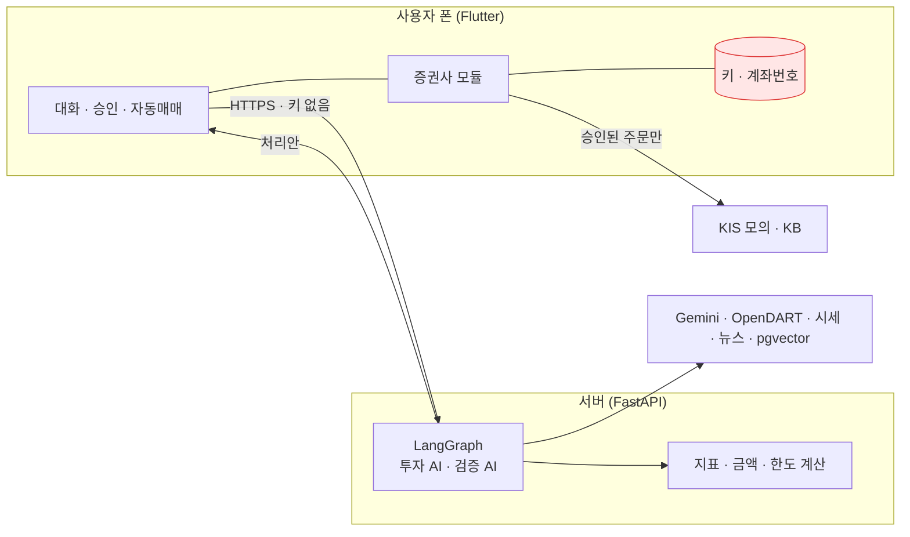

# 자연어 투자 에이전트

> "SK하이닉스 4주 사줘", "삼성전자 사도 돼?"처럼 말로 하면 **투자 AI가 제안하고 → 검증 AI가 원문을 다시 확인하고 → 사용자가 승인한 주문만 사용자 폰에서** 증권사로 나가는 앱.
> 모의투자에서는 이 흐름 그대로 **AI가 사람 손 없이 사고파는 자동매매**를 매일 돌리며 판단 로직을 고치고 있다.

LLM이 돈을 다룰 때 생기는 문제(지어낸 숫자, 근거 없는 확신, 키 유출, 사용자가 모르는 주문)를 **구조로 막는 것**이 중심이다.

> **지금 상태 (2026-10-16, 모의 자동매매 6일차)**
> 아직 **수익은 나지 않았다**. 6일 누적 계좌 **−5.71%**, 같은 기간 코스피 **−16.69%**.
> 10/16 반등장에서 AI가 하루에 6종목을 샀고 장중 **+1.64%**(30분마다 찍은 캡처 기준)까지 갔지만 **−0.34%**로 마감했다. 14:32에 하루 AI 분석 한도(100번)가 차서, 계좌가 빠지는 오후 1시간 동안 AI가 보유 종목을 한 번도 판단하지 못했다. 장 마감 뒤 한도와 매도 판단을 고쳤다 (아래 3장).
> 코스피보다 덜 빠진 것은 대부분 현금 비중 덕이고, 종목을 잘 골라서가 아니다.
> 매일 장이 끝나면 AI의 판단 기록을 다시 보고 원인을 찾아 고친다. 지금은 **AI를 조정하는 단계**다.

`Python · FastAPI · LangGraph · Gemini · PostgreSQL/pgvector · Flutter · KIS 모의투자 API · KB증권 Open API · Qwen2.5 LoRA` · 테스트 서버 312 / 앱 39

---

## 1. 핵심 수치

| 영역 | 결과 |
|---|---|
| 모의 자동매매 (10/8~10/16, 6거래일, 1,000만 원) | 누적 **−5.71%** vs 코스피 −16.69%. 체결 매수 12·매도 8. 수익 아직 없음 |
| 매일 고친 AI 판단·검증 로직 | 6일 동안 **40개 이상** (날마다 문제 → 원인 → 고친 것 → 테스트를 [수정 기록](docs/AI_CHANGELOG.md)에 남김) |
| 검증 AI 오류 주입 (틀린 제안 20개 × 3회) | 평균 **19.3/20** 차단, 멀쩡한 제안 30개 오탐 **0** |
| 1·2일차 제안 재점검 | 승인됐지만 빠진 것이 있던 제안 발견 → 코드 검사 보강 후 10/12 승인 33건 중 **23건을 다시 잡음** |
| 10/8 손실 원인 재현 | 고친 로직으로 그날 자료를 다시 넣자 하락 중 매수를 **12번 모두 거름** (수익 검증은 아님) |
| 요청 이해 골든 세트 | **77/77** 문장, 248항목 정답, 중앙값 1.6초 |
| 성향 신호 파인튜닝 (Qwen2.5-1.5B LoRA) | 정확도 34% → **83%**, 위험 놓침 0.4% (Gemini와 같음), 4배 빠름 |
| 백테스트 (1년, 생존 편향 제거) | 앱 규칙 **+36.7%** vs 동일 비중 +29.8% |
| 공시 RAG | 151종목 공시 11,967건, 본문 **29,352조각** 임베딩 |

## 2. AI가 어떻게 사고파나

### 하루 일과 (사람은 아침에 계획만 승인)

| 시각 | 누가 | 하는 일 |
|---|---|---|
| 07:00 · 14:00 | 서버 | 공시·재무·일별 종가 자동 수집 (14시는 전 거래일 종가) |
| 08:20 | 서버 | 아침 브리핑: 상승 추세 종목을 20거래일 등락률이 강한 순으로 후보 3개를 골라 투자 AI → 검증 AI로 미리 판단 |
| 아침 | 사람 | 앱에서 "오늘 계획" 승인 (살 총액, AI 매도 허용). 승인 안 하면 그날은 아무것도 안 함 |
| 09:05~15:20 | 폰 | 승인된 후보를 실시간 시세로 다시 검증해서 매수. "관찰"이면 30분 뒤 다시 |
| 10~14시 매시 | 폰 → 서버 | KIS 거래대금·상승률 상위 종목을 새 후보로 넣어 다시 판단 (2시간 안에 관찰한 종목은 빼고 다음 순위) |
| 09:30~15:28 | 폰 | 보유 종목을 30분마다 AI에게 "팔까?" 질문. 종목 ±3%, 코스피 −1.5%, 손절선 −7%, **오늘 최고 +2% 넘은 뒤 1.5%p 돌려줌**이면 바로 질문, **14:30 마감 전 점검** 한 번. 팔지는 AI가 "판다·든다"를 같은 무게로 비교해 정한다. **−10%면 AI에게 묻지 않고 절반, −15%면 전부 손절** (주문은 검증 AI를 거침) |
| 매수할 때 | 폰 | 코스피가 20일 평균 아래(하락장)이거나 그 종목이 오늘 −3% 넘게 빠졌으면 **종목당 몫의 절반만** |

### 판단 한 번의 흐름

```
폰: 잔고 · 현재가 · 1분봉 · VWAP · 시장 지수를 증권사에서 읽음 (키는 폰에만)
 → 서버: 자료 모으기 (공시 원문 RAG, 재무, 종가, 뉴스) + 코드가 지표 계산 (추세, 시장 국면, 세후 손익)
 → 투자 AI: 허용된 행동(매수·관찰·보유·매도) 중 하나 + 근거마다 출처 ID
 → 코드 검사: 없는 출처, 금액 단위, 뉴스를 사실로, 묵은 자료, 하락 중 매수 → 걸리면 반려
 → 검증 AI: 결론은 안 보고 출처 ID로 원문을 다시 읽어 대조 → 반려면 투자 AI가 고쳐 다시 (최대 2번)
 → 정책 검사 (금액·비중·장 시간, 코드) → 폰이 증권사에 주문 → 체결 기록
```

### AI에게 주는 자료 (숫자는 전부 코드가 계산하고 AI는 인용만)

| 자료 | 내용 | 넣은 날 |
|---|---|---|
| 공시 원문·재무 | 정기보고서·주요사항보고서 조각 최대 6개, 주요 계정 | 처음부터 |
| 현재가·장중 흐름 | 1분봉 최근 30개, 오늘 VWAP(거래량 가중 평균가), **5분 저가 연속 하락 / 저점에서 반등 중**, 오늘 시가·고가와 **고가 때·지금 수익(돌려준 폭)**, **하루 동안 본 현재가 흐름(시간별)** | 10/8, 10/14, 10/15, 10/16 |
| 시장 지수 | 코스피·코스닥 등락, 1·5·20거래일 흐름, 연속 하락, 20일 평균 대비 | 10/12, 10/14 |
| 추세 | 20·60일 평균 대비, 20일 평균 방향, 시장 대비 강도, 20일 고점 대비 | 10/14 |
| 계좌 | 보유 수량·평균가, **세금·수수료 뺀 지금 팔면 손익** | 10/14 |
| 뉴스 | 제목·언론사·링크만. 공시로 확인 안 되면 "보도에 따르면" 추론으로만 | 10/8, 10/14 |

## 3. 날마다 고친 것과 성과

| 날 | 시장 | 계좌 (그날) | 무엇이 잘못됐나 | 그래서 고친 것 |
|---|---|---|---|---|
| 10/8 (1일차) | 코스피 −2.62% | 산 종목 −1.52% | 장중 하락 중에 샀다 (반대 근거에 적고도 매수). 시장 지수·뉴스를 안 봄 | 자동 주문은 AI가 "관찰"로 거절 가능, 뉴스 출처, 주문 사고 5건 수정 |
| 10/12 (2일차) | −3.65% | 보유 −4.03% | 시장 급락을 못 봄. 분석 한도가 차서 3시간 판단이 멈췄는데 "보유"로 기록됨 | **시장 지수**를 AI 근거로, 시장 급락 시 즉시 재판단, **AI가 매도 수량(전부·절반)** 결정, 실패는 따로 기록 |
| 10/13 (3일차) | −5.46% | **−1.78%** | 시초가 급락 때 판 3종목 모두 종가가 더 높았다 (약 7.9만 원). 검증 반려 48건 중 35건이 "뉴스를 사실로" | 조건부 승인으로는 안 삼, 묵은 자료 검사, 사는 판단 30분 주기, 급등·거래대금 후보, 모의 한도 해제 |
| 10/14 (4일차) | −0.44% | **−0.03%** | 상승 추세 후보(삼성SDI +5.00%)를 위험을 이유로 안 삼. 검사 코드 버그로 판단 9번이 결론 없이 끝남 | 아래 4장 (공개 매매 기준 점검), **절반 매수**, 관찰 판단 점수 |
| 10/15 (5일차) | **−7.57%** | **−0.16%** | 후보를 "최근 공시 종목"으로 골라 같은 하락 종목을 5번 다시 보고 5번 관찰. 급락일엔 상승 추세 종목도 반등과 상관없이 관찰 | 장중에: **후보를 상승 추세·강한 순으로**, **반등 확인 뒤 절반 매수**, 뉴스 반려 완화. 마감 뒤: 상승 추세 관찰 종목 실시간 재판단, 흑자 전환 지표 수정, **강제 손절(−10% 절반·−15% 전부)**, **하락장 절반 매수** |
| 10/16 (6일차) | **+2.05%** | **−0.34%** (장중 +1.64%) | 하루에 6종목 매수. **14:32 분석 한도(100)가 차서 15:27까지 26번 거절 (보유 종목 매도 판단 17번)**, 그 사이 계좌 +0.76% → −0.93%. 그 전 판단도 이익 중인 종목은 모두 보유. 오후에 산 3종목 −2~3%. 실행 직전 가격이 바뀐 처리안을 체결로 오인 | 장중에: 재승인 버그, 계산 불가 지표 ID 떼기, 서버 자동 시작·놓친 브리핑 따라잡기. 장 마감 뒤: **분석 한도 150·보유 종목 몫 30**, 오늘 최고에서 이익을 돌려주면 바로 묻기·14:30 마감 전 점검, AI 자료에 오늘 시가·고가·하루 흐름, 투자 AI가 "판다·든다"를 같은 무게로 비교 (숫자 규칙 대신 AI 판단). [장중 캡처](docs/reports/live-20261016.md#2-장중-캡처-앱-자산-화면) |

10/14에는 웹에서 찾은 매매 기준과 지금 로직을 비교하는 점검을 했다 → [점검 보고서](docs/reports/ai-audit-20261014.md)

**효과가 확인된 것**
- 하락 중 매수: 10/8 손실 원인이 된 판단을 고친 로직으로 재현하면 12번 모두 거른다 (10/14부터는 코드가 직접 막음)
- 공포성 매도: 장 시작 30분 규칙 이후(10/14) 시초가 매도 0건
- 매도 수량 나누기: 10/13 NH·셀트리온을 절반씩 세 번 나눠 팖
- 뉴스를 사실로 쓰는 반려: 10/13 35건 → 10/14 13건
- 실시간 재확인: 10/15 폭락일에 서버가 "매수 검토"로 고른 종목을 앱이 실시간 시세로 다시 보고 3번 멈춤. 그때 샀으면 종가 기준 −9.81%(삼성SDI), −12.44%(피에스케이홀딩스)

**장중 기록 (10/16, 앱 자산 화면 자동 캡처)**

| 14:10 장중 최고 부근 | 15:31 마감 |
|---|---|
|  |  |

총자산 9,616,136원(14:10 캡처) → 9,428,986원(15:31). 오른 만큼 돌려준 것이 다음에 고칠 점이다 (이익 실현 선).

**아직 모르는 것**
- 수익. 5일은 하락장, 6일차 첫 반등장에서도 −0.34%로 마감했다. 체결된 매수는 12건이다
- 반등 매수가 효과가 있는지. 10/16에 처음 동작해 6종목을 샀지만, 오전에 산 2종목만 이익이고 하루 결과로는 판단하기 이르다 ([6일차 판단 돌아보기](docs/reports/live-20261016.md#3-판단을-돌아보면))
- 바꾼 매도 판단이 실제로 빠지는 구간에서 파는지. 10/16 오후 보유 판단 10건을 새 지시로 다시 돌려 보니 모두 보유였다 (그때는 VWAP 위·반등 중). 하락 구간은 판단이 막혀 다시 볼 자료가 없다 → 다음 거래일에 확인
- 하루 매수 한도, 늦은 시각 매수 제한 (사용자와 정할 것)
- AI가 너무 조심스러운지. 그래서 **관찰 판단 점수**를 만들어 매일 쌓는다

| 날 | AI가 "관찰"한 후보의 그날 평균 | 놓친 기회 (+2% 넘게) | 피한 손실 (−2% 넘게) |
|---|---|---|---|
| 10/13 | **−2.91%** | 1 | 2 (에이피알 −19.60%) |
| 10/14 | **+2.00%** | 3 (삼성SDI +5.54%) | 0 |
| 10/15 | **−8.87%** | 0 | 11 (고영 −14.80%) |

빠지는 날(10/13, 10/15)은 관찰이 손실을 피했고, 덜 빠지는 날(10/14)은 기회를 놓쳤다. 오르는 날 데이터가 아직 없다. (10/14는 공공데이터 종가, 10/15는 KIS 모의 종가)

날짜별 리포트·원자료(JSON): [docs/reports/README.md](docs/reports/README.md) · 고친 내역 전체 (문제 → 파일·함수 → 조절 값 → 테스트): [docs/AI_CHANGELOG.md](docs/AI_CHANGELOG.md)

## 4. 공개 매매 기준과 비교한 점검 (10/14)

1~3일차 기록과 코드를 실무 관례와 논문 기준에 비춰 봤다. AI가 받는 지표는 PER·PBR·실적·변동성뿐이어서 **언제 살지 볼 근거가 없었다**.

| 기준 | 근거 | 적용 |
|---|---|---|
| 20·60일 평균 위, 평균이 오를 때 매수 | 실무 관례 | 추세 자료 (코드 계산) |
| 지수가 평균 아래면 매수를 줄임 | Faber (낙폭 감소 효과) | 지수 20일 평균 대비 |
| 떨어지는 칼날을 잡지 않음 | 실무 관례 | 5분 저가 3번 연속 하락 + VWAP 아래면 **자동 매수를 코드가 막음** |
| 장 초반 30분 움직임은 이어지지 않음 | KAIST, KOSPI 809종목 | 9:00~9:30은 손절선만 질문 |
| 한국 개별 종목은 급등 뒤 되돌림 우세 | 1983~2023 한국 연구 | +10% 넘게 오른 종목은 후보에서 뺌 |
| LLM은 계산·정보 중요도 판단이 약함 | StockBench, FinMem | 모든 숫자는 코드가 계산, AI는 인용만 |
| 분할 진입 | 실무 관례 | 추세는 좋은데 위험이 크면 **절반 매수**, 다음 판단에서 나머지 |
| 손실 제한 (손절) | O'Neil 등 실무 관례 | 10/15부터 −10% 절반·−15% 전부는 AI 판단 없이 (AI가 급락일마다 보유를 골라 −7% 손절선이 걸리지 않았다) |
| ATR 손절, 이익 실현 규칙 | O'Neil, Van Tharp | **보류**: 고가·저가 일봉이 없고, 손익을 크게 바꾸는 규칙이라 데이터를 더 본 뒤 |

## 5. 검증: 틀린 제안을 거르나

**두 겹으로 막는다**: 확실한 것은 코드가 막고(출처 ID 존재, 금액 단위, 다른 종목 자료, "위험 없다" 문구, 뉴스만 출처인 사실, 묵은 자료), 판단이 필요한 것은 검증 AI가 원문과 대조한다.

| 오류 주입 평가 | 차단 | 바꾼 것 |
|---|---|---|
| 처음 | 15/20 | — |
| 코드 검사 보강 | 19/20 | 출처 종목 대조, 금액 단위·크기 대조, "위험·비용 없다" 문구 |
| 검증 AI 지시 수정 | **18 · 20 · 20 (평균 19.3)** | 코드 경고를 원문과 다시 대조 |

- 원래 제안서 30개는 모두 승인 (오탐 0). 평가 중 투자 AI의 실제 실수("78조 9,548조 원")도 잡았다
- **검사 코드도 틀린다**: 10/14에는 AI가 맞게 쓴 공시 금액을 검사가 못 읽어 9번 반려했다. 장 마감 뒤 기록을 다시 보고 찾아 고쳤다. 검사가 판단을 막으면 그것도 버그로 다룬다

평가 전체: [docs/reports/evaluation-20261010.md](docs/reports/evaluation-20261010.md)

## 6. 적용한 기술

### LangGraph: 대화가 주문이 되기까지

```
사용자 말 → rewrite("그거" 풀기) → classify ─┬ 조회    → fetch 멈춤 → 폰이 증권사에서 잔고·시세를 읽어 답함
                                              ├ 분석    → gather → 투자 AI → 검증 AI ─(반려)→ 투자 AI (최대 2번)
                                              ├ 주문    → 계좌(fetch) → gather → 투자 AI → 검증 AI → 정책 검사
                                              │           → approval 멈춤 → execute 멈춤 → 체결 기록
                                              └ 결과·기록·용어 → DB 기록으로 답 (LLM은 분류만)
```

- **멈춤(interrupt)으로 "서버는 키가 없다"를 구현**: 증권사 일이 필요하면 그래프가 멈추고 폰이 답해야 넘어간다 (`fetch` 조회, `approval` 승인, `execute` 주문, `question` 되묻기)
- **Postgres 체크포인트**: 앱을 껐다 켜도 승인 대기 대화가 이어진다. 10/8 재현 때 그날의 현재가·1분봉을 체크포인트에서 꺼내 썼다
- **분석 노드 재사용**: 주문 그래프가 분석과 같은 노드를 써서, 직접 지시한 주문도 자동매매 주문도 검증 없이 처리안이 될 수 없다
- **LLM 호출은 `llm.py` 한 곳**: 요청 이해 3번 호출을 1번으로 합쳐 6~10초 → 약 1.4초. 테스트는 이 파일만 가짜로 바꿔 비용 0

### RAG: 공시 원문을 근거로

- 코스피 100 + 코스닥 50, 공시 11,967건 → 정기보고서·주요사항보고서 본문 **29,352조각** (표 보존 14,251), Gemini embedding 768차원 + pgvector
- 요청 문장 + 고정 관점 3개(실적, 위험 요인, 사업 전망)로 검색해 위험 요인이 빠지지 않게 했다. 거리 기준은 실측으로 정함 (관련 문단 0.33~0.56)
- HNSW 색인이 종목 필터 전에 후보를 골라 **150종목 중 115종목 결과가 빈** 문제 → 종목 조각만 먼저 고르고 정확히 재는 방식으로 해결
- 조각마다 `dart:{접수번호}#{순번}` ID. 검증 AI는 투자 AI가 본 글이 아니라 **ID로 원문을 다시 불러와** 대조한다

### 성향 신호 파인튜닝

"다음 달 방 빼야 하는데 그 돈 굴려볼까" 같은 말 속 위험 신호 6종을 고르는 모델.

| 방법 | test (293) | hard (57) | 위험 놓침 | 문장당 |
|---|---|---|---|---|
| 키워드 규칙 | 49.5% | 24.6% | 40.3% | 0ms |
| Gemini 프롬프트 | 92.2% | 100% | 0.4% | 1,335ms |
| **Qwen2.5-1.5B LoRA** | 33.8% → **83.3%** | 36.8% → **96.5%** | **0.4%** | **303ms** |

가상 문장 1,500개, 말투로 학습·시험 분리, RTX 5060 Ti에서 GPU 메모리 16GB → 3.7GB. 실제 사용자 정확도는 미확인.

### 백테스트 (2025-10 ~ 2026-10, 235거래일)

매일 그날 기준 시가총액 상위 150종목을 다시 골라 생존 편향을 뺐고, 왕복 비용 0.23%를 넣었다.

| 전략 | 그날 기준 대상 | 살아남은 종목만 (편향) |
|---|---|---|
| 동일 비중 | +29.8% | +76.4% |
| **앱 브리핑 규칙** | **+36.7%** | +57.4% |
| 모멘텀 (5일 상승 상위 3) | −64.6% | +134.0% |

같은 모멘텀 전략이 편향 때문에 −64.6%에서 +134.0%로 부풀려진다. 과거 결과는 미래를 보장하지 않는다.

## 7. 설계

| 원칙 | 구현 |
|---|---|
| 서버는 증권사 키를 모른다 | 키는 폰 보안 저장소에만. 서버는 처리안까지, 주문은 폰이 직접 |
| 모든 주문은 3단계 | 투자 AI → 검증 AI → 사용자 승인 (자동매매는 아침 계획 승인). 정정·취소도 같은 길 |
| 검증 AI는 독립적 | 결론 없이 제안·출처 ID만 받아 원문을 다시 읽고 판정 |
| 숫자는 코드가 | LLM은 판단·문장만. 지표·금액·한도·세금·수수료는 코드가 계산 |
| 실패를 판단으로 기록하지 않는다 | 한도·오류 실패는 따로 기록 (10/12 교훈) |
| 기본은 모의투자 | 실전 모드는 직접 켜야 하고, 실계좌 주문은 사람이 직접 |



## 8. 실행

`apps/api/.env.example`을 `.env`로 복사해 키를 채우고, PostgreSQL(pgvector)을 띄운다.

```bash
uv --directory apps/api run python -m app.migrate
```

```bash
uv --directory apps/api run uvicorn app.main:app --port 8000
```

```bash
cd apps/client && flutter run --dart-define-from-file=dev_keys.env
```

```bash
uv --directory apps/api run pytest
```

관찰 판단 점수 (그날 종가가 수집된 다음 날):

```bash
uv --directory apps/api run python -m app.scorecard 2026-10-14
```

## 9. 한계와 다음 과제

- **수익 미검증**: 모의 자동매매 5거래일(모두 하락장), 체결 매수 6건. 전략을 판단하려면 수십 거래일이 필요하다
- 코스피보다 덜 빠진 것은 현금 비중 덕이다. 종목 선택 실력으로 보지 않는다
- **5일차에 찾은 문제** ([자세히](docs/reports/live-20261015.md#4-문제점)), 장 마감 뒤 4개 고침:
  - 반등 매수 신호(1분봉·VWAP)는 앱의 실시간 재확인에만 있는데, 서버 브리핑(실시간 시세 없음)이 관찰로 끝내 닿지 못함 → 상승 추세 관찰 종목은 앱이 실시간으로 다시 판단
  - 재무 지표가 적자 → 흑자 전환을 "105.79% 증가"로 계산해 검증 AI가 4번 반려 → "흑자 전환"으로 표시
  - AI가 출처 ID를 잘못 씀(`market:KDAQ` 등) → 코드가 바로잡음. 보유 종목 판단이 '관찰'로 나오면 '보유'로
  - 손절도 AI가 판단해서 급락일에는 손절선 아래(−9.16%)에서도 계속 보유 → 사용자 결정으로 **−10% 절반·−15% 전부 강제 손절**, 하락장(코스피 20일 평균 아래)에는 종목당 몫 절반
- 다음 과제: 관찰 판단 점수를 쌓아 AI가 너무 조심스러운지 확인, 절반·반등 매수 효과 확인, ATR 손절·이익 실현 규칙(일봉 고가·저가 필요), 수급(외국인·기관)·업종 지수
- KB증권 실전 연결은 실제 키로 확인 전이다. 실계좌 주문은 사람이 직접 한다

## 문서

| 문서 | 내용 |
|---|---|
| [docs/reports/README.md](docs/reports/README.md) | 날짜별 성과 모음 (요약·리포트·원자료 JSON) |
| [docs/AI_CHANGELOG.md](docs/AI_CHANGELOG.md) | AI 판단·검증 수정 기록과 조절 값 |
| [docs/reports/ai-audit-20261014.md](docs/reports/ai-audit-20261014.md) | 공개 매매 기준과 비교한 점검 |
| [docs/reports/2026-10-08-mock-auto-trading.html](docs/reports/2026-10-08-mock-auto-trading.html) | 1일차 원인 분석·재현 |
| [docs/plan/PROGRESS.md](docs/plan/PROGRESS.md) | 개발 진행 상황 |

모의투자 결과이며 투자 권유가 아니다.
