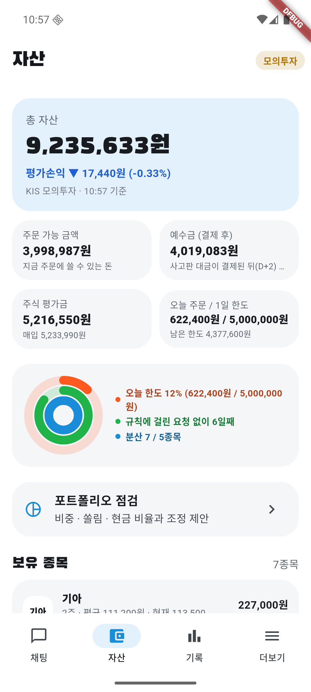
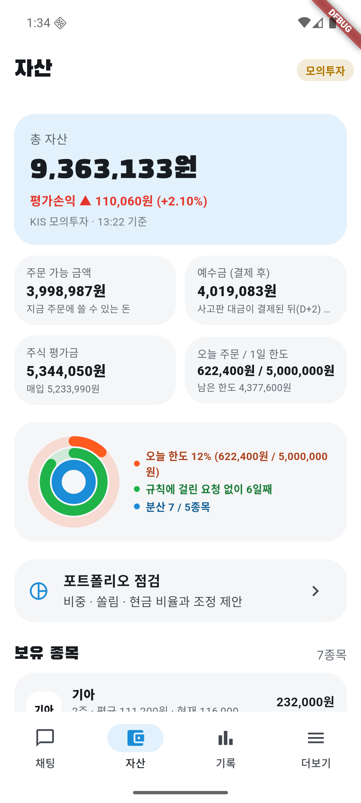
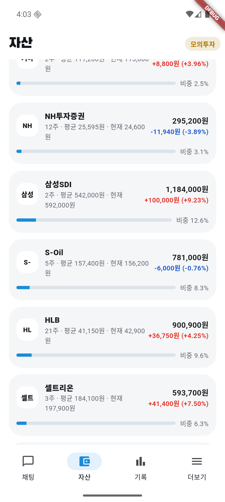
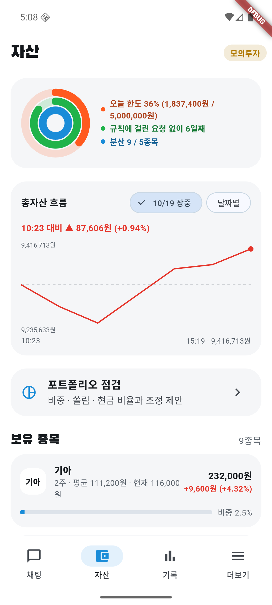

# 10/19 모의 자동매매 7일차: 아침 급락에 손절, 오후 반등으로 거의 다 회복

- 계좌: KIS 모의투자 (10/8 시작 1,000만 원)
- 기준: 앱 자산 화면 캡처 (마감 값은 16:03 캡처의 "15:19 기준" 잔고), 서버 기록(주문·AI 판단·검증)
- 사람이 한 일: 아침에 오늘 계획 승인. 장중 1시간마다 점검·캡처. 주문·매도 결정에는 손대지 않음. 장중에는 앱을 다시 빌드하지 않았다 (고친 것은 모두 장 마감 뒤 반영)
- 이날 코스피: 장 초반 **약 −2%**(09:05 −1.98%) → 15시 무렵 **약 +1.1~1.4%** (AI 판단에 인용된 앱 실시간 값). **종가는 미확인**
- 이날 처음 적용: 분석 한도 150·보유 몫 30, 오늘 최고에서 돌려준 이익 보고 바로 묻기, 14:30 마감 전 점검, 하루 흐름·시가·고가 자료, 변동성 기준 수량 + 주식 비중 70%

## 1. 결과

| | 값 |
|---|---|
| 총자산 | **9,416,713원** (전날 9,428,986원, 15:19 잔고 기준) |
| 하루 | **−0.13%** (장중 최저 9,235,633원 10:57, **−2.05%**) |
| 잘된 점: 바닥에서 회복 | 10:57 최저 → 15:19 **+181,080원 (+1.96%)** |
| 잘된 점: 남은 종목 | 평가손익 전날 −81,690원 → **+163,810원** (**+245,500원 개선**, 손실 → 이익 전환). 하루가 −0.13%인 것은 아침에 판 3종목의 손실 −249,100원이 확정됐기 때문 |
| 7일 누적 (시작 1,000만 원 대비) | 계좌 **−5.83%**. 코스피 누적은 종가 미확인 |
| 오늘 체결 | **매도 4건**, **매수 3건** (1,837,400원어치). 주문 실패 0 |
| 판 것의 확정 손익 (계산) | **−249,100원** (매입가 대비, 세금 7,881원 별도) |
| 현금 | 2,803,913원 (아침 708,086원 → 주식 비중 92%에서 약 70%로) |
| 남은 종목 평가손익 | +163,810원 (+2.54%) |
| AI 판단 | 127건 (보유 72, 관찰 26, 매수 검토 21, 매도 검토 8). 검증 반려 9번 (모두 고쳐서 승인) |
| 분석 한도 | 127/150. 보유 종목 판단이 막힌 일 없음 (10/16은 14:32에 한도가 차서 막힘) |

### 판 종목

| 시각 | 종목 | 수량 | 체결가 | 매입가 대비 | 왜 팔았나 (앱 기록·AI 근거) |
|---|---|---|---|---|---|
| 09:18 | 한화시스템 | 22 (전부) | 74,000 | **−9.09%** | 손절선(−7%)에 닿아 AI에게 물음 → 매도. 오늘 고가 79,400원에서 −6.8%, VWAP 아래 |
| 09:37 | 피에스케이홀딩스 | 1 (전부) | 187,900 | −3.74% | 오늘 매입가 대비 **+4.76%까지 갔다가 −3.74%** (이익 8.5%p 돌려줌). 새 "돌려줌" 판단의 첫 매도 |
| 09:39 | 솔브레인 | 4 (전부) | 323,500 | −6.37% | 급락(−6.5%)이라 물음 → 매도. 20·60일 평균 아래로 내려감. 처음엔 1주만 체결, 나머지 3주는 뒤에 체결 |
| 10:38 | HLB | 20 (41주 중) | 41,600 | **+1.09%** | 오늘 고가 42,550원에서 2.4%p 돌려줌 → 절반 매도 |

판 뒤 그날 종가로 판 게 맞았는지는 **미확인** (공공데이터 종가가 다음 날 수집된다). 10/13엔 시초가에 판 3종목이 모두 다시 올랐다. 오늘은 장 시작 30분 규칙 때문에 09:30 전에는 손절선(한화시스템)만 물었다.

### 산 종목

| 시각 | 종목 | 수량 | 체결가 | 어떻게 정했나 |
|---|---|---|---|---|
| 10:02 | SK이노베이션 | 4 | 155,600 | 주식 비중 70% 상한 안에서. 시장 −12.6%(5일)인데 상대 강도 +23%p |
| 13:33 | S-Oil | 5 | 157,400 | 13:00 관찰 → 13:33 반등 확인 뒤 매수 |
| 14:01 | LG에너지솔루션 | 1 | 428,000 | **악재 공시 뒤 매수** (아래 3장) |

### 남은 종목 (16:03 캡처, 매입가 대비)

삼성SDI **+9.23%** (오늘 +10%), 셀트리온 +7.50%, HLB +4.25%, 기아 +3.96%, S-Oil −0.76%, NH투자증권 −3.89%. SK이노베이션·고영·LG에너지솔루션은 캡처 아래쪽이라 숫자 미확인.

## 2. 장중 흐름 (앱 자산 화면 캡처)

| 시각 | 총자산 | 무엇이 있었나 |
|---|---|---|
| 06:40 (전날 마감) | 9,428,986원 | |
| 09:18~09:39 | | 손절·급락으로 3종목 매도 (코스피 약 −2%) |
| 10:22 | 9,326,007원 | SK이노베이션 매수 (10:02) |
| 10:39 | 9,275,733원 | HLB 절반 매도 직후 (자동 캡처) |
| 10:57 | **9,235,633원** | 오늘 최저 (−2.05%) |
| 11:56 | 9,301,883원 | |
| 12:56 | 9,366,833원 | 코스피 상승 전환 |
| 13:56 | 9,368,073원 | S-Oil 매수 (13:33) |
| 14:56 | 9,378,413원 | LG에너지솔루션 매수 (14:01) |
| 15:19 (마감 캡처) | **9,416,713원** | |

| 10:39 HLB 매도 | 10:57 최저 | 13:33 S-Oil 매수 | 마감 |
|---|---|---|---|
|  |  |  |  |

마감 보유 종목: 

1시간마다 정기 캡처(`HHMM_regular`)와 주문이 생길 때 자동 캡처(`HHMM_buy|sell_종목코드`)를 찍었다. 계좌번호는 화면에 없다.

## 3. 판단을 돌아보면

- **들고 간 종목은 오늘 잘 버텼다**: 남은 종목 평가손익이 −81,690원에서 +163,810원으로 +245,500원 좋아졌다 (삼성SDI +10%, 셀트리온·HLB 반등). 계좌는 바닥(10:57)에서 +1.96% 회복해 전날과 거의 같게(−0.13%) 마감했다
- **새 매도 판단이 처음 동작했다**: "오늘 최고에서 돌려준 이익"을 보고 판 것이 2번(피에스케이홀딩스, HLB 절반). KIS 모의 응답에 오늘 시가·고가가 실제로 온다 (10/16에 미확인으로 남긴 것). AI 근거에 "고가 79,400원", "시가 30,800원"이 들어갔다
- **아침 매도 4건 중 3건이 손실 확정** (−249,100원). 하락장 아침에 손절선·급락으로 팔았고, 오후에 시장이 반등했다. 판 종목의 종가는 미확인이라 판 게 맞았는지는 아직 모른다
- **보유 판단은 근거와 결론이 대체로 맞았다**: 보유 72건 중 근거가 모두 하락 쪽인데 결론이 보유인 것은 1건 (09:36 NH투자증권, 단어 기준 자동 분류). NH투자증권은 12번 다 보유였고, −6% 부근에서 −3.89%로 회복했다
- **매수는 급등 경고 오작동으로 거의 막혔다**: AI가 사자고 하고 검증 AI가 승인한 매수 처리안 **11건이 승인 대기로 만료**됐다. 코스피가 5일 −12.6% 빠진 하락장이라 5일 **+0.2%(대주전자재료)**, +2.7%(코웨이)도 "분석 대상 중 가장 많이 오른 편"으로 잡혔다. 자동매매가 산 기록이 "급등 경고를 받고도 산 습관"으로 쌓여, 자동매매 매수에도 확인을 받게 됐다
- **악재 공시 종목을 샀다**: LG에너지솔루션은 10/14 횡령·배임 혐의, 10/16 불성실공시법인 지정예고가 있었다. 오전엔 AI가 이 공시로 관찰했는데, 14:01 주문 직전 판단에서 "수량을 절반으로 줄인 분할 매수"로 바꿔 1주를 샀다
- **분석 한도는 남았다**: 127/150. 14:56에 안 가진 종목 몫(120)에 거의 닿았지만 보유 종목 몫 30번이 남아 오후 매도 판단이 계속됐다

## 4. 장 마감 뒤 고친 것

| 무엇이 있었나 | 어떻게 바꿨나 | 위치 |
|---|---|---|
| 09:05 코스피 −1.98%에 "보유 종목을 모두 다시 물어요" 기록만 남고 실제론 안 물음 (장 시작 30분 규칙). 알림이 소진돼 09:30 뒤 시장 급락 점검이 빠짐 | 장 시작 30분엔 시장 급락 알림을 쓰지 않는다 | `auto_trader.dart` `marketDropped`·`openingWait` |
| "하락장이라 절반만 사요"가 매수 판단 때마다 3번씩 기록됨 | 하루 한 번 | `auto_trader.dart` `_buy` |
| 급등 경고 오작동으로 매수 11건 만료 | 상위 10%이면서 **실제로 5일 +10% 이상**일 때만 급등 | 서버 `functions/orders.py` `HOT_MIN_RETURN` |
| 자동매매 주문이 "내 투자 습관"에 섞임 | 처리안에 `auto_origin`을 남기고 습관 집계에서 뺌 (예전 기록은 30일 지나야 빠짐) | `agents/order.py`, `functions/behavior.py` |
| 횡령·배임, 불성실공시를 위험으로 보지 않음 | 1등급(매우 높은 위험)에 추가. "미지정" 결정은 제외, 지정예고 뒤 미지정이면 풀림. 분석 대상 1등급 1개 → 8개 | `functions/suitability.py`, `collect.py` `refresh_risk_grade` |
| 1등급이면 적극투자형은 매수 제안 자체가 막혀 AI 판단을 확인할 수 없음 | **모의투자에서는 1등급도 AI가 매수를 판단** (사용자 결정). 1등급 근거 공시와 "감수할 근거가 없으면 관찰" 지시를 투자·검증 AI에게. 실전은 그대로 막음 | `suitability.py` `buy_block_reason(mock)`, `analysis.py` `grade_text` |
| 기록 화면에서 매수·매도 구분이 안 되고, 서버가 최근 100건만 보내 아침 매도가 잘림 | 매수(빨강)·매도(파랑) 태그와 필터, 서버에서 거름 | `history_page.dart`, `routers/history.py` |
| 하루 총자산 흐름을 앱에서 볼 수 없음 | 자산 탭 링 아래 총자산 그래프 (오늘 장중 / 날짜별). 폰이 정규장에만 총자산을 계산해 올림 | `equity_chart.dart`, `routers/snapshot.py` `GET /api/equity`, migration 020 |

| 기록 매도 필터 | 자산 그래프 (장중) | 자산 그래프 (날짜별) |
|---|---|---|
|  |  |  |

날짜별 그래프의 10/12~10/16 값은 날짜별 리포트의 마감 총자산, 오늘 장중 값은 위 캡처 값을 서버 기록에 붙여 넣은 것이다 (그 전엔 폰이 총자산을 올리지 않았다).

## 5. 문제점

1. **판 종목이 그 뒤 어떻게 됐는지 아직 모른다**: 오늘 종가 수집(다음 날) 뒤 확인
2. **아침 하락장 매도가 손실을 확정했다**: 4건 중 3건 손실. 손절선은 규칙대로지만, 시장 전체 급락(코스피 −2%)과 종목 문제를 AI가 어떻게 구분했는지 다시 볼 것
3. **관망(watch)으로 바뀐 자동매매 매수도 승인 대기 처리안이 생긴다**: 설계대로 자동 승인은 안 되고 만료되지만 처리안 목록이 지저분하다 (`agents/order.py` 244줄)
4. **마감 값이 15:19 잔고 기준이다**: 15:20~15:30 동시호가 뒤 종가로 다시 계산한 총자산은 미확인. 장 뒤(17:07)엔 시간외 가격으로 9,425,263원
5. 점검 스크립트가 AI 답변 안의 "오류" 단어를 실패로 잘못 셌다 (리포트 숫자에는 영향 없음)

## 6. 다음에 볼 것

- 급등 경고 기준을 고친 뒤 자동매매 매수가 실제로 나가는지
- 1등급(악재 공시) 종목을 AI가 사는지, 산다면 며칠 뒤 결과 (오늘 LG에너지솔루션 1건이 첫 사례)
- 장 시작 30분 뒤 시장 급락 점검이 실제로 도는지
- 판 4종목과 관찰 종목의 종가 점수 (`python -m app.scorecard 2026-10-19`)

모의투자 결과이며 투자 권유가 아니다.
