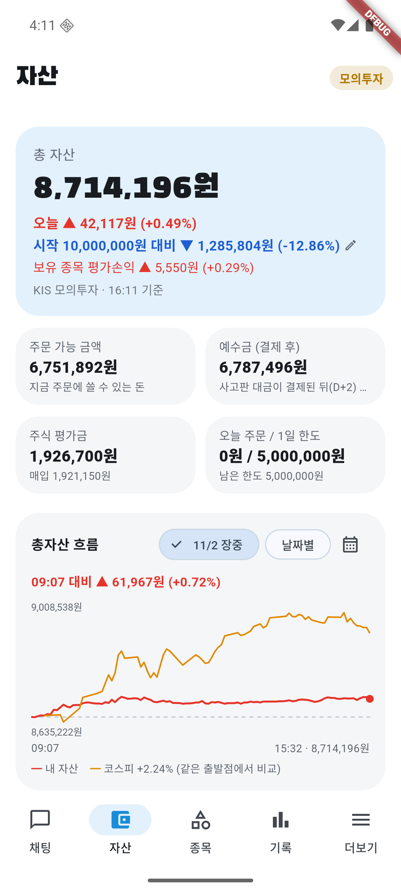
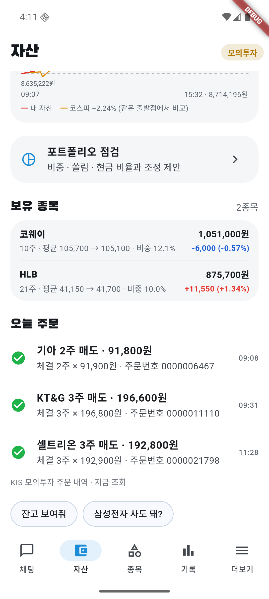

# 11/2 모의 자동매매 17일차: 코스피 +2.24%에 계좌 +0.49%, 하락장 규칙 때문에 새 매수 없음

- 계좌: KIS 모의투자 (10/8 시작 1,000만 원)
- 기준: 앱 자산 화면의 16:11 값 **총자산 8,714,196원**. 15:32 그래프 마지막 값(8,714,196원)과 같다. KIS 일봉 종가로 다시 계산한 값과의 대조는 **못 했다** (미확인).
- 이날 코스피 **+2.24%** (앱 그래프, 장중 판단 근거에는 +2.88%까지 나왔다). 코스피 20일 평균 아래 여부는 앱 기록으로만 확인했다: 09:07 "하락장이라 새로 사지 않아요".
- 사람이 한 일: 서버·에뮬레이터·앱을 켜고 오늘 계획을 승인(09:07, 사용자 지시), 장중 1시간마다 점검·캡처. 주문은 직접 내지 않음.
- 하이브·LG에너지솔루션·SKC(영업적자)는 신규 후보에 한 번도 없었다.

## 1. 결과

| | 값 |
|---|---|
| 총자산 | **8,714,196원** |
| 하루 | **+0.49%** (+42,117원). 코스피 +2.24% → **코스피보다 1.75%p 못함** |
| 시작 대비 | **−12.86%** (코스피 누적은 이날 값을 안 구해 **미확인**) |
| 오늘 주문 | 체결 **3건** (전부 매도). 매수 0건 |
| 현금 | 6,787,496원 (총자산의 약 78%). 주식 평가금 1,926,700원 (코웨이 10주, HLB 21주) |

### 판 종목

| 시각 | 종목 | 수량 | 체결가 | 어떻게 정했나 |
|---|---|---|---|---|
| 09:08 | 기아 | 2 | 91,900 | 매입가 대비 −17.4%라 강제 손절선(−15%)으로 전부 매도. 검증 AI를 거침. 10/30에 체결 안 된 그 주문의 후속 |
| 09:31 | KT&G | 3 | 196,800 | 매입가 대비 +1.2%, 투자 AI 매도 제안·검증 승인 |
| 11:28 | 셀트리온 | 3 | 192,900 | 매입가 대비 +1.3%, 투자 AI 매도 제안·검증 승인 |

## 2. 왜 돈을 쓰지 않았나

- 현금이 78%인데 주식 비중은 약 22%로 비중 한도(70%)·하루 한도(500만 원, 사용 0원)와 상관없다.
- 앱 기록 09:07에 "코스피가 20일 평균 아래(하락장)라 새로 사지 않아요". 이 판정은 종가 기준이라 하루 종일 유지된다.
- 14:01 삼성E&A, 14:36 HMM이 새 매수 후보로 올라와 검증을 통과했지만 규칙에 막혀 주문이 나가지 않았다.
- 이 규칙을 푸는 변형(몫의 10~50%만 사기, 평소대로)을 과거 1년으로 시험했더니 모두 지금보다 나빴다 → [시험 6절](sim-20261101.md). 그래서 규칙은 그대로 둔다.

## 3. 점검

- 서버·앱 로그 오류 없음. HMM 시세 조회가 한 번 시간 초과였으나 판단은 이어졌다.
- 코웨이·HLB는 보유로 승인(오후 점검 매번). 승인 판단 글에서 "20일 평균 아래"인 삼성전자·SK하이닉스 등은 관찰.
- **미확인**: 체결 안 된 자동 매도를 5분 뒤 취소하는 기능(10/30 추가)은 이날도 미체결 주문이 없어 실제 동작을 못 봤다.

## 4. 화면

| 시각 | 화면 |
|---|---|
| 16:11 마감 |   |
