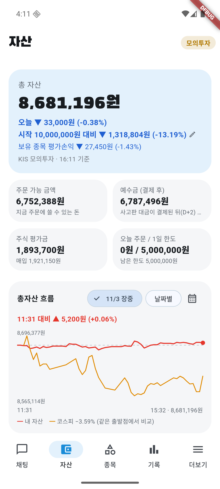
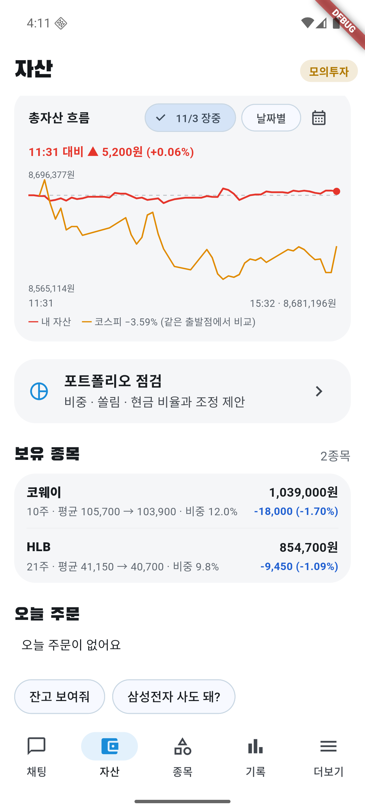

# 11/3 모의 자동매매 18일차: 코스피 약 −3.7% 급락에 계좌 −0.38%, 하락장 규칙으로 주문 0건

- 계좌: KIS 모의투자 (10/8 시작 1,000만 원)
- 기준: 앱 자산 화면의 16:11 값 **총자산 8,681,196원**. 15:32 그래프 마지막 값(8,681,196원)과 같다. KIS 일봉 종가로 다시 계산한 값과의 대조는 **못 했다** (미확인).
- 이날 코스피는 장중 판단 근거에 −3.72~−4.08%로 나왔다(15:04 기준 −3.72%, 코스닥 −4.24%). 종가 기준 값은 구하지 못했다(미확인). 앱 그래프의 "코스피 −3.59%"는 앱을 켠 11:31부터의 변화라 하루 전체 값이 아니다.
- 사람이 한 일: 서버·에뮬레이터·앱을 11:28에 켜고 로그인한 뒤 오늘 계획을 승인(11:31, 사용자 지시), 장중 1시간마다 점검·캡처. 주문은 직접 내지 않음.
- 하이브·LG에너지솔루션·SKC(영업적자)는 신규 후보에 한 번도 없었다.

## 1. 결과

| | 값 |
|---|---|
| 총자산 | **8,681,196원** |
| 하루 | **−0.38%** (−33,000원). 코스피 약 −3.7%보다 **약 3.3%p 나음** |
| 시작 대비 | **−13.19%** (−1,318,804원). 코스피 누적은 **미확인** |
| 오늘 주문 | **0건** (체결도 없음) |
| 현금 | 6,787,496원 (총자산의 약 78%). 주식 평가금 1,893,700원 |

### 보유 (마감)

| 종목 | 수량 | 평균 → 현재 | 평가손익 |
|---|---|---|---|
| 코웨이 | 10주 | 105,700 → 103,900 | −18,000원 (−1.70%) |
| HLB | 21주 | 41,150 → 40,700 | −9,450원 (−1.09%) |

## 2. 왜 하루 −0.38%로 막았나, 왜 사지 않았나

- 현금이 약 78%라 코스피가 약 −3.7% 빠져도 계좌는 거의 안 빠졌다. 코웨이는 코스피 하락 속에서 −1.2% 안팎, HLB는 −3% 안팎으로 버텼다(판단 근거 글).
- 앱 기록 11:31 "하락장이라 새로 사지 않아요"(코스피가 20일 평균 아래, 종가 기준이라 하루 종일 유지). 14:06 삼성E&A·HMM 매수 제안은 검증을 통과했지만 규칙에 막혀 주문이 나가지 않았다.
- 이 규칙을 푸는 변형은 과거 1년 시험에서 모두 지금보다 나빴다 → [시험 6절](sim-20261101.md). 규칙은 그대로 둔다.

## 3. 점검

- 판단 31건(보유 16, 관찰 9, 매수 6), 검증 승인 31·거부 1. 거부된 종목은 **확인하지 않았다**.
- 서버 시작 때 공공데이터 시세 조회가 시간 초과로 한 번 실패해 아침 수집을 따라잡지 못했다(api.log Traceback 2줄). 시간 초과는 3번까지 다시 시도하도록 [market_data.py](../../apps/api/app/integrations/market_data.py)를 고치고 테스트를 추가했다(서버 358개 통과). 실행 중인 서버에는 아직 적용 전이며 실제 시간 초과에서 재시도되는 것은 못 봤다.
- 앱 로그 "예약 확인 실패: 로그인이 필요해요"는 로그인 전에 한 번 찍힌 줄.
- 서버·에뮬레이터가 전날 저녁에 꺼진 채라 11:28에야 켰다. 그 전(09~11시)에는 앱 계획 승인과 점검이 없었다.
- **미확인**: 체결 안 된 자동 매도를 5분 뒤 취소하는 기능(10/30 추가)은 오늘도 매도가 없어 동작을 못 봤다.

## 4. 화면

| 시각 | 화면 |
|---|---|
| 16:11 마감 |   |
