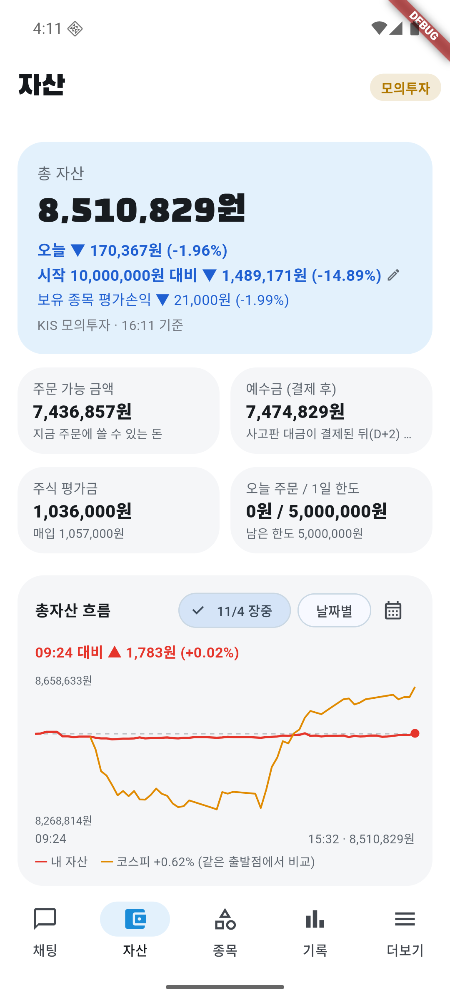
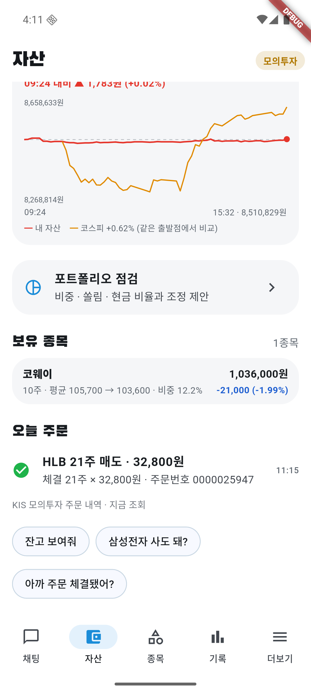

# 11/4 모의 자동매매 19일차: HLB 강제 손절로 −1.96%, 규칙에 막힌 매수 제안에 이유 표시 추가

- 계좌: KIS 모의투자 (10/8 시작 1,000만 원)
- 기준: 앱 자산 화면의 16:11 값 **총자산 8,510,829원**. 15:32 그래프 마지막 값(8,510,829원)과 같다. KIS 일봉 종가로 다시 계산한 값과의 대조는 **못 했다** (미확인).
- 이날 코스피는 앱 그래프(09:24부터) 기준 **+0.62%**로 마감했다. 장중에는 크게 내렸다가 오후에 올랐다. 종가 기준 값과 코스피 누적은 **미확인**.
- 사람이 한 일: 서버·에뮬레이터·앱을 켬(08:43). **오늘 계획 승인은 사용자가 11:13에 직접 눌렀다.** 장중 1시간마다 점검·캡처. 주문은 직접 내지 않음.
- 하이브·LG에너지솔루션·SKC(영업적자)는 신규 후보에 한 번도 없었다.

## 1. 결과

| | 값 |
|---|---|
| 총자산 | **8,510,829원** |
| 하루 | **−1.96%** (−170,367원). 코스피 +0.62%보다 **약 2.6%p 못함** |
| 시작 대비 | **−14.89%** (−1,489,171원). 코스피 누적은 **미확인** |
| 오늘 주문 | 체결 **1건** (매도). 매수 0건 |
| 현금 | 7,474,829원 (총자산의 약 88%). 주식 평가금 1,036,000원 (코웨이 10주) |

### 판 종목

| 시각 | 종목 | 수량 | 체결가 | 어떻게 정했나 |
|---|---|---|---|---|
| 11:15 | HLB | 21 | 32,800 | 매입가(41,150) 대비 −20.3%라 강제 손절선(−15%)으로 AI에게 묻지 않고 전부 매도. 검증 AI를 거침 |

- 매입가 대비 손실은 약 175,000원(수수료·세금 제외). 하루 손실 170,367원의 대부분이다.
- 11/3 종가(40,700원)에서 하루 만에 약 −19% 빠졌다. **원인은 확인하지 못했다.**
- 오늘 계획 승인(11:13) 직후 점검에서 바로 걸렸다. 승인이 늦어서 손절이 늦어졌는지는 알 수 없다(아침에는 앱을 켜지 않았다).

## 2. 왜 돈을 쓰지 않았나

- 현금 약 88%, 신규 매수 0건.
- 앱 기록 13:01 "새 매수 후보: 삼성E&A, HMM, LG씨엔에스" 바로 뒤에 "코스피가 20일 평균 아래(하락장)라 새로 사지 않아요". 세 건 모두 검증 AI는 승인했지만 규칙에 막혔다.
- 11:14·12:01·14:01·14:36에는 "새로 검증을 통과한 매수 후보가 없어요"로 후보 자체가 비었다(규칙 때문이 아님).
- 08:44 HMM 매수 제안은 막힌 이유를 **확인하지 못했다**(그 시각엔 승인 전이었고 하락장 기록도 없었다).
- 하락장 규칙을 푸는 변형은 과거 1년 시험에서 모두 지금보다 나빴다 → [시험 6절](sim-20261101.md).

## 3. 고친 것

1. **시세 조회 재시도** (11/3 커밋 `269d53f`): 서버 시작 때 시간 초과로 아침 수집이 실패하던 것을 3번 재시도하게 했다. 오늘 서버를 새로 켠 뒤 `api.log`에 Traceback이 없었다(재시도가 실제 시간 초과를 막았는지는 **미확인**).
2. **기록 화면에 "규칙에 막힘 · 이유"** (사용자 요청, 2026-11-04):
   - 서버: `proposals.blocked_reason`(마이그레이션 023), `POST /api/auto/blocked`, 기록 목록 응답에 `blocked_reason`. 이유는 `bear` 하락장 · `early` 아침 급락 · `exposure` 비중 한도 · `small` 살 몫 부족.
   - 앱: 규칙으로 못 산 제안을 서버에 알리고(제안마다 하루 한 번), 기록 화면에 "규칙에 막힘 · 하락장" 같은 표시, 날짜 머리글은 "매수 제안 4 · 매도 제안 1 · 체결 1"처럼 제안 수와 체결 수를 나눴다.
   - 오늘 13:01 세 건은 앱 기록으로 이유가 확인돼 직접 반영했고, 08:44 HMM은 이유를 몰라 비웠다.
   - 테스트: 서버 359개·앱 45개 통과, 에뮬레이터 기록 화면 확인.
3. 기록 화면의 "매수 N건"이 산 건수처럼 보여 헷갈리던 점이 위 변경으로 풀렸다(제안 수와 체결 수 분리).

## 4. 점검

- 서버·앱 로그 오류 없음(문제 줄 0개).
- 판단 31건(관찰 15, 보유 9, 매수 6, 매도 1), 검증 승인 31·거부 2. 거부된 종목은 **확인하지 않았다**.
- **미확인**: 새 앱 코드가 실제 장중에 막힘을 서버에 올리는 동작(내일 장중 확인), 15:32 스냅샷의 KIS 종가 대조, 5분 뒤 취소 기능의 실제 동작, HLB 급락 원인.

## 5. 화면

| 시각 | 화면 |
|---|---|
| 16:11 마감 |   |
