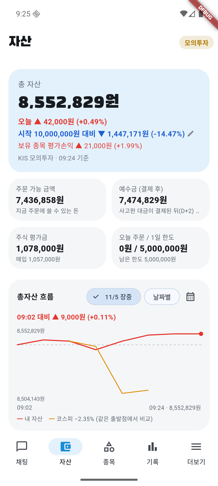
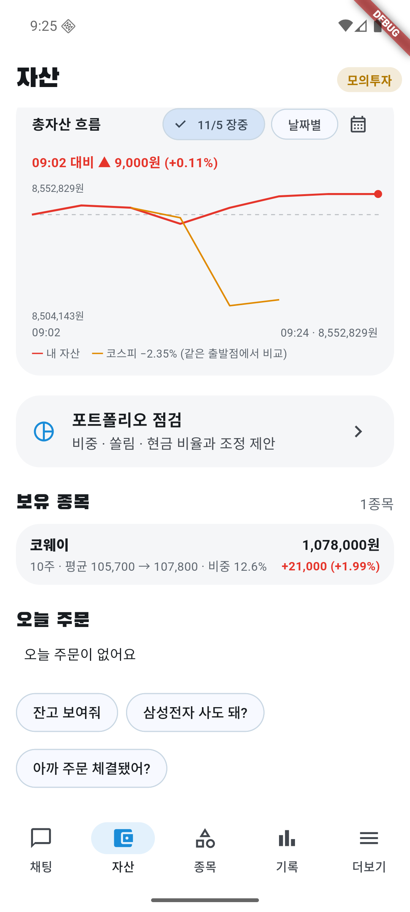
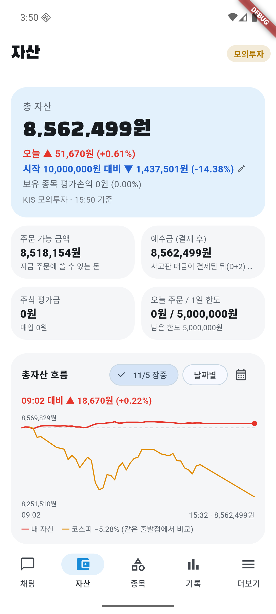
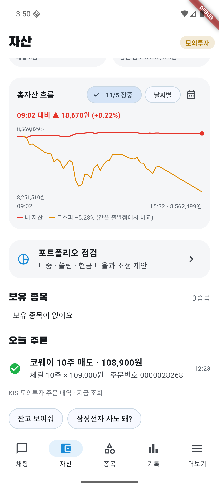

# 11/5 모의 자동매매 20일차: 코웨이를 팔고 전부 현금, 하락장 소액 매수 시험을 내일부터 적용

- 계좌: KIS 모의투자 (10/8 시작 1,000만 원)
- 기준: 앱 자산 화면 15:50 값 **총자산 8,562,499원** (15:32 그래프 마지막 값과 같음). KIS 일봉 종가로 다시 계산한 대조는 **못 했다** (미확인).
- 코스피: 앱 장중 그래프(09:02 기준 출발점) **−5.28%**. 전일 종가 대비 종가 등락률은 **미확인**.
- 사람이 한 일: 서버·에뮬레이터·앱을 켬(08:43), **오늘 계획 승인은 Claude가 08:44에 눌렀다** (사용자 위임). 주문은 직접 내지 않았다.

## 1. 결과

| | 값 |
|---|---|
| 총자산 | **8,562,499원** |
| 하루 | **+0.61%** (+51,670원). 그래프 기준 09:02 이후 계좌 +0.22%, 코스피 −5.28% |
| 시작 대비 | **−14.38%** (−1,437,501원) |
| 오늘 주문 | 체결 **1건** (매도 코웨이). 매수 0건 |
| 현금 | 8,562,499원 (총자산의 100%, 주식 0원) |

- 12:23 코웨이 10주를 109,000원에 전량 매도 (평균 105,700원, 약 +3%). 이익 매도 규칙으로 판 것으로 보이나 AI가 판 이유를 따로 확인하진 않았다.
- 판 뒤 종가·그 뒤 움직임은 **미확인**.

## 2. 왜 돈을 쓰지 않았나

- 12:01·14:36 셀트리온 매수 제안은 검증을 통과했지만 서버 기록상 `blocked_reason = bear`(하락장 규칙)로 막혔다. **어제 추가한 "규칙에 막힘 · 이유" 기능이 실제 장중에 서버에 기록되는 것을 처음 확인했다.**
- 08:43 삼성E&A·오리온 매수 제안은 승인 전이라 이유가 비어 있다.
- 이 날 판단 32건(관찰 20, 보유 6, 매수 4, 매도 2), 검증 승인 32·거부 3 (거부 종목은 확인하지 않았다).

## 3. 이 날 한 시험과 결정

- 하락장에서 수익이 나는 규칙을 찾는 시험을 하루 종일 돌렸다 → [시험 리포트](sim-20261105.md). **종목 규칙은 하락장에서 이긴 적이 없고**, 후보는 하락장 밤새 보유(ETF)뿐이다.
- 사용자 결정(11/5): **모의투자에서만 하락장에도 AI가 판단해 사되 주식 비중을 총자산의 20%까지만** 허용해 2주 지켜본다 (11/19쯤 평가). 15:40 핫리로드로 앱에 적용했고 **내일(11/6)부터 동작한다**. 오늘은 매수 시간이 끝나서 효과 없음.
- 새 시험·자료 받기 코드는 아직 커밋하지 않았다.

## 4. 점검

- 서버 로그 문제 줄 0개. 앱 로그 1줄은 에뮬레이터 블루투스 하드웨어 오류(앱과 무관해 보임).
- **미확인**: 15:32 스냅샷의 KIS 종가 대조, 5분 뒤 취소 기능의 실제 동작, 하락장 20% 매수가 실제로 동작하는지(11/6 확인), 코웨이 매도 이유.

## 5. 화면

| 시각 | 화면 |
|---|---|
| 09:24 |   |
| 15:50 마감 |   |
