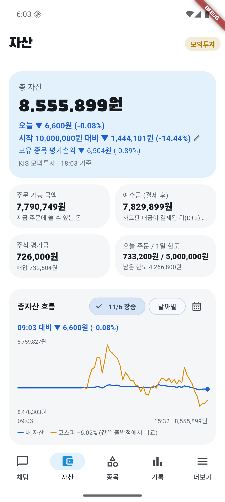
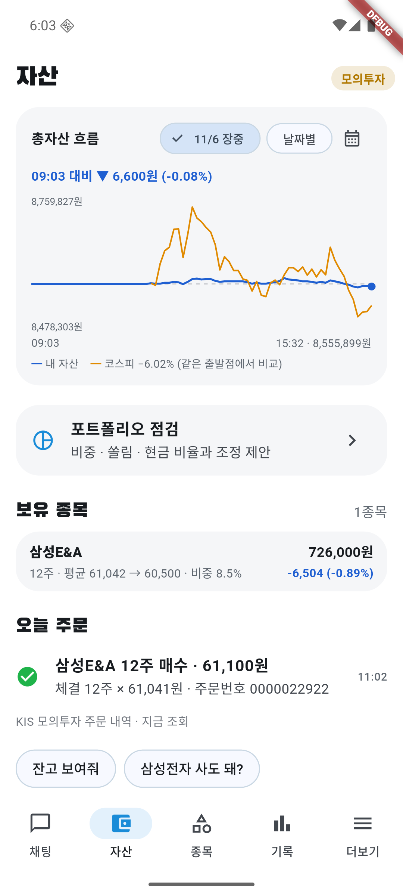

# 11/6 모의 자동매매 21일차: 하락장 20% 규칙이 처음 동작해 삼성E&A 12주 매수

- 계좌: KIS 모의투자 (10/8 시작 1,000만 원)
- 기준: 앱 자산 화면 18:03 값 **총자산 8,555,899원** (15:32 그래프 마지막 값과 같음). KIS 일봉 종가로 다시 계산한 대조는 **못 했다** (미확인).
- 코스피: 앱 장중 그래프(09:03 기준 출발점) **−6.02%**. 전일 종가 대비 종가 등락률은 **미확인**.
- 사람이 한 일: 서버·에뮬레이터·앱을 켬(09:00쯤). 앱 기록에 `09:03 오늘 계획 승인`이 있는데 **누가 눌렀는지는 확인 못 했다** (Claude는 승인 버튼을 누르지 않았다). 주문은 직접 내지 않았다.

## 1. 결과

| | 값 |
|---|---|
| 총자산 | **8,555,899원** |
| 하루 | **−0.08%** (−6,600원). 그래프 기준 09:03 이후 계좌 −0.08%, 코스피 −6.02% |
| 시작 대비 | **−14.44%** (−1,444,101원) |
| 오늘 주문 | 체결 **1건** (매수 삼성E&A 12주). 매도 0건 |
| 현금 | 7,829,899원 (총자산의 약 91.5%) |
| 보유 | 삼성E&A 12주 (평균 61,042 → 현재 60,500, −0.89%, 비중 8.5%) |

## 2. 11/5에 정한 하락장 20% 규칙이 처음 동작했다

- 11:01 앱 기록: "코스피가 20일 평균 아래(하락장)라 주식 비중을 총자산의 20%까지만 새로 사요 (모의투자 시험)".
- 11:02 삼성E&A 12주를 61,100원에 주문, 61,041원에 체결 (733,200원). 이전 규칙이면 `bear`로 막혔을 매수다. 투자 AI → 검증 AI(승인)를 거쳤다.
- 12:01 삼성바이오로직스 매수 제안: 20% 한도에 남은 몫(966,835원)이 1주 값(1,495,000원)보다 작아 사지 않았다. 한도가 실제로 작동한 것이다.
- 11:03 코스피 −5.39%로 "시장 급락" 처리돼 보유 종목을 투자·검증 AI에게 다시 물었고 삼성E&A는 보유로 결론. 이후 14:44까지 정기 점검마다 보유.
- 14:37 SK바이오팜 10주(89,600원) 매수 제안은 "급등 직후 매수라 자동 승인 안 함 → 처리안 모아보기에서 사람이 판단"으로 넘어가 주문이 나가지 않았다 (기존 안전장치). 이후 가격은 **미확인**.
- 09:02·09:03 삼성E&A·삼성바이오로직스 매수 제안은 지수가 1% 넘게 빠진 아침이라 10시 전에는 `early`로 쉬었다 (09:05 기록).

**평가는 이르다**: 매수 1건, 마감 −0.89%뿐이라 규칙이 낫다/나쁘다를 말할 수 없다. 11/19쯤 하락장 매수 전체 손익으로 판단한다.

## 3. 판단과 점검

- 판단 42건 (관찰 27, 보유 10, 매수 5), 검증 승인 42·거부 2 (거부 중 1건은 KIS 조회 실패).
- 서버 로그 문제 줄 0개 (1,521줄). 앱 로그 1줄은 에뮬레이터 블루투스 하드웨어 오류(앱과 무관해 보임).
- KIS 모의 조회 실패 2번: 09:10 잔고 조회 `Connection reset by peer`, 13:46 삼성E&A 매도 판단 때 "조회 실패". 모두 다음 점검에서 정상으로 돌아옴 (알려진 일시 오류).
- **점검을 늦게 했다**: 11/5 마감 때 점검 예약(cron)을 다시 걸지 않아 사용자가 물은 10:14까지 중간 확인이 없었다. 10:14에 예약을 다시 걸었다.

## 4. 미확인

- 15:32 스냅샷과 KIS 종가 계산 대조, 코스피 종가 등락률
- 09:03 계획 승인을 누른 주체
- 5분 뒤 매도 주문 취소 기능의 실제 동작 (오늘 매도 0건)
- SK바이오팜의 이후 움직임, 20% 규칙의 장기 효과

## 5. 화면

| 시각 | 화면 |
|---|---|
| 18:03 마감 |   |
