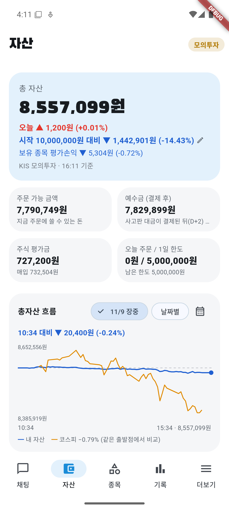
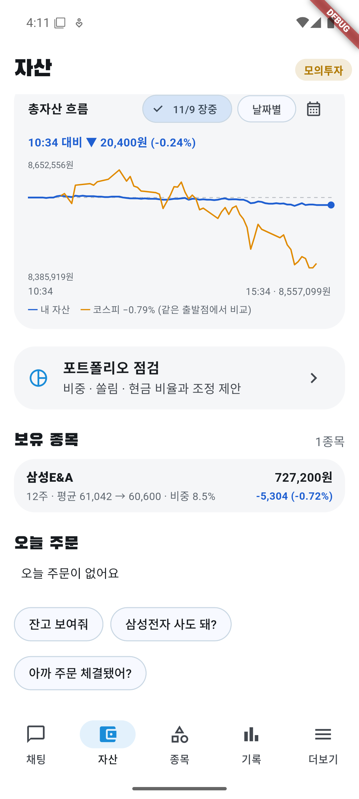

# 11/9 모의 자동매매 22일차: 주문 0건, 현금 91%로 코스피 −0.79%를 거의 제자리로 지남

- 계좌: KIS 모의투자 (10/8 시작 1,000만 원)
- 기준: 앱 자산 화면 16:11 값 **총자산 8,557,099원**. 15:34가 그래프 마지막 점이고 값이 같다. KIS 일봉 종가로 다시 계산한 대조는 **못 했다** (미확인).
- 코스피: 앱 장중 그래프(10:34 출발점) **−0.79%**. 전일 종가 대비 종가 등락률은 **미확인**.
- 사람이 한 일: 서버·에뮬레이터·앱을 켬(Docker가 꺼져 있어 DB 컨테이너를 먼저 켬). 앱 기록에 10:35 계획 승인이 있는데 **누가 눌렀는지는 확인 못 했다** (Claude는 승인 버튼을 누르지 않았다). 주문은 직접 내지 않았다.

## 1. 결과

| | 값 |
|---|---|
| 총자산 | **8,557,099원** |
| 하루 | **+0.01%** (+1,200원). 코스피 −0.79%(10:34부터) |
| 시작 대비 | **−14.43%** (−1,442,901원) |
| 오늘 주문 | **0건** (매수·매도 모두) |
| 현금 | 7,829,899원 (총자산의 약 91.5%) |
| 보유 | 삼성E&A 12주 (평균 61,042 → 60,600, −0.72%, 비중 8.5%) |

## 2. 왜 주문이 없었나

- 매수 제안 4건(삼성바이오로직스·SK바이오팜 등)은 검증을 통과했지만 주문으로 이어지지 않았다.
  - 삼성바이오로직스: 하락장 20% 한도에 남은 몫(약 97만 원)이 1주 값보다 작아 `small`로 막힘. 한도 계산은 추정이며 하락장 여부를 직접 확인하지는 못했다.
  - SK바이오팜: 14:01 매수 제안 뒤 장중 약세로 14:01·14:32에 관찰로 바뀜.
- 14:08 삼성E&A 매도 제안(이익 +0.39%)은 14:09에 "이익이 너무 작다"며 관찰로 바뀌어 주문이 나가지 않았다. 이후 보유 유지. 마감 60,600원으로 팔았다면 오히려 손실이었다.
- 12:00 후보 재탐색은 "새로 검증을 통과한 매수 후보가 없어요"로 정상 동작. 10:35 재탐색은 결과 줄이 없었고 원인은 **미확인**, 11:00 재탐색은 30분 제한 문구가 나왔다(서버 시작 때 만든 브리핑 때문으로 추정).
- 한진칼·SK스퀘어·알테오젠·삼성SDI는 급등 또는 하락 추세로 관찰.

**평가는 이르다**: 20% 규칙은 오늘 주문을 내지 않아 시험 자료가 늘지 않았다. 11/19쯤 하락장 매수 전체 손익으로 판단한다.

## 3. 판단과 점검

- 판단 35건 (관찰 22, 보유 8, 매수 4, 매도 1), 검증 승인 35·거부 2.
- 서버 로그 문제 줄 0개 (1,358줄), 앱 로그 0개 (126줄).
- 11/6 점검 지연 뒤 평일 장중 점검 예약을 걸어 11:22·12:22·13:22·14:33·15:07·16:11에 확인했다. 점검 중 adb 뒤로가기로 앱이 홈으로 나간 일이 한 번 있어 앱을 다시 띄웠다(주문과 무관).

## 4. 미확인

- 15:32 스냅샷과 KIS 종가 계산 대조, 코스피 종가 등락률
- 10:35 계획 승인을 누른 주체, 10:35 재탐색 결과 줄이 없던 이유
- 하락장 상태에서의 20% 한도 계산(추정)
- 5분 뒤 매도 주문 취소 기능의 실제 동작 (매도 주문 0건)

## 5. 화면

| 시각 | 화면 |
|---|---|
| 16:11 마감 |   |
