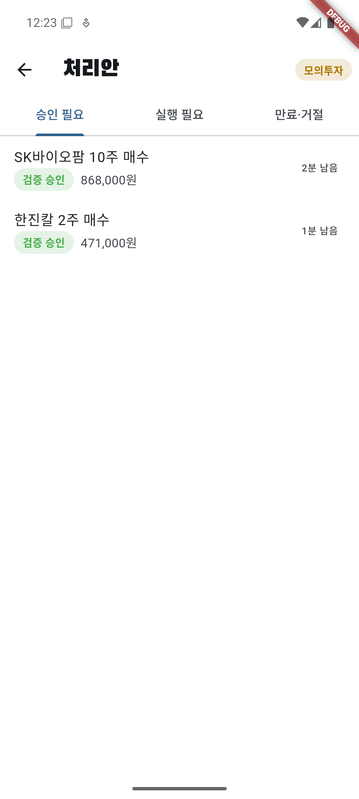
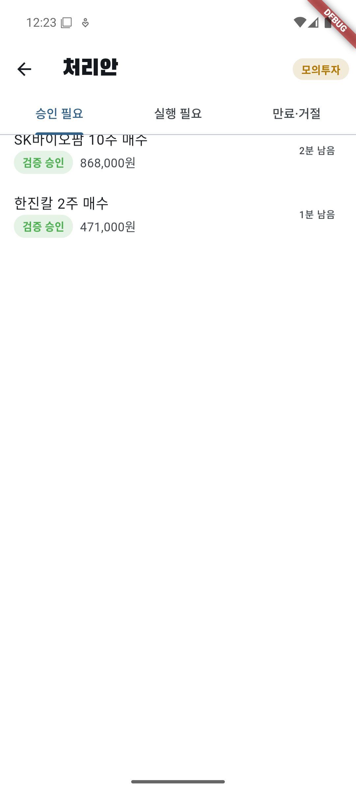
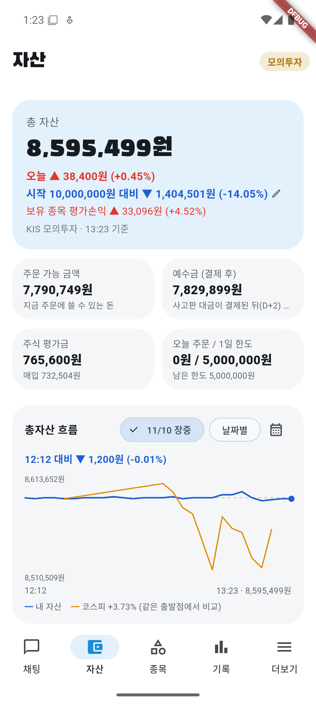
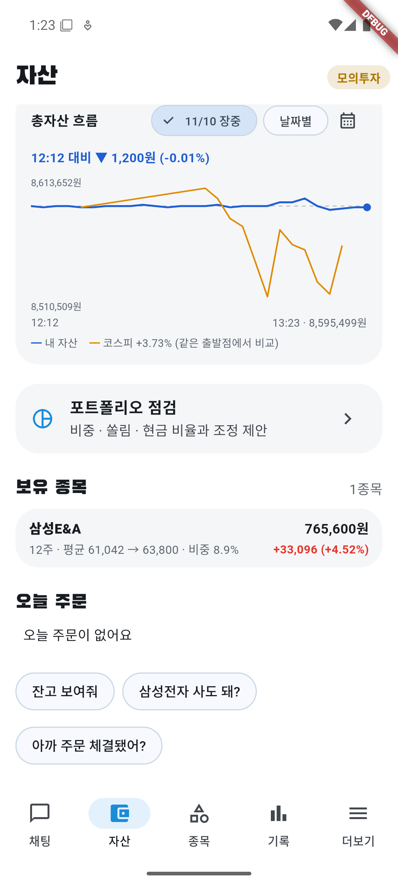
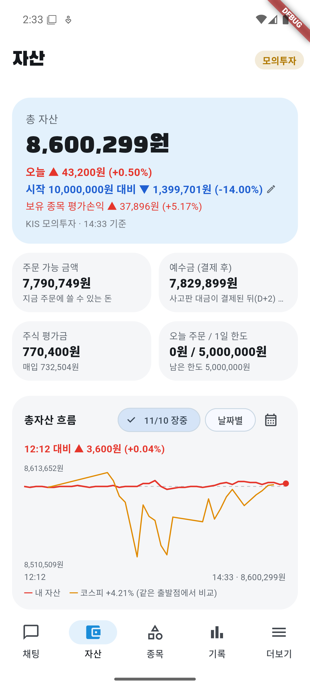
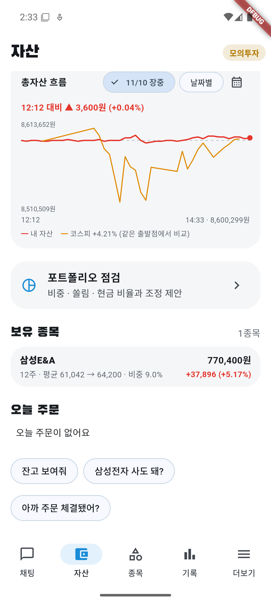
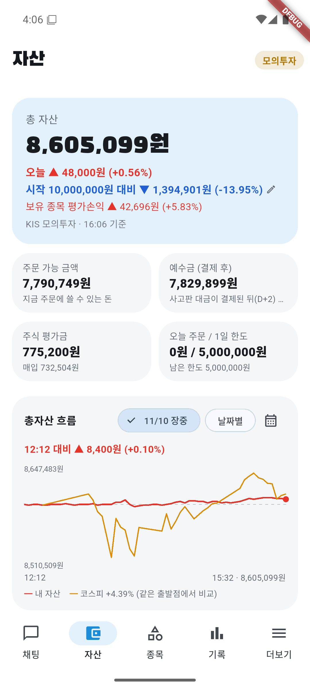
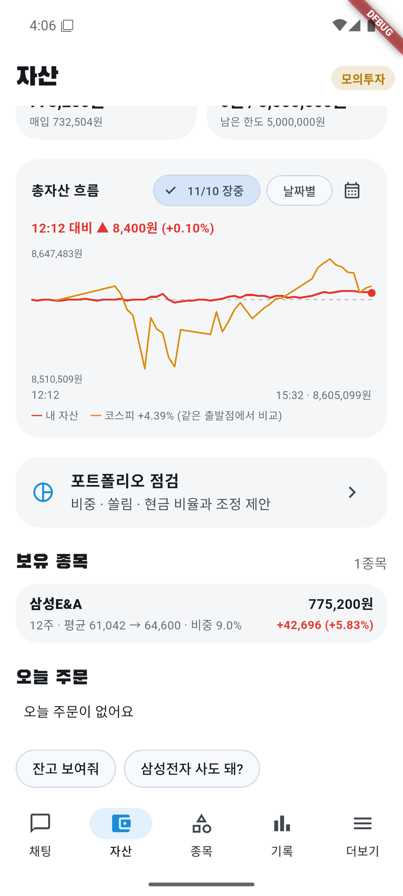

# 11/10 모의 자동매매 23일차: 코스피 +4.39% 반등일에 계좌 +0.56%, 주문 0건, B 규칙은 깊은 하락장(−8.1%)이라 막힘

- 계좌: KIS 모의투자 (10/8 시작 1,000만 원)
- 기준: 앱 자산 화면 16:06 값 **총자산 8,605,099원**. 15:32 그래프 마지막 점과 같다. KIS 일봉 종가로 다시 계산한 대조는 **못 했다** (미확인). 다만 현금 7,829,899원 + 삼성E&A 12주 × 64,600원 = 8,605,099원으로 앱 값과 맞는다(계산).
- 코스피: 앱 값 **+4.39%**. 15:32 스냅샷의 코스피 값으로, 12:13에 이미 +4.17%였으므로 전일 대비 등락률로 보인다(추정). 공식 종가 등락률은 **미확인**.
- 서버가 **12:12에야 켜졌다**(서버 로그 `서버 시작 2026-11-10 12:11:58`). 그래서 오전장(09:00~12:12)은 자동매매가 돌지 않았다.
- 사람이 한 일: 계획 승인은 앱 기록 12:12 "오늘 계획 승인"(누른 주체는 이 리포트에서 확인 못 함). 16:00쯤 에뮬레이터가 꺼져 있어(원인 미확인) 16:03에 다시 켰고 잠금 PIN은 사용자가 풀었다. 주문은 아무도 내지 않았다.

## 0. 오늘 바꾼 것: 하락장 매수 B 규칙 적용 (사용자 결정, 모의투자만)

- **12:20쯤 앱에 반영**(커밋 4162e32, 앱 테스트 45개 통과). 11/6부터 쓰던 "하락장이면 주식 비중 20%까지" 규칙을 바꿨다.
- 왜: 20% 규칙은 비싼 종목(삼성바이오로직스 1주 151만 원 등)은 살 몫이 1주 값보다 적어 하락장 주문이 거의 0건이었다. 11/9 과거 1년 시험(규칙만, AI 비용 0원)에서 얕은 하락만 사는 쪽이 안 사는 것과 오차 범위 안에서 비슷했고 낙폭은 작았다(1년 +57~60%, 뒤 4개월 −7%, 낙폭 −20%대). **이득이 확인된 것이 아니라 모의투자 시험이다.**
- 내용:

| | 11/6 규칙 (20%) | 11/10 B 규칙 |
|---|---|---|
| 얕은 하락 (코스피가 20일 평균 아래, −5% 이내) | 주식 비중 20%까지 | 주식 비중 **50%**까지, 한 종목 **총자산 15%**, 첫 매수는 그 **1/3** |
| 깊은 하락 (20일 평균보다 −5% 넘게 아래) | 주식 비중 20%까지 | **새로 사지 않음** |
| 예전에 산 보유분 | 종목당 몫에 안 넣음 | 종목당 15% 상한에 넣음 |
| 실전 모드·총자산 모름 | 막음 | 그대로 막음 |

- 투자·검증 AI, 손절선 −7%, 10시 전 급락 쉬기는 그대로다.
- 반영 직후 12:27에 오전에 "사람 확인 필요"로 묶인 한진칼·SK바이오팜 표시를 임시로 풀어 B 규칙 크기로 다시 판단하게 했다.
- 첫날 결과: 12:44 코스피가 20일 평균 대비 **−8.1%**라 깊은 하락으로 판정돼 **새 매수 0건**(자세한 내용 2-2).

## 1. 결과

| | 값 |
|---|---|
| 총자산 | **8,605,099원** |
| 하루 | **+0.56%** (+48,000원). 코스피 +4.39% → **3.83%p 뒤짐** |
| 시작 대비 | **−13.95%** (−1,394,901원) |
| 오늘 주문 | **0건** (매수·매도 모두) |
| 현금 | 7,829,899원 (총자산의 약 91%) |
| 보유 | 삼성E&A 12주 (평균 61,042 → 64,600, **+5.83%**, +42,696원, 비중 9.0%) |

하루 수익 48,000원은 전부 삼성E&A다(12주 × 전일 60,600 → 64,600원, +4,000원). 현금이 91%라 지수 급등을 거의 못 따라갔다.

## 2. 성과 분석

### 2-1. 반등일에 또 뒤졌다 — 원인은 현금 비중

- 코스피가 크게 오른 날 계좌가 뒤진 것은 10/23·10/27·10/28·11/2에 이어 또 반복이다. 오늘은 보유 종목(삼성E&A)이 지수보다 더 올랐지만(+6.60% vs +4.39%) 비중이 9%뿐이었다.
- 반대로 큰 하락일(10/30 −3.48%, 11/5 −5.28%, 11/6 −6.02%)에는 같은 현금 비중 덕에 덜 빠졌다. **현금 비중이 "덜 잃는 대신 덜 버는" 구조로 그대로 작동하고 있다** (사실 + 해석).
- 12:12 이후만 보면 계좌 +0.10%(앱 그래프 "12:12 대비"), 코스피 선도 출발점과 거의 같은 높이로 끝났다(그래프 눈대중, 정확한 값 미확인). 즉 **하루 차이 대부분은 서버가 꺼져 있던 오전에 이미 벌어졌다**(추정). 다만 오전에 켜져 있었어도 아래 2-2 규칙상 새로 사지 않았을 가능성이 크다.

### 2-2. B 규칙 첫날: 동작은 했지만 "깊은 하락장"이라 막혔다

- 12:20쯤 B 규칙(얕은 하락만 비중 50%·종목당 15%·첫 매수는 1/3)을 앱에 반영했다(커밋 4162e32).
- 12:44 앱 기록: **"코스피가 20일 평균 아래(하락장, 평균 대비 −8.1%)라 새로 사지 않아요"**. B 규칙의 얕은 하락 기준은 −5% 이내라, 오늘은 **깊은 하락으로 판정돼 하루 종일 새 매수가 막혔다**. 14:01 삼성바이오로직스 매수 제안도 "규칙에 막힘 · 하락장"으로 기록됐다.
- 코스피가 하루에 +4% 넘게 올라도 20일 평균보다 −8.1% 아래였다. 지난 20일 동안 큰 폭으로 빠졌기 때문이다. **20일 평균이 따라 내려오기 전까지는 B 규칙이 거의 매수를 내지 않을 수 있다** (추정).
- 정리: B 규칙은 "깊은 하락은 안 산다"는 설계대로 동작했다. 이득·손해 판단은 아직 매수 0건이라 **평가 불가**.

### 2-3. 매수 제안 6건이 주문으로 이어지지 않은 이유

| 시각 | 종목 | 결과 | 이유 (앱 기록) |
|---|---|---|---|
| 12:12 | 삼성E&A | 매수 아님 | 이미 보유 중, 같은 시각 보유 점검에서 "보유" |
| 12:13 | 삼성바이오로직스 | 규칙에 막힘 · 살 몫 부족 | B 규칙 반영 전(20% 규칙). 살 몫 952,539원 < 1주 1,510,000원 |
| 12:14 | 한진칼 2주 @235,500 | 만료 | "급등 직후 매수"라 자동 승인 안 함 → 사람 확인 필요 → 10분 뒤 만료. 20일 평균보다 +68% 위였다 |
| 12:15 | SK바이오팜 10주 @86,800 | 만료 | 같은 이유(급등 직후) |
| 12:27 | (한진칼·SK바이오팜) | 다시 판단 | "(임시) 사람 확인 표시를 풀었어요: B 규칙 크기로 다시 판단" → 12:44 깊은 하락장 판정으로 막힘 |
| 14:01 | 삼성바이오로직스 | 규칙에 막힘 · 하락장 | 깊은 하락장 |

- 기록 화면의 "매수 (직접 지시)"는 사람이 채팅에 쓴 것이 아니라 **자동매매가 주문 요청을 채팅 형식으로 보낸 것**이다(앱 자동매매 기록 12:14·12:15와 시각이 같음).
- 한진칼처럼 20일 평균보다 +68% 위에 있는 종목을 사지 않은 것은 안전장치가 의도대로 동작한 것이다. 한진칼·SK바이오팜 종가는 **미확인**이라 놓친 이익인지 피한 손실인지는 판단하지 않는다.

### 2-4. 보유 종목: 삼성E&A 이익을 들고 갔다

- 이익이 +4.5~5.7%일 때 8번 매도 판단을 물었고 모두 "보유"(검증 승인). 근거는 20·60일 평균 위의 상승 추세, VWAP(거래량 가중 평균가) 위.
- 마감 64,600원(+5.83%)으로 들고 간 것이 오늘은 맞았다. 다만 **팔지 않은 이익은 확정 이익이 아니다**. 11/9엔 같은 종목이 −0.72%였다.
- 11/6부터의 하락장 매수 1건(삼성E&A)만 놓고 보면 +42,696원(+5.83%, 수수료·세금 전 평가). 1건이라 규칙 전체 평가로 쓰기엔 부족하다.

### 2-5. 누적

- 시작 대비 **−13.95%** (11/9 −14.43% → 0.48%p 회복). 같은 기간 코스피 누적은 **미확인**.
- 매도·매수가 없어 확정 손익 변화 0원.

## 3. 판단과 점검

- 판단 28건 (관찰 14, 보유 8, 매수 6), 검증 승인 28·거부 6 (1차 반려 후 2차 승인 포함).
- 후보 재탐색: 12:12, 13:00("새로 검증을 통과한 매수 후보가 없어요"), 14:00(삼성바이오로직스), 14:35("없어요").
- 서버 로그 문제 줄 0개 (2,458줄), 앱 로그 1개(에뮬레이터 블루투스 하드웨어 경고, 주문과 무관).
- 장중 점검 캡처: 12:22·13:23·14:33 (아래 화면).

## 4. 미확인

- 서버가 12:12에야 켜진 이유, 12:12 계획 승인을 누른 주체
- 16:00쯤 에뮬레이터가 꺼진 이유
- KIS 일봉 종가로 다시 계산한 마감 값 대조, 코스피 공식 종가 등락률과 누적 등락률
- 한진칼·SK바이오팜 종가 (만료된 매수의 득실)
- 얕은 하락장에서 B 규칙으로 실제 매수가 나가는 모습 (오늘은 깊은 하락이라 못 봄)
- 5분 뒤 매도 주문 취소 기능의 실제 동작 (매도 주문 0건)

## 5. 다음에 볼 것

- 코스피가 20일 평균 −5% 이내로 올라오는 날 B 규칙 첫 매수(종목당 15%의 1/3)가 나가는지
- 서버·앱을 장 시작 전에 켜기 (오늘은 오전장을 놓쳤다)
- 11/19쯤 하락장 매수 전체 손익으로 규칙 판단 (예정대로)

## 6. 화면

| 시각 | 화면 |
|---|---|
| 12:22 |   |
| 13:23 |   |
| 14:33 |   |
| 16:06 마감 |   |
