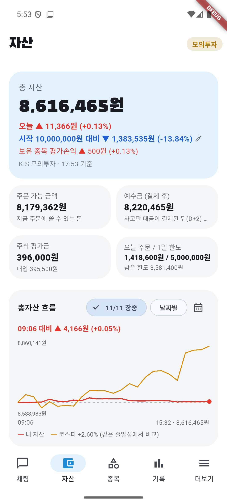
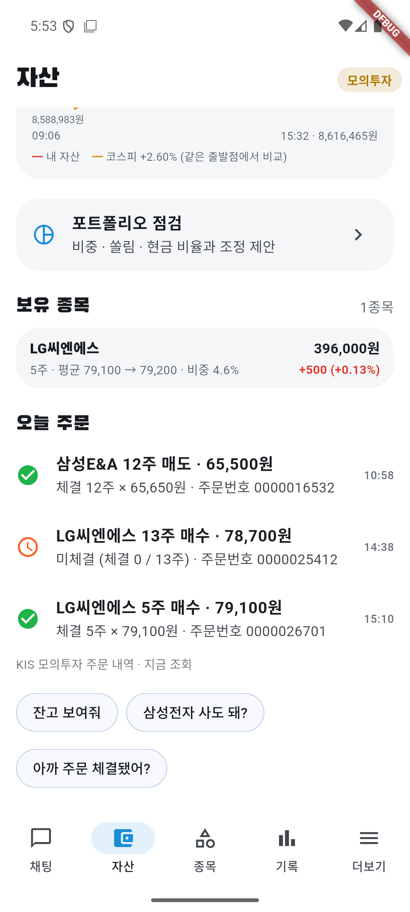

# 11/11 모의 자동매매 24일차: 첫 무인 아침 시작, 그런데 앱은 B 규칙 이전 버전으로 돌았다

- 계좌: KIS 모의투자 (10/8 시작 1,000만 원)
- 기준: 앱 자산 화면 17:53 값 **총자산 8,616,465원**. 15:32 그래프 마지막 점과 같다. KIS 일봉 종가 대조는 **못 했다** (미확인).
- 코스피: 앱 값 **+2.60%** (15:32 스냅샷 값, 전일 대비로 보임). 공식 종가 등락률은 **미확인**.
- 사람이 한 일: 없음. 처음으로 **사람 손 없이** 아침이 시작됐다 (08:10 윈도우 작업 → 08:17 앱 켜짐, 08:51 Claude 예약 작업이 오늘 계획 승인). 마감 뒤 17:50쯤 에뮬레이터 시스템이 응답하지 않아 Claude가 다시 켰다(장 마감 뒤라 매매 영향 없음).

## 1. 결과

| | 값 |
|---|---|
| 총자산 | **8,616,465원** |
| 하루 | **+0.13%** (+11,366원). 코스피 +2.60% → **약 2.5%p 뒤짐** |
| 시작 대비 | **−13.84%** (−1,383,535원) |
| 체결 | 매도 1 (삼성E&A 12주 @65,650), 매수 1 (LG씨엔에스 5주 @79,100). 매수 1건(LG씨엔에스 13주 @78,700)은 **미체결로 남음** |
| 현금 | 8,220,465원 (총자산의 약 95%) |
| 보유 | LG씨엔에스 5주 (평균 79,100 → 79,200, +0.13%, 비중 4.6%) |

## 2. 문제점 (먼저 볼 것)

| # | 문제 | 영향 | 근거 |
|---|---|---|---|
| 1 | **앱이 B 규칙 이전 버전으로 돌았다** | 오늘 매매 전부가 11/6 "하락장 비중 20%" 규칙으로 판단됐다. 어제 반영한 B 규칙(깊은 하락장은 새로 안 삼)이 적용되지 않았다 | 09:05 앱 기록 "주식 비중을 총자산의 **20%**까지만 새로 사요". 에뮬레이터에 깔린 앱은 11/10 **12:12** 빌드(`lastUpdateTime`), B 규칙 커밋은 12:20. 어제는 실행 중 앱에 덮어쓰기(핫리로드)로만 반영했고, 오늘 아침 스크립트는 깔려 있는 옛 앱을 켰다 |
| 2 | 아침 첫 서버가 뜨지 않은 것으로 보인다 | 08:20 아침 브리핑이 08:50에야 만들어졌다 | 08:16 서버 켜기 → 08:50 승인 작업이 서버 응답이 없어 다시 켬. 08:16 서버 로그는 08:50 재시작 때 덮어써져 **원인 미확인** (Docker를 막 켠 직후라 DB 준비 전에 떴을 가능성, 추정) |
| 3 | LG씨엔에스 13주 매수가 미체결인 채로 방치됐다 | 1분 뒤(14:39) "계좌에 없어서 보유 기록에서 뺐어요"로 처리하고 주문은 취소하지 않았다. 15:10에 같은 종목 5주를 또 샀다. 13주가 나중에 체결됐다면 계획보다 많이 샀을 것이다 | 앱 "오늘 주문": 13주 미체결(0/13), 5주 체결. 5분 뒤 자동 취소는 **매도 주문에만** 있다 |
| 4 | 장중 매시 점검이 없었다 | 장중 문제(1·3번)를 그날 못 잡았다 | 매시 점검을 반복 예약으로 만들지 않았다. 마감 뒤 만들려 했으나 자동 모드 안전 검사에 막혀 **아직 없음** |
| 5 | 총자산 그래프가 10:56~15:12 비었다 | 보유 종목이 없던 시간에 스냅샷이 저장되지 않은 것으로 보인다(추정) | account_snapshots 10:56 다음이 15:12. 삼성E&A를 10:58에 다 팔고 15:10에 LG씨엔에스를 산 시간과 겹친다 |
| 6 | 마감 뒤 에뮬레이터 "Process system isn't responding" | 매매 영향 없음. 다시 켜서 해결 | 17:50, 점검용 화면 정보 덤프(uiautomator) 뒤 발생 (원인 추정) |

## 3. 성과 분석

### 3-1. 삼성E&A를 +7.1%에 팔았다 (오늘 수익의 대부분)

- 09:30 +8.8%(급등), 09:57 +9.6% 때는 AI가 "보유", 10:24 +8.0%로 이익이 줄자 다시 물었고 역시 보유. 10:56 +7.1% 정기 점검에서 매도 제안 → 검증 승인 → 10:58 12주 @65,650 체결.
- 매입 61,042원 대비 **확정 이익 약 +55,296원**(수수료·세금 전, 계산). 고점(+9.6%)보다 약 2.5%p 덜 받고 팔았다.
- 11/6 하락장 20% 규칙으로 산 첫 종목이 이익으로 끝났다. 1건이라 규칙 평가로는 부족하다.
- 삼성E&A 종가는 **미확인**이라, 판 뒤 더 올랐는지는 판단하지 않는다.

### 3-2. 반등일에 또 뒤졌다

- 코스피 +2.60%에 계좌 +0.13%. 10:58 이후 현금이 95%를 넘어 지수 상승을 거의 못 탔다. 앱 그래프 기준 09:06 대비 계좌 +0.05%.
- 반등일마다 뒤지는 흐름(10/23·10/27·10/28·11/2·11/10)이 이어진다. 원인은 현금 비중이다(사실). 다만 오늘은 문제 1 때문에 **의도한 규칙(B 규칙)이 아닌 상태의 결과**라 B 규칙 평가 자료로 쓰지 않는다.

### 3-3. 매수가 막힌 이유

| 시각 | 종목 | 결과 | 이유 (앱 기록) |
|---|---|---|---|
| 09:05 | 삼성바이오로직스 | 안 삼 | 살 몫(947,739원) < 1주 값(1,510,000원) — 20% 규칙 |
| 09:06 | SK바이오팜 10주 | 사람 확인 → 오늘 다시 안 물음 | 급등 직후 매수 |
| 09:06~15:09 | 한진칼 2~6주 (7번) | 관찰 | 실시간 재판단에서 투자 AI가 관찰 |
| 14:02 | NAVER 7주 | 사람 확인 → 오늘 다시 안 물음 | 급등 직후 매수 |
| 14:38 | LG씨엔에스 13주 @78,700 | 주문 접수, 미체결 | 지정가가 시세보다 낮았던 것으로 보임 (추정) |
| 15:10 | LG씨엔에스 5주 @79,100 | 체결 | — |

- B 규칙이었다면 어제처럼 깊은 하락장(코스피가 20일 평균 대비 약 −8%)이라 LG씨엔에스도 사지 않았을 가능성이 크다(추정, 오늘 깊이 값은 기록에 없음).

### 3-4. 누적

- 시작 대비 **−13.84%** (11/10 −13.95% → 0.11%p 회복). 같은 기간 코스피 누적은 **미확인**.

## 4. 판단과 점검

- 판단 40건 (관찰 24, 매수 10, 보유 4, 매도 2), 검증 승인 40·거부 3.
- 후보 재탐색: 10:00·11:00·14:00·14:35 "새로 검증을 통과한 매수 후보가 없어요", 12:00·13:00 SK바이오팜(사람 확인으로 묶여 주문 없음).
- 서버 로그 문제 줄 0개 (1,165줄, 08:50 이후분만). 앱 로그 1줄: LG씨엔에스 체결 조회 중(시각 미확인) KIS 모의 연결 끊김 1번(일시).

## 5. 미확인

- 08:16 서버가 뜨지 않은 원인 (로그 덮어써짐)
- KIS 일봉 종가 대조, 코스피 공식 종가·누적 등락률, 삼성E&A·LG씨엔에스 종가
- LG씨엔에스 13주 미체결 주문이 마감에 자동 소멸됐는지 (앱은 17:53에도 미체결로 표시)
- B 규칙의 실제 장중 동작 (오늘은 옛 앱이라 못 봄)

## 6. 고칠 것 (사용자 확인 뒤)

1. ~~앱 다시 빌드·설치~~ **18:43 완료 (사용자 승인)**: 앱 테스트 45개 통과 → 지금 코드(커밋 4162e32, B 규칙)로 디버그 앱을 빌드해 데이터를 지우지 않고 설치(`lastUpdateTime 2026-11-11 18:43:18`). 앱 안에 B 규칙 전용 메모 키(`auto_bear_note2`)가 들어 있는 것을 확인했고, 다시 켰을 때 로그인·모의투자·자동매매 켜짐이 그대로였다. B 규칙의 실제 장중 동작은 11/12에 확인한다. 앞으로 앱 코드를 바꾸면 핫리로드만 하지 말고 설치까지 한다.
2. 아침 스크립트가 서버 로그를 덮어쓰지 않게(이어 쓰기) + 서버가 뜰 때까지 확인 후 재시도.
3. 미체결 **매수** 주문도 5분 뒤 취소하고, 취소 전에는 보유 기록에서 빼지 않기 (금액·주문 경로라 테스트 필수).
4. 장중 매시 점검 반복 예약 (허락 필요).

## 7. 화면

장중 점검 캡처는 없다 (문제 4).

| 시각 | 화면 |
|---|---|
| 17:53 마감 |   |
